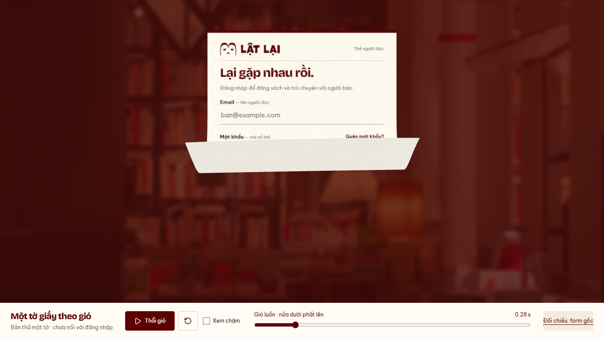

# Auth — nửa dưới giấy phất theo gió, 13/10/2026

Nhánh `codex/auth-wind-single-sheet`, base `8b1d9a8`.
Chủ dự án không duyệt cảm giác nhấc góc của bản trước; đã duyệt nghiên cứu và
dựng lại **một tờ**, nửa dưới phất rộng rồi bung theo đà. Chờ duyệt visual mới.
Subject: `refine(web): carry broad paper flutters into wind flight`.

## Xem bản thử

[Demo local](http://127.0.0.1:5198/previews/auth-wind/): Thổi gió, Xem chậm0.35×,
scrub và reset. Chạy bằng `pnpm --filter @used-books/user-web dev:auth-wind`.
Clock2giây; nhịp hất/bay chính kết thúc trước clock cuối. Không autoplay.

[Desktop clip](desktop.webm) · [Mobile clip](mobile.webm) ·
[Bung theo đà](desktop-turn.png) · [Mobile](mobile-lift.png).
Clip gồm soi pose, chạy thường, chạy chậm và reset.

## Thay đổi

- Thay cung cong theo đường chéo/pin góc bằng các dải dọc: tích phân góc tiếp
  tuyến theo chiều dài giấy. Sóng cong rộng chạy từ phần dưới lên thân; mép và
  bụng phản ứng trễ nhau, hai bên lệch pha nhẹ. Giữ chiều dài từng đoạn dọc;
  đây là rig thiết kế, không phải giải mô phỏng khí động học/cloth đầy đủ.
  Biến dạng ngang giữa các dải là xấp xỉ; không tuyên bố isometry toàn mặt.
- Nửa dưới hất lên rồi hạ bớt trước đợt tiếp; vùng nghỉ phía trên thu hẹp dần.
  Không ghim cứng một góc. Dịch chuyển bắt đầu trong lúc giấy còn phất và tăng
  tốc liên tục; nhả xoay quanh đầu trên để cả thân bay lên/phải. Sóng còn dư
  khi bay, không trả giấy phẳng trước khi chuyển sang flight.
- Camera32độ giảm phóng đại phối cảnh khi giấy tiến gần; pose nghỉ vẫn khớp
  DOM. Bóng tiếp xúc giảm theo độ nâng của cả thân và mép, tránh bóng chữ nhật
  đậm nằm lại dưới phần giấy đã cuộn.
- Giữ một mesh hai mặt, snapshot đã clear input, finite play, pause/resize/
  context loss cleanup và authored motion dưới reduced preference.
- Entry preview riêng; không sửa Login sản phẩm, session/API, ba tờ hoặc
  bồ công anh. Không dependency mới, không imagegen.

Tham khảo đã đọc ở lượt nghiên cứu trước: [tấm mỏng trong luồng khí](https://www.sciencedirect.com/science/article/pii/S0889974621000098)
và [follow-through/overlap](https://learn.microsoft.com/en-us/windows/win32/lwef/animation-principles).
Nghiên cứu tấm giữ một đầu chỉ gợi ý cơ chế sóng cong; timeline2s là thiết kế
cho preview, không phải thông số thực nghiệm của xấp giấy.

## Kiểm chứng trên source cuối

[Harness](../../../apps/user-web/tests/auth-wind-preview.mjs), [runtime](runtime.json).
Chromium151, desktop1366×768 và mobile390×844; reduced preference bật theo policy.

- PASS: lower region nâng rộng (vị trí75%chiều dài đạt Z≈0.246H ở nhịp đầu),
  mép nâng≈0.477H rồi hạ≈0.102H, sau đó nâng lại. Upper quarter ban đầu nằm nghỉ.
  Góc mép giảm khoảng1.95→1.24rad trong khi góc bụng tăng0.43→0.49rad: xác nhận
  các vùng đổi hướng khác thời điểm. Đây là tọa độ mesh, không là số pixel nhìn thấy.
- PASS: rest DOM/mesh mean RGB difference2.45/3.03 trên255; play2s, slow,
  replay/reset;0APIrequest và0pageerror ở hai lượt chính. Snapshot front328/332ms
  trên máy này; không là benchmark thiết bị thật.
- PASS: resize446×645→700×700; simulated hidden pause; WebGL context loss thật
  khôi phục DOM và retry reload. IAB chạy thường và reset thực tế.
- PASS: lint và preview build; warning chunk>500kB giữ (JS≈962kB,gzip265kB).
  Detector chạy một lần,0finding. Docs/diff check PASS.
- Không chạy lại143unit/production build của baseline924e217 vì source sản
  phẩm không đổi. Không chạy Safari, physical phone, FPS, worker/CPU-busy hoặc
  live Login; không nhận kiểm tra desktop/mobile viewport là native PASS.

Đã soi một vòng desktop/mobile, chỉnh bóng và góc nhìn/biên độ rồi xác nhận
một vòng cuối. Self-review; human approval đang chờ. READINESS giữ nguyên.
Không push/PR/merge/deploy. WIP API của teammate được bảo toàn.

## Bước tiếp theo

Chủ dự án duyệt motion một tờ trước khi ghép ba tờ/coverage/breeze/handoff.
Worker và kiểm tra tích hợp Login vẫn là các phần chưa triển khai.
