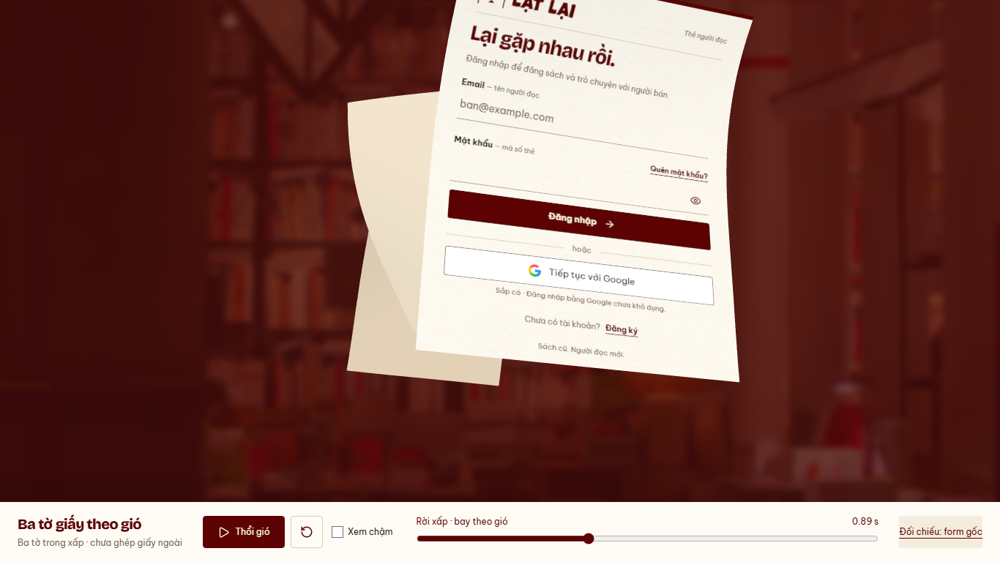
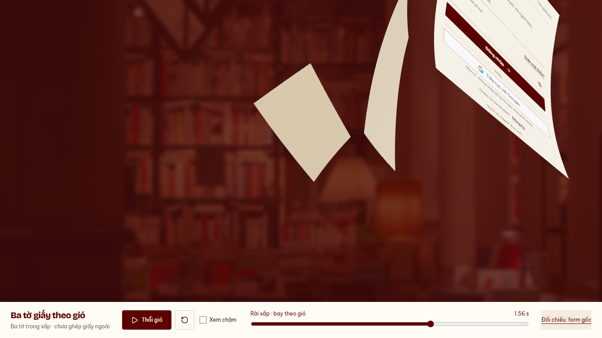

# Auth — ba chuyển động giấy riêng, 14/10/2026

Nhánh `codex/auth-wind-stack-preview`, base `6ce6db5` sau research được chủ dự
án cho triển khai. Subject `refine(web): author independent flights for the auth stack`.
Bản nhân cùng rig tại `54ba953` bị từ chối; evidence cũ giữ ở
[auth-wind-stack](../auth-wind-stack/README.md). Bản này **chờ duyệt cảm giác motion**.

[Preview ba tờ](http://127.0.0.1:5198/previews/auth-wind/stack/) ·
[Research/reference](../../../docs/design/AUTH_WIND_LIFT_RESEARCH.md) ·
[Clip QA desktop](desktop.webm) · [Clip QA mobile](mobile.webm).
Clip QA chứa scrub/soi pose trước play thường và chậm; xem nhịp thật ở preview.





## Thay đổi

- Mỗi tờ có cubic Bézier riêng, tốc độ dọc đường riêng, hướng xoay3trục riêng,
  trục uốn/độ cong/pha và tần số flutter riêng. Chung envelope cơn gió;
  không random mỗi frame, không còn gọi rig một tờ với delay cho cả ba.
- Form trôi chéo lên/phải, nghiêng vừa; middle đi cung ngang rộng và đổi mặt;
  back chao xuống/ra cạnh ngắn rồi cuốn lên. Clock giữ2.4s, khởi động vị trí
  ở84/252/420ms; bend/gust bắt đầu sớm trên cả xấp, trước khi đường bay tách.
- Uốn cung tích phân128bước, xoay cơ sở cung theo trục mỗi actor; ripple nhỏ
  chạy qua thân. Căn tâm mesh trước transform, không giữ nửa trên/gập nửa dưới.
  Đây là rig được dựng, không là mô phỏng khí động học hoặc cloth solver.
- Depth lanes nối liên tục từ stack tới khoảng cách sâu đã dựng. Bbox chỉ
  đo cho QA, không đẩy mesh bằng correction theo từng frame. Lane sâu làm
  hai tờ sau nhỏ dần theo phối cảnh; hiệu quả thị giác vẫn cần chủ dự án duyệt.
- Form scale giữ1, không ép cover. Giữ snapshot/hai mặt/màu giấy/DOM nghỉ và
  controls play/pause/slow/scrub/reset. Entry một tờ giữ nguyên motion cũ.
  Preview mới4455desktop/2475mobile vertex, renderer/camera chung.
- Không đổi production Login/tear/breeze/route/session/API, không ghép giấy
  ngoài. Không thêm dependency hoặc asset vào sản phẩm.

## Kiểm chứng

[Harness](../../../apps/user-web/tests/auth-wind-preview.mjs) · [Runtime](runtime.json).
Chromium151, desktop1366×768/mobile390×844, reduced preference bật theo motion
policy chủ dự án. Node24.12.0/pnpm11.19.0; engine warning yêu cầu Node≥24.15.0
được giữ, không đổi môi trường máy.

- PASS101pose: count3, front scale1, bbox depth gap>0; min1.87desktop/2mobile
  world unit. Margin2 cũ thuộc framewise guard đã bỏ; gap dương vẫn đủ chứng
  minh các bbox không giao nhau tại mẫu đo. Không nhận sampling là collision
  solver hay bằng chứng mọi thời điểm/viewport tùy ý.
- PASS so các tờ ở cùng local progress0.45 để bù stagger: orientation khác
  >0.25rad theo khoảng cách vector Euler, sampled profile khác>0.01. Đây là
  gate chống bản sao, không là thang điểm đẹp hoặc mô hình quán tính vật lý.
- PASS rest DOM→mesh meanRGB2.47/2.98 trên255 trong vùng form, gate<6;
  không tuyên bố toàn xấp pixel-perfect. Front gust7reversals, no folded flap.
- PASS cuối clock không còn pixel alpha nào của cả xấp trong canvas;
  normal/slow/replay/reset, resize, simulated hidden pause, WebGL context loss
  thật→DOM/retry. 0APIrequest/0pageerror ở lượt chính. IAB play/reset thật.
- PASS regression một tờ (late profile khớp baseline, gust5reversals/lifecycle),
  output ở `.tmp/auth-wind-single-regression` để không ghi đè evidence đã duyệt.
- PASS lint, preview build hai entry, detector1run0; docs/diff check PASS.
  Chunk warning>500kB (~971kB/gzip268kB) giữ. Front snapshot315/375ms,
  chưa đo toàn preparation/FPS/CPU-busy/worker/Safari/điện thoại thật.
- Production tests/build không chạy lại vì production source/dependency giữ.
  Không đóng READINESS/human sign-off, chưa push/PR/merge/deploy; WIP API giữ.

Lệnh chạy:

```sh
pnpm --filter @used-books/user-web dev:auth-wind
pnpm --filter @used-books/user-web test:auth-wind:stack
node apps/user-web/tests/auth-wind-preview.mjs --regression
pnpm --filter @used-books/user-web lint
pnpm --filter @used-books/user-web build:auth-wind
pnpm docs:check
git diff --check
```

Bước tiếp: chủ dự án xem/duyệt preview ba chuyển động riêng. Sau duyệt mới
ghép external cover pages/breeze và kiểm timeline, rồi tích hợp Login success.
