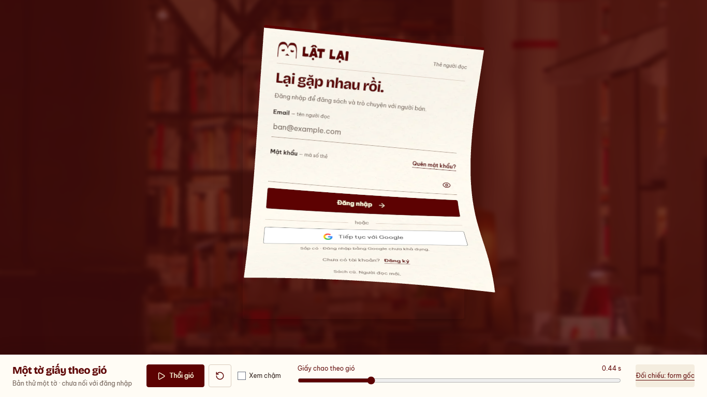

# Auth — cả tờ chao và trôi theo gió, 13/10/2026

Base `106499a`, nhánh `codex/auth-wind-single-sheet`.
Chủ dự án từ chối nhịp nửa dưới gập lên vì giống vỗ cánh và giao quyền chọn
hướng chuyển động mới. Subject `refine(web): let the whole auth sheet drift in wind`.
Đây vẫn là **preview một tờ**, chưa phải thay Login sản phẩm.

[Demo local](http://127.0.0.1:5198/previews/auth-wind/) ·
[Clip desktop](desktop.webm) · [Clip mobile](mobile.webm).
Chạy `pnpm --filter @used-books/user-web dev:auth-wind`; Thổi gió, Xem chậm,
scrub/reset. Clock2s, không autoplay. Clip gồm soi pose rồi chạy thường/chậm.

## Hướng mới

- Bỏ vùng thân trên đứng yên và nửa dưới gập ngược. Sóng cong nông có đổi dấu
  chạy chéo qua toàn thân; mép trái/phải lệch pha, góc uốn tối đa thấp hơn90độ.
- Tích phân góc tiếp tuyến từng dải dọc giữ độ dài các đoạn; căn lại tâm mesh
  sau khi uốn để độ cong không tự đẩy giấy đi. Biến dạng ngang là xấp xỉ thiết kế,
  không tuyên bố mô phỏng cloth/khí động học thực.
- Cả tờ chao và dịch từ sớm; quỹ đạo trượt tăng tốc lên/phải, xoay quanh thân
  và tiếp tục có sóng cong khi bay. Không pin mép/góc hoặc chuyển sang một clip
  flight riêng. Bóng tiếp xúc giảm theo độ rời xấp.
- Giữ camera32độ, texture hai mặt/clear input, snapshot thực của form, cleanup,
  finite2s và full authored motion dưới reduced preference theo owner policy.
  Không thêm dependency hoặc asset. Ba tờ/bồ công anh/route/session chưa đổi.

## Kiểm tra cuối

[Harness](../../../apps/user-web/tests/auth-wind-preview.mjs), [runtime](runtime.json).
Chromium151 tại1366×768/390×844, reduced preference bật,0APIrequest/0pageerror.

- PASS: upper body tham gia sóng, độ cong đổi dấu qua thân, góc uốn tại các pose
  được lấy mẫu0.63–1.03rad (gate<1.2rad), tránh nửa dưới gập ngược như cánh.
  Đây là kiểm tra hình học có lấy mẫu, không thay đánh giá cảm giác gió.
- PASS: DOM/mesh nghỉ meanRGBdifference2.45/3.03 trên255, play/slow/replay/reset;
  resize446×645→700×700; hidden pause giả lập; WebGL context loss thật→DOM/retry.
  Snapshot cold249/234ms trên máy QA, không là latency Login thật.
- Đã soi batched ảnh desktop/mobile, thao tác IAB tốc độ thường/chậm/reset.
- PASS lint, preview build, detector một lần0finding, docs/diff check.
  Preview chunk≈962kB/gzip265kB còn warning>500kB. Normal entry không import rig.
- Production tests/build không chạy lại: source sản phẩm không đổi, baseline
  `924e217` đã có143unit/production build PASS. Safari, physical phone, FPS,
  worker/CPU-busy, live Login và tích hợp ba tờ chưa kiểm/triển khai.

Tự kiểm kỹ thuật, chưa có human approval cho visual. Không push/PR/merge/deploy.
WIP API và READINESS giữ nguyên. Chờ xem cảm giác một tờ trước bước ghép ba tờ.
