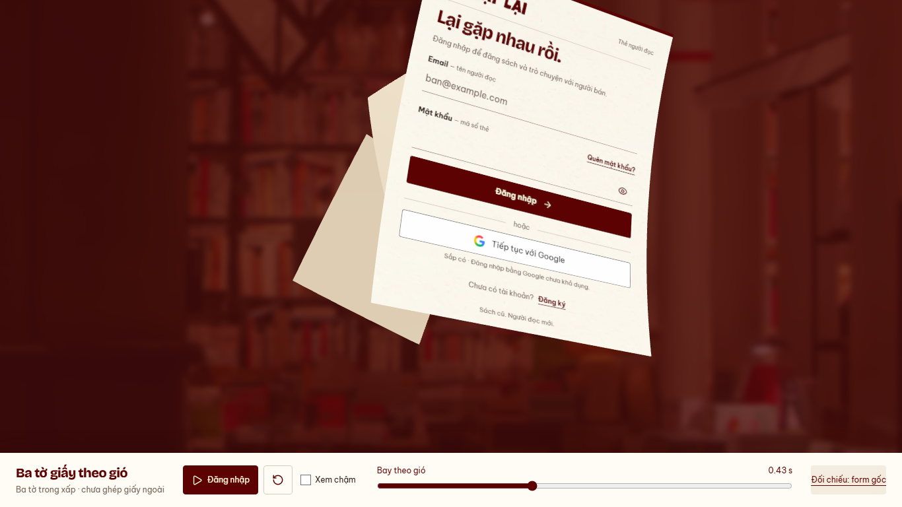

# Auth — chỉ bay, bỏ đoạn đón gió, 14/10/2026

Nhánh `codex/auth-wind-stack-preview`, base `7706ddf`.
Subject `refine(web): remove the opening gust from auth paper flights`.
Chủ dự án yêu cầu thử bắt đầu ngay ở nhịp bay; chờ duyệt tại
[preview](http://127.0.0.1:5198/previews/auth-wind/stack/).
[Bản còn gust249.6ms](../auth-wind-immediate/README.md) giữ để đối chiếu.

- Bỏ hoàn toàn gust, flutter, sway và rung góc; không còn wind attack76.8ms.
  Cả ba dịch chuyển theo Bézier ngay từ frame đầu; xoay/uốn riêng theo release.
  Độ cong nối từ form phẳng, không nhảy sang pose giữa clip hoặc đổi kích thước.
  Xóa249.6ms còn lại, tổng1152ms. Entry một tờ giữ nguyên.
- Control “Đăng nhập” ở thanh dưới chỉ chạy preview; source form inert,
  chưa tích hợp Login thật/external cover/breeze, không gọi API.
- [Runtime](runtime.json): Chromium151 desktop1366×768/mobile390×844,
  reduced preference bật. PASS cả ba chuyển động trong20ms,101pose flutter0,
  depth gap>0 (min2), scale1, orientation/profile khác tại cùng progress;
  cuối đoạn không còn pixel giấy. PASS DOM→mesh RGB2.47/3.63 (<6/255),
  finite/no folded flap/upper-body curvature, play/slow/replay/reset/resize,
  hidden pause/context loss/retry,0API/0pageerror. IAB play/reset thật.
- PASS lint/preview build/detector1run0/docs/diff. Node24.12<24.15 và chunk>500kB
  warning có sẵn. Một tờ/production regression không chạy lại vì source giữ;
  kết quả trước ở7706ddf. Physical/Safari/FPS/live auth chưa kiểm.
  READINESS và WIP API giữ; không push/PR/merge/deploy.

[Clip QA desktop](desktop.webm) · [Clip QA mobile](mobile.webm).
Clip chứa scrub rồi play thường/chậm; xem nhịp thật ở preview.

Bước tiếp: chủ dự án duyệt cảm giác trước ghép giấy ngoài/breeze/Login.
