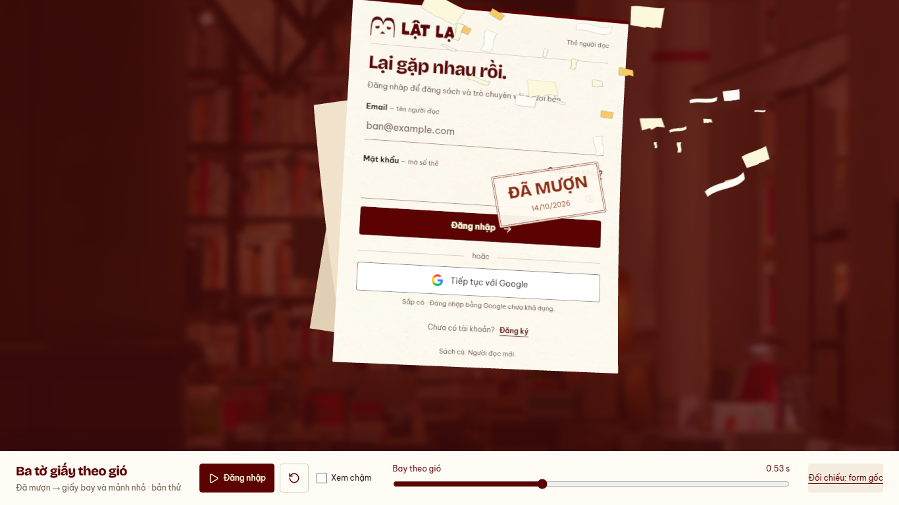

# Auth — thử ghép mảnh giấy nhỏ, 14/10/2026

Nhánh `codex/auth-wind-stack-preview`, base `e2ca87e`.
Subject `feat(web): add a small paper burst to the auth flight preview`.
Theo yêu cầu chủ dự án; chờ duyệt tại
[preview](http://127.0.0.1:5198/previews/auth-wind/stack/).
[Bản dấu+bay](../auth-wind-stamp/README.md) giữ để đối chiếu.

- Thêm30mảnh desktop/18mobile, dùng lại bốn outline từ
  [paper-scene.ts](../../../apps/user-web/src/components/auth/paper-scene.ts),
  palette cream/paper/yellow/wine và nét in nhạt của burst cũ.
  Art raster vào12texture nhỏ lúc dựng; Sprite chung renderer/camera với xấp.
  Flight/scale/depth/góc/blur tĩnh riêng, không random hay tạo texture mỗi frame.
- Bung quanh xấp khi flight bắt đầu, lệch tối đa90ms, cuốn chéo lên/phải;
  fade quintic trong28% cuối lifetime, không cắt ngang để kết thúc.
  Mảnh nhỏ18–88px theo depth/viewport, footprint hình nhỏ hơn texture rect;
  lifetime720–915ms, kết thúc trong clock cũ1432ms.
- Giữ dấu280ms và ba tờ bay1152ms, không quay lại đón gió/xé giấy.
  Mảnh trang trí không lấy chữ/field từ form. Đây là preview ghép thử,
  chưa external cover/breeze/Login thật; không sửa source sản phẩm/dependency.
  Dispose material/texture/group khi đổi viewport/unmount.

[Runtime](runtime.json) · [Clip QA desktop](desktop.webm) · [Clip QA mobile](mobile.webm).
Clip gồm scrub kiểm tra rồi play thường/chậm; xem nhịp thật tại preview.

- PASS Chromium151 desktop1366×768/mobile390×844 với reduced preference bật:
  count30/18, không bung trước stamp, có mảnh khi flight bắt đầu;
 101flight pose finite/count/bounded exit, stamp/no gust/scale1/distinct/gap>0 giữ.
  Canvas hết pixel giấy khi kết thúc, DOM→mesh RGB2.47/3.63 (<6/255).
- PASS play/slow/replay/reset/resize/hidden pause/context loss/retry;
 0API/0pageerror; IAB play/reset thật. Desktop/mobile visual xem một lượt.
- PASS lint/preview build/detector1run0/docs/diff. Engine Node24.12<24.15 và
  chunk982kB/gzip271kB warning giữ. Một tờ/production tests không chạy lại vì
  nhánh render/source liên quan giữ; regression một tờ PASS tại `e2ca87e`.
  FPS/Safari/physical/live auth chưa kiểm; không đổi READINESS/WIP API,
  chưa push/PR/merge/deploy.

Bước tiếp: chủ dự án xem cảm giác/mật độ trước ghép thêm lớp khác.
