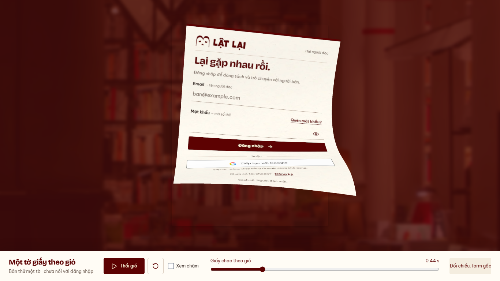

# Auth — thêm gust nhanh ở nửa đầu, 13/10/2026

Base `08769bd`, nhánh `codex/auth-wind-single-sheet`. Chủ dự án thấy bản drift
ổn và yêu cầu phập phồng nhanh/mạnh hơn ở đầu, giữ đoạn bay như cũ.
Subject: `refine(web): add a brisk opening gust to the auth paper`.

[Demo](http://127.0.0.1:5198/previews/auth-wind/) · [Desktop](desktop.webm) ·
[Mobile](mobile.webm). Chạy `pnpm --filter @used-books/user-web dev:auth-wind`.
Một tờ, clock2s, play/slow/scrub/reset; chưa thay Login sản phẩm.

## Thay đổi có giới hạn

- Một sóng nhanh bổ sung lên rig drift: khoảng3.7–4Hz ở nửa đầu, biên độ góc
  tối đa0.34rad trước trọng số theo vùng giấy. Sóng chạy chéo, có độ trễ theo
  chiều dài và giữa hai mép. Thân chỉ chao phụ0.014–0.018rad để tránh giật cứng.
- Quintic ramp-in tới0.11s, giữ rồi ramp-out0.62–1s; giá trị và hai đạo hàm
  đầu của envelope về0 ở1s. Từ1s toàn công thức uốn/rotation quay lại baseline;
  vị trí/quỹ đạo/duration chưa sửa. Không tăng tốc cả đoạn bay hoặc thêm gập cánh.
- Tham khảo [tấm mỏng trong luồng khí](https://www.sciencedirect.com/science/article/abs/pii/S0889974621000098)
  và [follow-through/overlap](https://learn.microsoft.com/en-us/windows/win32/lwef/animation-principles).
  Tần số/biên độ trên do thiết kế cho preview, không lấy làm thông số thực nghiệm.

## Evidence

[Harness](../../../apps/user-web/tests/auth-wind-preview.mjs), [runtime](runtime.json):
Chromium151,1366×768/390×844, reduced preference bật theo owner policy.

- PASS5lần đổi chiều góc mép trong các sample0.16–0.88s, không fold-back;
  upper body và sóng hai phía tâm giữ. Profile1s/1.16s khớp tuyệt đối baseline
  đã lưu. Screenshot desktop1.1s có SHA256 trùng baseline; không tuyên bố mọi
  frame/viewport pixel-identical. Tần số và shape constraints không thay visual approval.
- PASS DOM/mesh nghỉ2.45/3.03 meanRGB trên255;0APIrequest/0pageerror; play2s,
  slow/replay/reset; resize/hidden pause/context loss→DOM/retry. IAB đã play/reset.
- Lint/preview build/docs/diff PASS, detector một lần0finding. Build warning
  chunk>500kB giữ (~963kB/gzip265kB). Snapshot cold232/379ms, không là latency Login.
- Source production không đổi nên không rerun143unit/production build baseline.
  [Giới hạn của prototype](../auth-wind-drift/README.md) giữ: chưa physical/Safari/
  FPS/worker/live Login/ba tờ/coverage/breeze integration. READINESS và WIP API giữ.

Không dependency mới, không push/PR/merge/deploy. Chờ cảm nhận gust mới trước
khi chuyển sang ba tờ; bản drift nền đã được chủ dự án xác nhận ổn.
