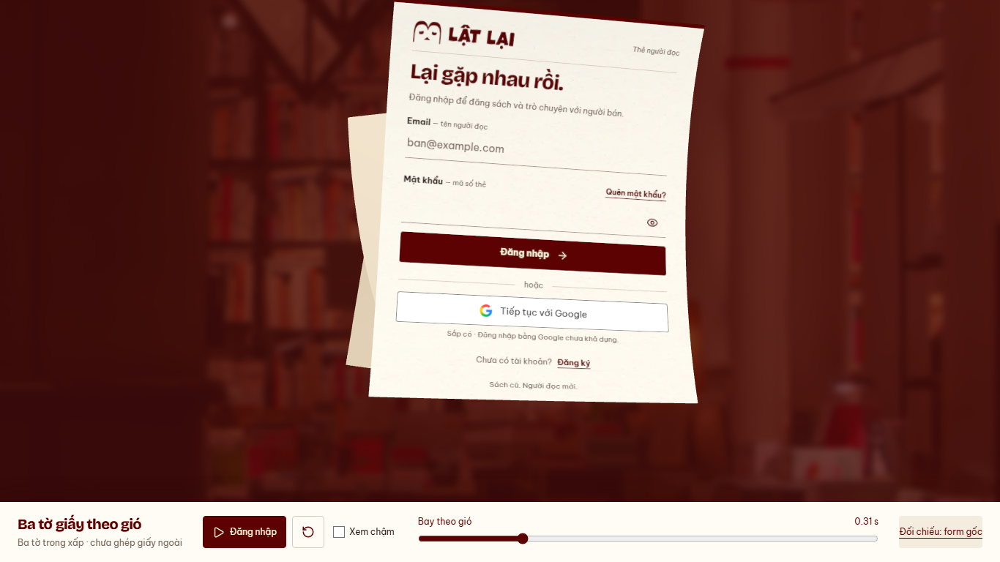

# Auth — bay ngay khi bấm, 14/10/2026

Nhánh `codex/auth-wind-stack-preview`, base `c77330a`.
Subject `refine(web): launch auth papers immediately with a shorter gust`.
Theo yêu cầu thử của chủ dự án; chờ duyệt nhịp mới ở
[preview](http://127.0.0.1:5198/previews/auth-wind/stack/).
[Bản trước](../auth-wind-distinct/README.md) giữ để đối chiếu.

- Đoạn đón gió1.248s rút80% còn249.6ms, diễn ra đồng thời với bay.
  Bỏ delay84/252/420ms và đoạn ease chờ của đường bay; cả ba trôi từ frame đầu.
  Clock toàn đoạn1.4016s, giữ ba đường bay/hướng xoay/trục uốn riêng và scale form1.
- Control preview đổi từ “Thổi gió” sang “Đăng nhập”. Đây là nút thử motion;
  form gốc vẫn inert, chưa ghép đăng nhập thật/giấy ngoài/breeze.
  Entry một tờ giữ nhịp đã duyệt; không thêm dependency.
- [Runtime](runtime.json): Chromium151 desktop1366×768/mobile390×844,
  reduced preference bật. PASS chuyển động của cả ba trong20ms,101pose gap>0
  (min0.79desktop/2mobile), orientations/profiles khác tại cùng progress,
  scale1 và canvas không còn pixel giấy khi kết thúc.
- PASS DOM/mesh meanRGB2.47/3.63 (<6 trên255), no folded flap;
  play/slow/replay/reset/resize/hidden pause/context loss/retry,0API/0pageerror.
  Regression một tờ giữ baseline và lifecycle; lint/preview build/detector/docs/diff.
  Engine Node24.12<24.15 và chunk>500kB là warning có sẵn.
  Chưa đo FPS/physical/Safari/live auth; không thay READINESS hoặc WIP API.

[Clip QA desktop](desktop.webm) · [Clip QA mobile](mobile.webm).
Clip gồm scrub kiểm tra rồi play thường/chậm; xem nhịp thật ở preview.

Bước tiếp: chủ dự án duyệt cảm giác nhịp mới trước ghép external cover/breeze/Login.
