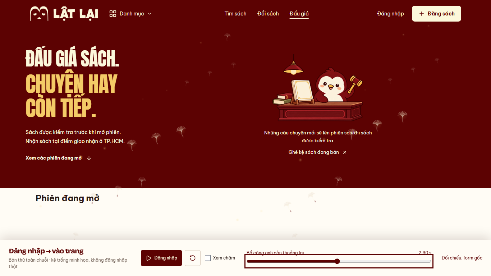

# Auth — toàn chuỗi dấu/giấy/vào trang, 14/10/2026

Chủ dự án đã duyệt toàn chuỗi tại `5de3a4e` và giao tích hợp làm hiệu ứng Login
chính. Preview này là reference lịch sử được chấp nhận; production hiện dùng
cùng source authoritative cho ba tờ/dấu/flight qua các re-export mỏng.
[Documentation production](../auth-wind-production/documentation.md) ghi hành vi
hiện tại, evidence và giới hạn. Clock preview cố định4700ms; production chờ
chuẩn bị renderer và mount thật của trang đích, nên thêm latency tương ứng.

Checkpoint preview lịch sử: nhánh `codex/auth-wind-stack-preview`, base `fd79101`,
subject `feat(web): preview the full auth paper journey`.
[Preview toàn chuỗi](http://127.0.0.1:5198/previews/auth-wind/journey/) cần server local.
[Dấu/ba tờ/mảnh nhỏ](../auth-wind-fragments/README.md) giữ để đối chiếu.

Phạm vi và kiểm tra dưới đây thuộc bản preview trước tích hợp:

- Dấu280ms → ba tờ bay1152ms với đường bay/độ uốn riêng, mảnh nhỏ cũ giữ.
  Không đón gió, không xé, không phóng form để che viewport.
- Dùng lại `createPaperScene` cho ba giấy ngoài, bỏ burst của scene này để
  tránh nhân đôi mảnh nhỏ. Vào từ700ms, kín tại1350ms, giữ đến1500ms,
  bay khỏi đến2200ms. Handoff tại1350ms nằm trong core12–88% giấy lớn.
- Dùng lại `createPaperBreeze`:26/16seed,14/8dust, glow/luồng gió và flutter
  liên tục; individual native fade bắt đầu sau2200ms, hết tại4700ms.
  Không chuyển cảnh hay đặt lại vị trí hạt khi trang đích hiện.
- Chung một clock cho mesh/WAAPI: play/pause/slow/scrub/reset/replay;
  effect gốc được pause/seek, không chạy ngầm riêng. Resize recapture;
  hidden pause và khôi phục breeze khi visible, unmount dispose.
- Trang đích minh họa dùng MainLayout/Header/AuctionHero thật, kệ trống có
  sẵn; preload font/ảnh trước khi sẵn sàng. Không dựng AuctionEntrance.
  MemoryRouter giữ trong preview, nguồn/destination inert; không auth,
  không tạo session, không REST/socket hoặc chuyển route sản phẩm.
  Source Login/storm/breeze sản phẩm giữ nguyên. Ba HTML entry riêng;
  preview build mới gồm journey, production build không thêm entry.

[Runtime](runtime.json) · [Clip QA desktop](desktop.webm) · [Clip QA mobile](mobile.webm).
Clip gồm kiểm tra scrub và play thường/chậm. Xem nhịp thật ở preview.

- PASS Chromium1511366×768/390×844, reduced preference bật: clock/stamp/
  coverage trước handoff, source/destination visibility, outside exit,
  count/tail seed fade, reset/replay/pause/resize/visibility;0API/0pageerror.
- PASS regression preview xấp: compare/101pose/natural scale1/ba đường bay/
  burst/no gust/exit/resize/hidden/contextloss/retry. Evidence fragments trước
  giữ nguyên sau regression, không thay bằng captures mới.
- PASS lint/preview build ba entry/docs/diff; detector1run0findings.
  Desktop/mobile visual một lượt và một lượt xác nhận sau sửa preload/
  visibility transition kế thừa. Không chạy lại detector.
- Node24.12<24.15 và preview chunk>500kB warning có sẵn. FPS/physical/Safari/
  live auth/production/native NOT RUN; kỹ thuật PASS không là visual approval.
  Không dependency/API/schema/READINESS thay đổi, WIP API giữ.
  Tại checkpoint này chưa push/PR/merge/deploy; bước chờ duyệt đã được chủ dự án
  hoàn tất sau đó. Không cộng evidence preview thành live Auth hay production PASS.

