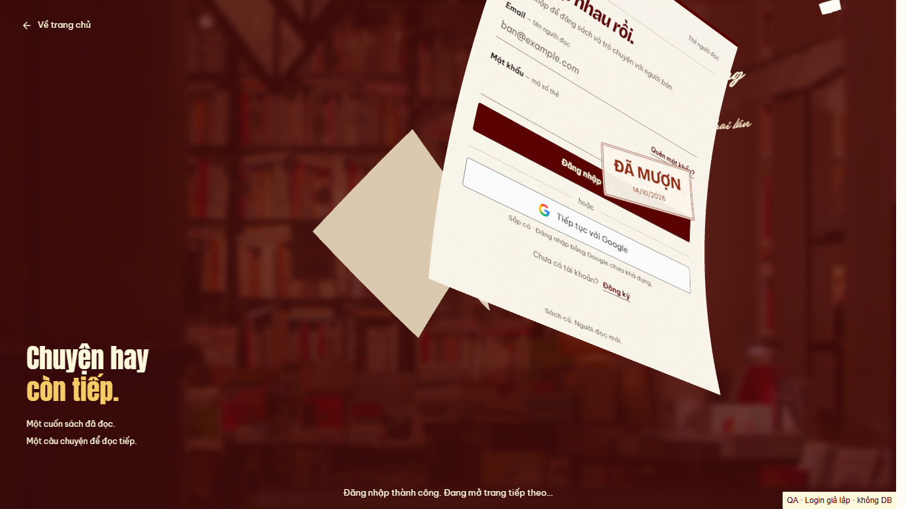
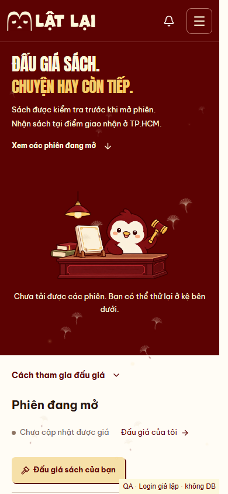
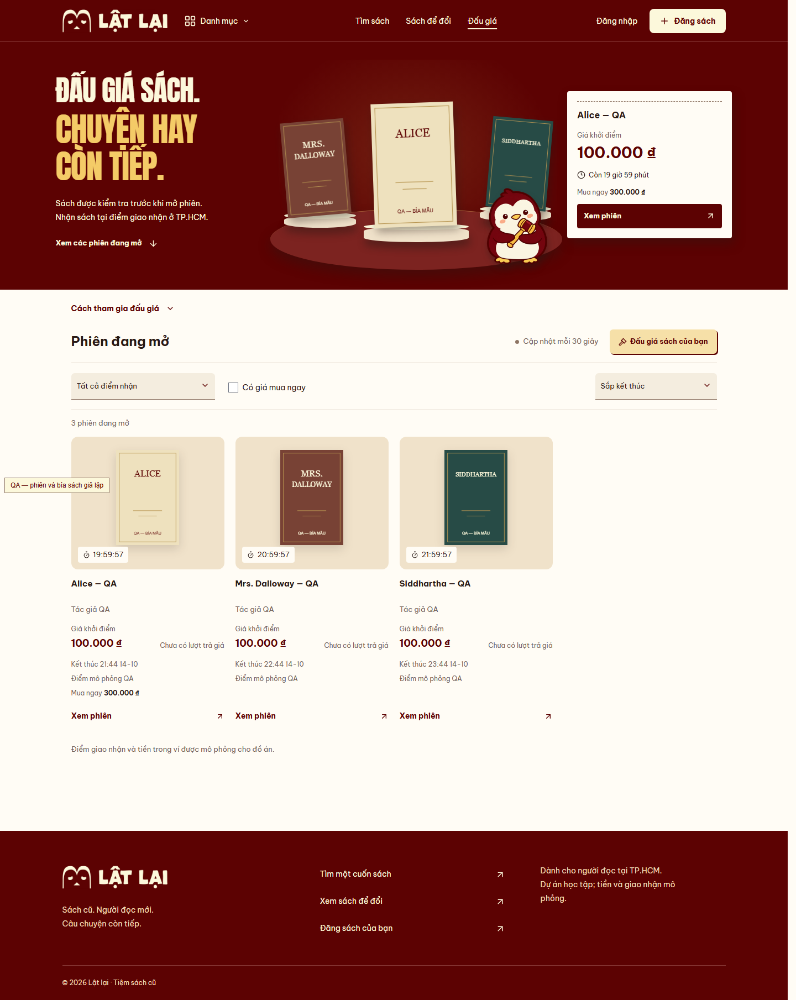

# Login chính và sân khấu đấu giá — 14/10/2026

Chủ dự án duyệt toàn chuỗi preview `5de3a4e` và giao tích hợp, rà lỗi, push/PR,
theo dõi CI. Branch `codex/auth-wind-login-integration`, base main `7a52d08`.
Gói được tách khỏi các thay đổi Detail/Exchange chưa tích hợp và WIP API trên
checkout cũ. Không đổi endpoint, contract, session store, DB hoặc READINESS.

Login thật chỉ chạy sau khi API xác nhận thành công. Dấu “ĐÃ MƯỢN” 280ms,
ba tờ nguyên vẹn bay 1152ms theo ba đường/uốn riêng; mảnh nhỏ cũ đi cùng giấy.
Không có đón gió, xé đôi hay phóng form để che màn hình. Ba giấy ngoài bắt đầu
700ms, kín tại 1350ms; chờ DOM trang đích thực sự mount rồi giữ thêm 150ms,
mở trong 700ms. Breeze giữ chuyển động liên tục và tan trong 2500ms sau mở.
Đi vào Đấu giá qua giấy không chạy thêm rèm; lần vào sau từ navbar/Back/reload
vẫn có rèm. Rèm hiện tại giữ navbar, tổng 1385ms và hình gọn đã duyệt.

Mesh/serializer/flight/stamp/fragments nay nằm ở `src/components/auth/wind/`;
preview chỉ re-export cùng nguồn. Three 0.186.1 tải lười trên Auth, production
không giữ drawing buffer hoặc quét bounding box từng frame. Capture local
xóa input value/default/attribute, kể cả mật khẩu đang hiện; không đưa session
hay trường nhập vào ảnh. Bộ nhớ/animation được dọn khi hoàn tất hoặc rời trang.
Thiếu capture/WebGL dùng giấy DOM nguyên vẹn; thiếu WAAPI dùng giấy che kỹ thuật.

## Kiểm chứng

- Lint, typecheck, 135 unit/21 file, build và preview build: PASS.
- Session client 21 unit/2 file, docs checker và 5 checker tests: PASS.
- [Regression Login](runtime.json): PASS Chromium, desktop 1366×768 và mobile
  390×844 với reduced preference bật. Sai Login giữ form; đúng Login có ba
  actor WebGL; serialized revealed credentials bị xóa; query/hash, focus,
  scroll/inert được khôi phục. Back, resize, context loss, thiếu capture,
  chuẩn bị trước/sau timeout không làm kẹt hoặc hồi sinh canvas muộn.
- [Capture/video](video-runtime.json): PASS thêm viewport người dùng 465×628.
  Dấu DOM chờ renderer, GPU/fallback chỉ đóng dấu một lần. [Review ban đầu](finish-review.md)
  tìm một P2; [verdict](verdict-pass.md) chấm lỗi đồng bộ dấu đã resolved,
  disposition `ship` tại phạm vi lỗi đó. AI review không thay review người thật.
- Rèm/Hero regression riêng: PASS geometry/hit testing navbar, pending/empty/
  error/retry, filter/price update không replay, resize/hidden/context loss,
  failed/slow art và không Canvas. Hai ảnh auction bên dưới là fixture QA.
- Detector các target đã đổi: 0 findings. Invocation đầu sai đường dẫn hai
  target Auction; chỉ hai target chưa kiểm được chạy ở đường dẫn đúng.
- Node local 24.12 thấp hơn yêu cầu 24.15 và build cảnh báo chunk >500kB.
  Chunk Auth lười ~551kB/~140kB gzip; không tuyên bố FPS/thiết bị thật.

Fixtures Login/API lỗi và ba sách QA không ghi API/DB. Live Auth, Safari,
physical mobile, screen-reader speech và human acceptance: NOT RUN.
Remote CI/PR do điểm lưu và PR ghi trạng thái trên head thực tế.

## Xem bản cuối

[Desktop clip](desktop.webm) · [Mobile clip](mobile.webm) · [465px clip](user-465.webm).
Các file `*-stamp.png` là khung đầu chuỗi đóng dấu/khởi hành, không phải mốc
0ms chính xác; `*-flight.png` là ba giấy đang bay; `*-lingering.png` là trang
đích có breeze. `desktop.png`/`mobile.png`/`user-465.png` kiểm control lọc;
hai khung hẹp đã tự scroll tới control sau click.

