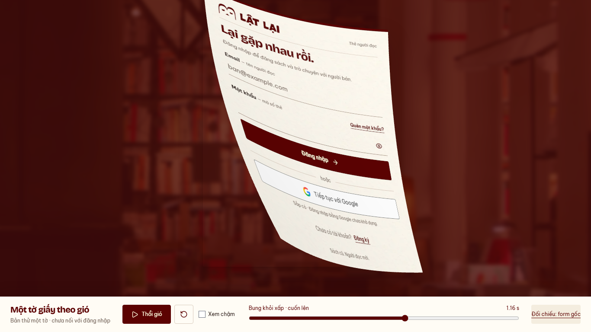

# Một tờ giấy Auth theo gió — bước 1, 13/10/2026

Nhánh `codex/auth-wind-single-sheet`, base `280a218`.
Chủ dự án duyệt triển khai bước preview một tờ sau
[nghiên cứu](../../../docs/design/AUTH_WIND_LIFT_RESEARCH.md).
Hoàn tất prototype local; **chờ chủ dự án duyệt chuyển động**, chưa thay Login.
Refinement sau `924e217`: chủ dự án yêu cầu mép lất phất rồi thân níu lại trước
khi bung. Subject `refine(web): flutter the paper edge before wind release`.

## Xem và chạy lại

Từ repo, Node >=24.15 (đã chạy24.19.0), pnpm11.19.0:

```sh
pnpm --filter @used-books/user-web dev:auth-wind
```

Mở [bản thử local](http://127.0.0.1:5198/previews/auth-wind/).
Thổi gió / Tạm dừng / Xem lại; Xem chậm0.35×; thanh thời gian và nút đối chiếu
form gốc/lưới ở pose0. Thời lượng chuyển động2s là nhịp thử, không là latency
Login thật. Không autoplay. Resize dựng lại; hidden dừng, không tự chạy tiếp.



[Clip desktop](desktop.webm) · [Clip mobile](mobile.webm) ·
[Mặt sau](desktop-back.png) · [DOM gốc](desktop-dom.png) · [Lưới ở nghỉ](desktop-mesh.png).
Clip gồm thao tác soi các pose, chạy thường và chạy chậm.

## Thiết kế và implementation

- Entry riêng trong [previews/auth-wind](../../../apps/user-web/previews/auth-wind/index.html),
  không được import bởi router/main của sản phẩm. Dùng AuthLayout/LoginPage thật,
  MemoryRouter, JourneyContext no-op, toàn source inert/aria-hidden; không gọi
  session.restore/login. Phông chữ, logo, giấy, nội dung và mặt sau từ Auth hiện tại.
- Three.js0.186.1 pin làm **devDependency**, licenseMIT; không React Three Fiber.
  [PlaneGeometry](https://threejs.org/docs/pages/PlaneGeometry.html) cho825mobile/
  1485desktop vertices; một tờ, một mesh hai mặt. Rig tự viết điều khiển cung cong
  theo chiều gió, mép phía đón gió lên trước, thân nghiêng theo, rồi lật và bay lên/phải.
  Hai gust không đều ở0–0.75s nâng/hạ mép; thân bắt đầu theo sau từ0.62s.
  Góc trên/phải giữ nguyên world position tới1.16s; lúc bung, ràng buộc góc
  được nhả dần để giấy bay quanh thân thay vì tiếp tục xoay quanh bản lề.
  Có một nhịp uốn hồi nhỏ sau nhả; shadow contact giảm theo lúc thân rời mặt.
  Uốn theo tọa độ chiều dài; thêm góc dẫn nhỏ. Không tuyên bố đây là mô phỏng cloth
  hoặc toàn bộ mặt giấy hoàn toàn không biến dạng: twist nhỏ và sampling còn xấp xỉ.
- Snapshot Auth riêng: clone computed CSS, nhúng local font/image/filter và
  pseudo-elements qua SVG foreignObject → CanvasTexture. Native input được xóa
  value/defaultValue trước serialization, kể cả password đã hiện; không có dữ liệu
  tài khoản thật trong preview. Không tải ảnh form lên dịch vụ hoặc lưu field.
- Đo lại bounding rect tại handoff sau khi preview fit cửa sổ; chống nhảy vị trí
  khi snapshot và layout xảy ra khác nhịp. Không giữ text DOM trên một lớp bay riêng.
  Mặt sau có UV riêng, không in ngược chữ trước. Shading nhẹ, không chất liệu bóng.
- Chuẩn bị snapshot một lần; replay dùng lại. Hạ DPR tối đa2, giải phóng geometry/
  textures/material/renderer khi dựng lại. Source được memo để không render lại
  cả form mỗi frame. Main-thread renderer ở bước1; worker chưa triển khai.
- No WebGL/capture failure giữ DOM và có nút tải lại. Context loss trong motion
  dừng, hiện lại DOM. DOM-motion fallback đầy đủ thuộc bước tích hợp sau.
- Bồ công anh/glow đã duyệt và ba tờ cover chưa ghép vào prototype này.

## Kiểm chứng

[Harness](../../../apps/user-web/tests/auth-wind-preview.mjs),
[runtime](runtime.json); Chromium151.0.7922.34 tự khởi chạy, viewport1366×768 và
390×844, reduced preference bật nhưng authored motion giữ theo owner policy.
API bị intercept;0requestAPI,0pageerror ở hai lượt chính. Không DB/bucket.

- PASS rest/mesh compare, bốn pose phất/nâng/bung/mặt sau, finite play2s, slow replay,
  reset; source DOM visible lại. Pixel mean absolute RGB difference trong vùng
  giấy: desktop2.45/255, mobile3.03/255 (gate<6); không gọi là pixel-perfect.
  Raster antialias/resampling và native control còn khác nhẹ.
- PASS thêm hai lần edge lift→return, gust sau cao hơn gust trước; góc giữ sai lệch
  <0.01 world unit ở5pose trước nhả. Edge Z desktop87→0→129→14, mobile80→0→119→13;
  đây là tọa độ geometry trước fit viewport, không phải độ dời pixel màn hình.
- Snapshot cold front220desktop/233mobile ms trong lượt cuối trên máy QA; thời gian chưa là
  benchmark thiết bị thật hoặc ngân sách production. Đo từ snapshot call, không
  gồm mọi import/font initialization. Chưa cho phép chèn latency này vào Login.
- PASS resize446×645→700×700, hidden pause bằng event giả lập, context loss thật
  qua WEBGL_lose_context→DOM, nút retry reload. Trình duyệt IAB cũng đã thao tác
  slow play/scrub keyboard/reset ở cửa sổ hẹp. Không thay viewport người dùng.
- PASS refinement: lint0warning và build preview riêng. Baseline `924e217` có
  143unit/21files và production typecheck/build PASS; không chạy lại source sản
  phẩm không đổi. Production và preview có warning chunk>500kB; preview JS khoảng961kB/
  gzip264kB, chưa tối ưu shipping. Normal production entry không import Three.
- Detector một lần0finding; docs/diff check PASS. Đây là self-review, không có
  reviewer độc lập hoặc human approval cho kết quả mới.

Lệnh kiểm tra:

```sh
pnpm --filter @used-books/user-web test:auth-wind:browser
pnpm --filter @used-books/user-web lint
pnpm --filter @used-books/user-web test
pnpm --filter @used-books/user-web build
pnpm --filter @used-books/user-web build:auth-wind
pnpm docs:check
git diff --check
```

Build preview vào `.tmp/auth-wind-preview-build`, không copy public assets;
đây là compilation check. Xem bản đầy đủ qua dev server có assets của app.

## Gate tiếp theo

Chờ duyệt độ cứng, góc nâng và quỹ đạo **một tờ**. Sau đó mới làm ba tờ cùng
luồng gió, che viewport và handoff route. Worker/CPU-busy, Safari, thiết bị thật,
FPS, field/stamp live Login, security/lifecycle integration và fallback finite
chưa kiểm/triển khai ở bước1. READINESS không đổi; không push/PR/merge/deploy.
