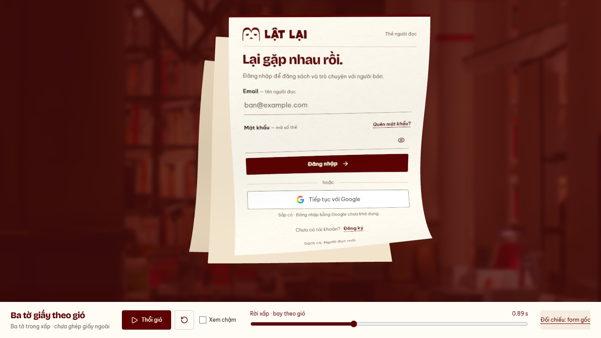
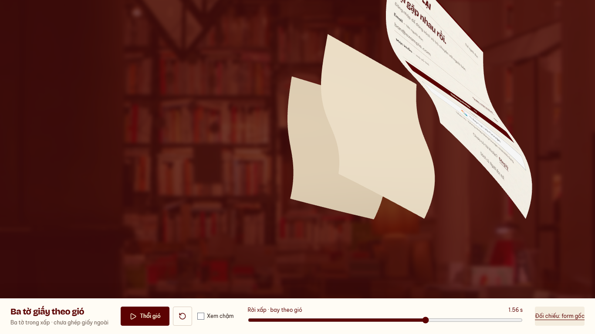

# Auth — ba tờ trong xấp bay theo gió, 13/10/2026

**14/10/2026: chủ dự án từ chối motion tại `54ba953` vì ba tờ bay giống nhau.**
Các ảnh/test bên dưới là evidence kỹ thuật của bản bị từ chối, không là
visual approval. [Khảo sát lại theo video Jafar Fazel](../../../docs/design/AUTH_WIND_LIFT_RESEARCH.md)
chốt đề xuất ba đường bay/hướng xoay/độ uốn riêng; chưa sửa runtime.

Nhánh `codex/auth-wind-stack-preview`, base `f8a095b`.
Chủ dự án chấp nhận tạm motion một tờ và cho bước tiếp theo. Trong lúc dựng,
chủ dự án chốt **form bay tự nhiên; giấy ngoài của storm cũ che chuyển cảnh**.
Subject `feat(web): preview three auth sheets drifting out of the stack`.

[Bản ba tờ](http://127.0.0.1:5198/previews/auth-wind/stack/) ·
[Một tờ đã chốt](http://127.0.0.1:5198/previews/auth-wind/) ·
[Clip desktop](desktop.webm) · [Clip mobile](mobile.webm).





Clock preview2.4s; play/pause/slow0.35×/scrub/reset. Clip có các lần soi pose
và kiểm tra rồi mới play thường/chậm. Không autoplay, không gọi Login/API/DB.

## Kết quả bước này

- Ba mesh từ đúng front/middle/back của AuthLayout. Hai tờ sau chụp riêng từ
  DOM để giữ màu#f0e2ca/#e0cfb4, kích thước, góc0.9/2.2độ và độ lệch nghỉ.
  Không nhân ba nội dung form. Texture hai mặt và cơ chế clear input giữ.
- Rig một tờ đã chấp nhận được dùng chung; front giữ quỹ đạo/độ cong, không
  phóng lớn/ép lật/đổi hướng về tâm để cover. Delay hai lớp sau156/312ms trong
  clock2.4s, cùng hướng lên/phải; fan nhẹ giúp thấy từng lớp rời xấp.
- Một WebGL renderer/camera cho cả ba actor, một lần draw mỗi pose. Depth
  slabs không chồng nhau, tính từ mọi vertex đã transform, ngăn mặt cong xuyên
  nhau. Cơ chế này ưu tiên thứ tự sâu ổn định; đây vẫn là rig thiết kế, không là
  cloth collision solver. Bản ba tờ4455desktop/2475mobile vertices.
- Rest DOM giữ khi chưa play; mesh align theo kích thước không xoay và tâm từ
  rect thực. Lấy góc CSS riêng cho rear; hide/restore cả ba DOM cùng lúc.
- Entry `/stack/` riêng cùng source preview; entry một tờ vẫn dùng được.
  Normal app/router không import prototype. Thêm build entry và script QA.
- Không ghép external pages, fragments, breeze hoặc handoff route ở bước này.
  Production `paper-scene`/`PaperStormLayout` giữ nguyên; giấy ngoài của luồng
  cũ sẽ tiếp tục cover khi tích hợp. Bỏ hẳn phương án form che viewport theo
  yêu cầu mới của chủ dự án; không lấy ba tờ form làm điều kiện navigate.

## Kiểm chứng cuối

[Harness](../../../apps/user-web/tests/auth-wind-preview.mjs), [runtime](runtime.json).
Node24.19.0/pnpm11.19.0, Chromium151,1366×768/390×844, reduced preference bật.

- PASS41pose: đúng3actor, local progress có thứ tự, depth gap≥2world unit,
  front scale ratio=1. Ở pose cuối không còn pixel alpha nào của mesh trong
  toàn canvas. Alpha retention chỉ phục vụ QA preview, chưa tối ưu shipping.
- PASS rest DOM/mesh trong vùng form: meanRGB2.47/2.98 trên255, gate<6;
  không tuyên bố toàn xấp pixel-perfect. Sóng/gust5reversals/late shape baseline
  giữ; profile lấy mẫu không thay kiểm tra cảm giác motion của người dùng.
- PASS normal/slow/replay/reset, resize446×645→700×700, simulated hidden pause,
  WebGL context loss thật→khôi phục cả xấp DOM và retry. 0APIrequest/0pageerror.
  IAB thực tế đã play/reset; ảnh desktop/mobile đã soi theo request cuối.
- PASS regression một tờ sau refactor shared renderer (harness đầy đủ), lint,
  preview build hai entry; detector1run0. Docs/diff check PASS.
  Chunk warning>500kB giữ (~965kB/gzip266kB); không là production delivery gate.
- Snapshot front387/374ms trong lượt cuối, chưa tính toàn bộ preparation bốn
  mặt. Không nhận là ngân sách Login/FPS. Chưa worker, CPU-busy, Safari,
  physical phone, native, live Login hoặc external cover/breeze integration.
- Không rerun production143unit/build: source sản phẩm/dependency không đổi;
  baseline924e217 có evidence riêng. Không đóng READINESS hoặc human approval.

Lệnh chạy lại (PowerShell hoặc terminal tại root):

```sh
pnpm --filter @used-books/user-web dev:auth-wind
pnpm --filter @used-books/user-web test:auth-wind:stack
pnpm --filter @used-books/user-web test:auth-wind:browser
pnpm --filter @used-books/user-web lint
pnpm --filter @used-books/user-web build:auth-wind
pnpm docs:check
git diff --check
```

## Bước sau

Chờ duyệt ba tờ, rồi ghép giấy ngoài/breeze đã có vào cùng timeline; sau đó
mới thay Login success/tear và kiểm actual destination mount, focus/unlock,
Back/hidden/GPU fallback/CPU-busy. Không push/PR/merge/deploy; WIP API giữ.
