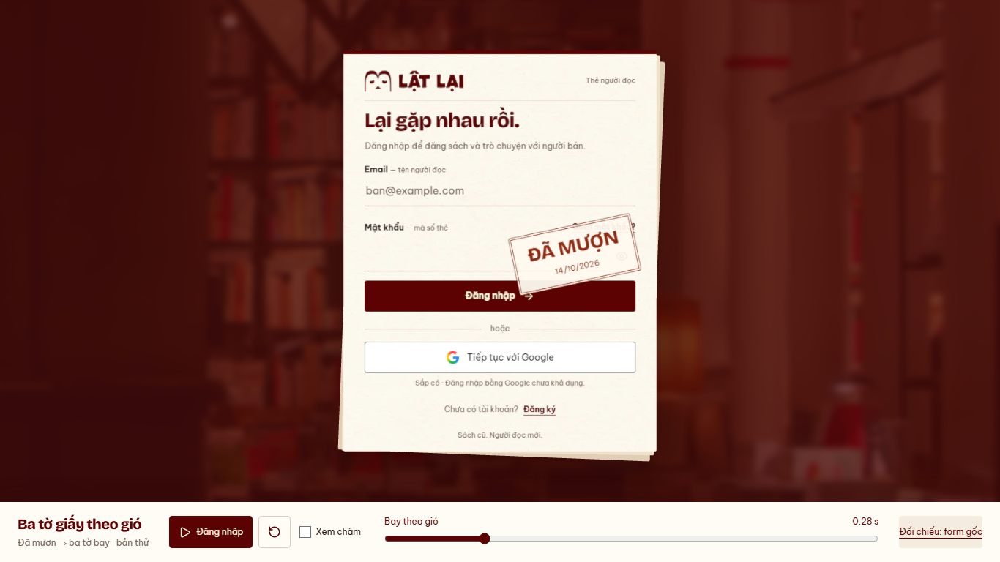
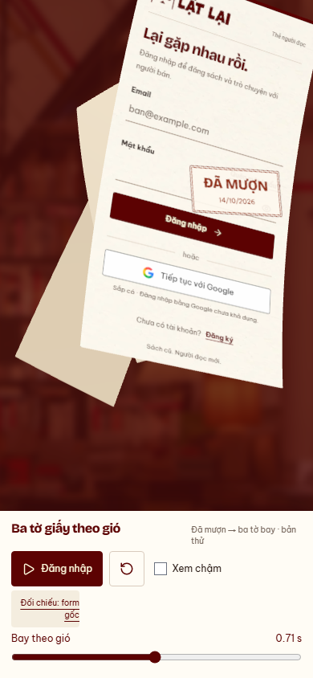

# Auth — dấu Đã mượn rồi ba tờ bay, 14/10/2026

Nhánh `codex/auth-wind-stack-preview`, base `3fd8d2e`.
Subject `feat(web): compose the borrowed stamp with auth paper flights`.
Theo yêu cầu ghép của chủ dự án, chờ duyệt chuỗi tại
[preview](http://127.0.0.1:5198/previews/auth-wind/stack/).
[Bản chỉ bay](../auth-wind-flight/README.md) giữ làm mốc.

- Giữ art/dòng ngày/nhịp stampHit280ms cubic-bezier(.16,1,.3,1) của AuthLayout:
  opacity0→1, scale1.6→1, góc−12độ. Stamp xong là bay1152ms, tổng1432ms.
  Không trở lại gust/flutter/sway hoặc xé giấy; ba đường bay và form scale1 giữ.
- Imprint là texture alpha riêng trên mặt trước của mesh form, uốn/xoay/di chuyển
  cùng giấy. Không dùng stamp cố định ngoài màn hình, không recapture mỗi frame.
  Chụp stamp từ DOM/style thật lúc chuẩn bị; bỏ DOM tạm trong finally;
  clear input/handler/session như capture cũ. Shader mặt sau không mang stamp.
- Bản thử thể hiện dấu success bằng control “Đăng nhập” ở thanh dưới; source form
  vẫn inert, không gọi API. Chưa ghép external cover/breeze hoặc Login thật.
  Không sửa AuthLayout/Login/session production, không thêm dependency.

[Runtime](runtime.json) · [Clip QA desktop](desktop.webm) · [Clip QA mobile](mobile.webm).
Clip có scrub kiểm pose rồi play thường/chậm; xem nhịp thật tại preview.

- PASS Chromium151 desktop1366×768/mobile390×844, reduced preference bật:
  rest stamp0, scale hit, paper nghỉ đến280ms, cả ba bay sau stamp20ms.
  PASS101flight pose flutter0/depth gap>0/scale1/distinct rotation/profile,
  cuối đoạn không còn pixel giấy. DOM→mesh RGB2.47/3.63 (<6/255).
- PASS play/slow/replay/reset/resize/hidden pause/context loss/retry;
  0APIrequest/0pageerror; IAB play/reset thật. Soi art/ngày stamp và stamp theo
  mặt giấy trên desktop/mobile. PASS regression một tờ: baseline/lifecycle giữ.
- PASS lint/preview build hai entry/detector1run0/docs/diff. Chunk972kB/gzip269kB
  và engine Node24.12<24.15 warning có sẵn. Chưa đo full preparation/FPS/physical/
  Safari/live auth. READINESS/WIP API giữ; không push/PR/merge/deploy.

Bước tiếp: chủ dự án duyệt chuỗi dấu+bay trước ghép giấy ngoài/breeze/Login.
