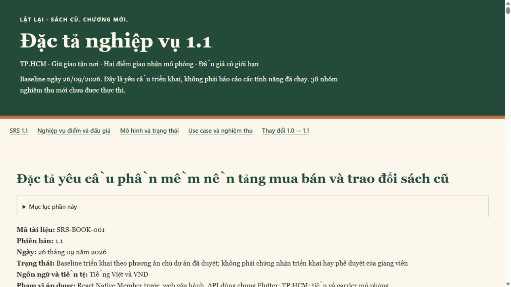

# Kiểm tra bộ tài liệu SRS1.1

Ngày 26/09/2026. Phạm vi: tài liệu, không phải nghiệm thu nghiệp vụ phần mềm.

Trạng thái: **đã kiểm tra tài liệu**, không đồng nghĩa đã implement các yêu cầu mới.

| Kiểm tra thực chạy | Kết quả |
|---|---|
| Tạo HTML từ source và chạy lại `--check` | Đạt; bản offline khớp source |
| Mã yêu cầu và coverage matrix | 26 FR mới, 12 UC, 38 nhóm AC, 16 POL bổ sung; mọi FR mới có ca truy vết |
| Liên kết Markdown nội bộ của bộ hiện hành | Tất cả đích tồn tại; HTML anchor không trùng/mất |
| Ví dụ phí Order/Exchange và công thức Auto | Ví dụ kiểm tra nhất quán; không phải test code nghiệp vụ runtime |
| Digest snapshot SRS/use-case1.0 theo manifest gốc | 33 tệp giữ nguyên, gồm MD/HTML/PlantUML/PNG/SVG/ZIP |
| `pnpm contract:check` | Đạt; OpenAPI0.4.0 và types vẫn đồng bộ, không thêm route planned mới trong lần này |
| Python compile, `git diff --check` | Đạt; không lỗi whitespace; có cảnh báo CRLF ở workflow đã thay từ trước |
| Browser desktop1280px | Năm phần và50 bảng; chữ/tiêu đề rõ, không tràn ngang trang, link phụ lục đúng đích |
| Browser mobile390px | Không tràn ngang trang; bảng rộng cuộn riêng; mục lục mở/đóng hoạt động |
| Tài nguyên offline | Không script/CDN/font ngoài; source diagram Mermaid giữ dưới phần mở rộng có nhãn |

Rà soát nghiệp vụ đã bổ sung sự khác biệt DirectDelivery/ViaPoint, Fulfilling so
với InTransit, slot giữ cho return, barrier hai cuốn/hai acceptance, phí mỗi chặng,
quỹ sự cố có nguồn và BuyNow/bid/close cạnh tranh. Bộ hiện hành đã cập nhật đường
dẫn ở README, docs index, team/setup/architecture, listing spec/acceptance/plan và
ADRs liên quan. Tài liệu nguồn lịch sử không bị thay bằng nội dung1.1.

Không chạy lại API E2E/native build trong lần tài liệu này vì không thay runtime,
OpenAPI, Prisma hoặc UI ứng dụng. Kết quả API trước đó vẫn nằm ở báo cáo catalog/
draft, không được dùng để đánh Passed cho38 nhóm AC mới.

Ảnh kiểm tra bản đọc desktop:

Source: [SRS1.1](SRS_V1_1.md), [changelog](SRS_V1_1_CHANGELOG.md),
[bản offline](SRS_V1_1.html). Tất cả AC-H/AC-AU mới vẫn chưa chạy.
