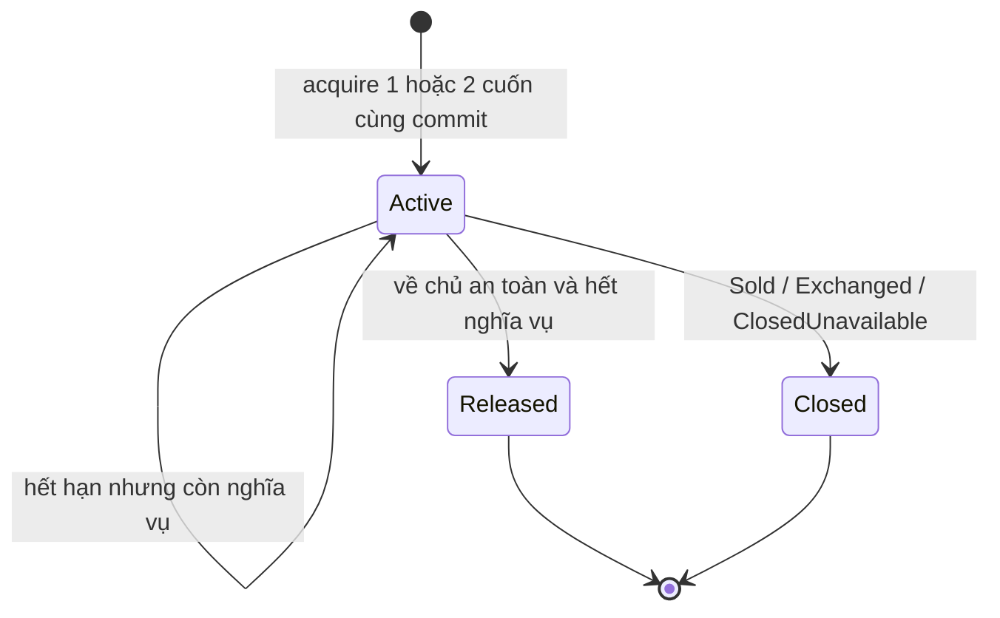

# Cam kết giao dịch và giữ sách

27/09/2026 · Thiết kế triển khai theo [ADR 0013](../adr/0013-exclusive-commitment-foundation.md).
Nguồn nghiệp vụ: [SRS 1.1](../SRS_V1_1.md),
[LOCAL-AUCTION-01](LOCAL_HANDOVER_AUCTION.md),
[mô hình giao nhận](LOCAL_TRANSACTION_DESIGN.md). **Đã triển khai phần F0/F1 backend;
F2a ví/nạp mô phỏng đã có backend; các phần giao dịch trả tiền/F3–F5 vẫn là thiết kế.**
Đọc cùng [ca nghiệm thu](COMMITMENT_ACCEPTANCE.md) và [lộ trình](TRANSACTION_FOUNDATION_PLAN.md).

Cập nhật F0: địa chỉ, nơi gửi và [quote DirectDelivery](DIRECT_SALE_QUOTE_REPORT.md)
đã có API/schema riêng (OpenAPI0.11.0). Các nhận xét “hiện có” ở mục2 giữ bối cảnh
đợt thiết kế trước F0; xem báo cáo F1 bên dưới cho phần Order đã triển khai.

## 1. Điều đã chốt

Cập nhật F1: [backend Order chưa trả tiền](UNPAID_ORDER_REPORT.md) đã triển khai
create/read/cancel/expiry và commitment Order-only. F2a bổ sung
[ledger và nạp mô phỏng](SIMULATED_WALLET_REPORT.md); chưa có journal Order payment,
hold, custody hay transfer. Mô hình mở rộng giao dịch bên dưới vẫn là thiết kế.

| Quyết định | Hành vi |
|---|---|
| Một bản vật lý, một cam kết | Một listing có tối đa một commitment Active xuyên mua, đổi và intake đấu giá |
| Đề xuất khác giao kết | Giỏ/chat/quote/Exchange Proposed không giữ sách, tiền hoặc slot |
| Đổi hai cuốn | Accept giữ cả hai hoặc không giữ cuốn nào; mỗi cuốn thuộc một người khác nhau |
| Thời hạn khác quyền giữ hiện vật | Deadline chặn trả tiền/chấp nhận; chỉ release khi nghĩa vụ tiền và sách cho phép |
| Đấu giá sang mua | Chuyển cùng commitment/slot sang Order, không về Available ở giữa |
| Server chốt điều kiện | Không tin số tiền, payer, owner, trade, custody hay eligibility do client gửi |
| Không nâng phạm vi | TP.HCM, ship trực tiếp còn nguyên; ViaPoint/auction triển khai sau các prerequisite |

`Reserved` chỉ mô tả listing đang bị ràng buộc, không nói tiền đã thanh toán,
sách đã nhận hay đơn đã hoàn tất. `Cancelled` cũng không chứng minh sách đã về chủ.

## 2. Đối chiếu với code hiện tại

| Nền tảng đang có | Tác động bắt buộc ở increment triển khai |
|---|---|
| [CommandService](../../apps/api/src/modules/commands/command.service.ts): user/session lock, receipt, audit/outbox | Mở rộng typed context/receipt và system principal; không gọi lồng `run()` để tạo nhiều transaction |
| [ListingLifecycleService](../../apps/api/src/modules/listings/listing-lifecycle.service.ts): chỉ thay Available | Acquire phải khóa cùng listing, tăng version một lần; giữ hồi quy sửa/ẩn/xóa/gỡ |
| [PublicListingService](../../apps/api/src/modules/listings/public-listing.service.ts): predicate chung | Thêm NOT EXISTS Active commitment và custody blocker cho list/detail/media, bên cạnh trade projection |
| Revision/ảnh đã submit bất biến | Pin revision/media trong snapshot; không dùng URL ảnh có hạn làm bằng chứng lâu dài |
| Trigger listing bắt version tăng đúng 1 | Mọi acquire/transfer/close cập nhật projection/version qua Listing service một lần/command, không tăng hai lần do callback |
| Auth chỉ ACTIVE/RESTRICTED | Chưa đáp ứng quyền xử lý nghĩa vụ cũ của LOCKED trong SRS §4; gate trước funding |
| Receipt chỉ Catalog/Listing/Media, actor bắt buộc User | Cần migration/contract mới; không ép Order thành Listing hoặc worker thành tài khoản giả |
| Không Address/ServiceArea/fulfillment/ledger/custody | Không thể bật checkout hoàn chỉnh chỉ bằng thêm bảng reservation |

## 3. Bất biến và mô hình dữ liệu đích

### Ràng buộc chung

- C-01: `count(commitment where listing=L and status=Active) <= 1`, do DB bảo vệ.
- C-02: ở cuối commit, `trade=Reserved` khi và chỉ khi tồn tại Active commitment.
  Released/Closed không còn quyền giữ. Available vẫn cần đủ moderation/visibility/
  account và không custody blocker để giao dịch. Sold/Exchanged/ClosedUnavailable
  không có Active commitment và không được acquire lại.
- C-03: context đang sở hữu cam kết có đúng tập sách trong WorkflowItem: Order/intake
  một; Exchange hai. Trạng thái Proposed/chưa acquire không được có commitment.
  Khi transfer, context intake cũ đánh dấu Transferred; context Order mới sở hữu.
- C-04: owner và listing/revision identity không được đổi. History/event không sửa/xóa.
- C-05: acquire/transfer/close, snapshot, projection, version, receipt, audit và
  outbox cùng commit. Không giao dịch DB lồng; không gọi provider bên trong transaction.
- C-06: release kiểm tra context ID **và** commitment version; không `UPDATE ... WHERE listingId`
  đơn lẻ. Một Proposed bị từ chối không gọi release.
- C-07: mọi số tiền là integer VND từ policy/snapshot. Reservation không ghi ledger
  hoặc công bố đã giữ tiền; domain funding thực hiện journal qua LedgerService cùng Tx.

### Thực thể

| Thực thể | Trường/quan hệ chính | Bảo vệ |
|---|---|---|
| WorkflowContext | id, kind Order/Exchange/AuctionIntake, orderId?, exchangeId?, auctionIntakeId?, version, ownershipPhase | Exactly one FK đúng kind; mỗi aggregate có một context, không xóa khi có lịch sử |
| WorkflowItem | contextId, listingId, listingRevisionId, catalogRevisionId, ownerId, itemSnapshot | PK(contextId, listingId); FK(listingId, listingRevisionId) tới đúng revision; bất biến |
| AgreementSnapshot | contextId, schemaVersion, policyVersion, participants, fulfillment, amounts, deadlines | Server xây, JSON schema đóng; phiên bản và dữ liệu bất biến, không chỉ hash |
| ExclusiveCommitment | id, listingId, currentContextId, status Active/Released/Closed, version, acquiredAt, endedAt?, reason? | FK(currentContextId, listingId) tới WorkflowItem; unique Active/listing; version >0 |
| CommitmentEvent | id, commitmentId, sequence, kind, fromContextId?, toContextId?, beforeVersion, afterVersion, commandReceiptId, occurredAt, reason | Append-only; unique(commitmentId, sequence); acquire/transfer/release/close truy vết được |
| PointSlot (increment ViaPoint) | id, pointId, listingId, currentContextId, releasedAt? | Một slot chưa release/listing; count dưới khóa point <= capacity; transfer giữ ID |

`ownershipPhase` của context là None/Holding/Transferred/Closed, độc lập tiến độ Order.
Cancelled nhưng còn reclaim có thể vẫn Holding; không ép context Closed theo tên state
của giao dịch. None chỉ hợp lệ khi chưa acquire (ví dụ Proposed), không phải chỗ chứa
Order AwaitingPayment không có sách. Constraints đối chiếu state theo loại aggregate.

Đích thiết kế có đủ ba loại FK; triển khai tăng dần chỉ bật kind đã có bảng nghiệp vụ
thật. Increment đầu Order-only có CHECK `kind=Order` và FK Order bắt buộc; khi thêm
Exchange/intake mới mở CHECK, thêm FK và kiểm thử cardinality. Không tạo bảng Order
rỗng giả lập chỉ để cho một reservation trỏ tới. Dùng FK deferred khi thực sự có
chu trình insert, kiểm tra exactly-one và aggregate/context tại COMMIT.

Partial unique index đích (tên SQL sẽ chốt trong migration):

```sql
CREATE UNIQUE INDEX commitment_one_active_listing
ON exclusive_commitments (listing_id) WHERE status = 'Active';
```

Không đưa `expires_at > now()` vào unique predicate. Deadline là dữ liệu aggregate;
thời gian trôi không tự làm biến mất bản ghi Active. Thêm CHECK kết thúc/endedAt/reason,
FK RESTRICT, trigger bất biến/event, constraint trigger deferred kiểm tra C-02/C-03
trên mọi bảng thay đổi liên quan. DB checks không thay object authorization/service.
Trigger lấy khóa theo giao thức; direct SQL sai cố tình phải bị test chặn.

## 4. Snapshot và version

Checkout tham chiếu listing ID, expected listing version/revision, quote ID/version
và lựa chọn giao nhận đã xem. Exchange accept thêm expected proposal revision/version
và **cả hai** version/revision listing. Server lấy owner, giá, media, vùng và policy.

Snapshot gồm tên sách/tác giả/ấn bản và catalog revision; nội dung/ảnh listing theo
thứ tự; seller/recipient IDs; địa chỉ gửi/nhận theo schema riêng tư; service-area
ID/version và mã địa bàn; method, point ID/version nếu có; lựa chọn mỗi chặng,
payer, phí, cọc/Δ; policy version, các mốc thời gian đã tính. Quote không chứa token
hoặc ký URL ảnh trong receipt. Address ID/version được đối chiếu quyền và trạng thái
hiện tại; cập nhật sổ địa chỉ sau giao kết không sửa snapshot.

Direct Order: P + S Buyer trả, S=30.000đ theo demo; Seller ứng S khi pickup và được
hoàn ứng qua settlement. Không thêm Buyer ShipmentFeeHold cho cùng chặng. ViaPoint:
tiền sách và từng phí chặng tách biệt. Exchange: D_A=V_B, D_B=V_A, bên có sách thấp
trả |V_A−V_B|; phí ship riêng. Ví dụ A100k/B300k: A cọc300k+bù200k, B cọc100k,
chưa tính ship. Giá quoted không đồng nghĩa tiền đã được giữ.

Catalog hiện Confirmed bất biến; vẫn pin revision để thay đổi tương lai không sửa
lịch sử. Lựa chọn fulfillment gắn revision listing và thay đổi phải qua duyệt lại;
listing cũ chưa có địa chỉ/vùng/lựa chọn vẫn được xem nhưng chưa được checkout.
Không backfill địa chỉ hoặc tự cấp điểm đủ điều kiện cho dữ liệu hiện có.

Khi checkout dùng quote đã thay đổi giá/phí/địa chỉ/policy hoặc expected version thì trả
conflict để xem lại; không tự chấp nhận điều kiện mới. Retry cùng key sau commit
trả receipt cũ trước kiểm tra version đã tăng; GET sau đó trả trạng thái hiện tại.
GET quote F0 trả assessment Changed/Expired/Unavailable theo ADR0016, không trả
HTTP409 chỉ vì lịch sử không còn hiện hành. POST /orders trong F1 kiểm tra lại quote
khi tạo đơn chưa trả tiền; giao diện checkout/thanh toán vẫn chưa triển khai.

## 5. Chuyển trạng thái cam kết

| Lệnh/sự kiện | Tiền điều kiện | Kết quả nguyên tử |
|---|---|---|
| Checkout thường | Buyer/Seller đủ quyền; khác người; Sale/Both đủ eligibility và snapshot hiện hành | Order AwaitingPayment + Active một cuốn + trade Reserved, hạn15 phút |
| Tạo/counter Proposed | Exchange/Both, hai chủ khác nhau, trong quota, versions đúng | Proposal revision mới, hạn48 giờ; không commitment/slot/hold |
| Accept | Đúng awaiting participant, trước hạn; proposal và hai listing không đổi | AcceptedAwaitingFunding + Active cả hai + Reserved cả hai, hạn24 giờ |
| Auction intake | Sale, Seller đủ quyền, điểm/vùng/slot hợp lệ; đủ inbound fee nếu chọn ship | Context intake + Active một cuốn + slot + phí theo LedgerService |
| Auction BuyNow/close | Đúng outcome duy nhất và người thắng đủ quyền | OrdersService tạo Order/snapshot giá thắng; transfer giữ commitment/slot ID và Active |
| Trả tiền/funding | Trước hạn, đúng context đang giữ, đủ available | Ledger journal và state cùng commit; giữ Active, không acquire lần hai |
| Hủy/hết hạn chưa có tiền/sách đi | Xác minh chưa có nghĩa vụ hoặc dispatch/custody không rõ | Context Closed, Active→Released, trade Available; bảo toàn visibility/moderation |
| Hủy có tiền/custody | Còn refund/return/incident cần thực thi | SettlementPending/reclaim theo aggregate, commitment tiếp tục Active |
| Hoàn tất mua/đổi | Settlement và nghĩa vụ hàng đã đủ, không blocker | Active→Closed, trade Sold/Exchanged; Exchange xử lý cả hai trong một Tx |
| Hoàn về chủ không đổi tình trạng | OwnerConfirmed hợp lệ, tiền/claim/incident đã xử lý | Active→Released, Available; Hidden/Removed vẫn giữ nguyên |
| Hoàn về chủ đổi tình trạng | Như trên, cần dữ liệu listing và duyệt mới | Listing-domain transition tạo revision cần duyệt; release + Available/PendingReview cùng Tx, không public |
| Mất/không thể thu hồi | Quyết định có hiệu lực, mọi nghĩa vụ tài chính đã thực thi | Active→Closed, trade ClosedUnavailable, reason và incident link |

Hàng “hoàn đổi tình trạng” đòi hỏi **transition riêng của Listing service**, tạo
revision đúng cơ chế lời khai/duyệt và bảo toàn snapshot cũ. Không đổi mỗi enum
PendingReview trên revision Approved cũ (SQL hiện tại không cho phép). Nếu chưa có
transition hoặc bằng chứng hợp lệ thì closure thất bại toàn bộ, giữ Active, đưa vào
xử lý nghĩa vụ; không bật luồng return đó trước khi triển khai phần phụ thuộc.

`OwnerConfirmed` lúc tạo chỉ dựa trên khai báo đang sở hữu và chưa có bàn giao trong
hệ thống; không phải nhãn đã kiểm tra hiện vật. Sau dispatch/Unknown, lời bấm “đã lấy
về” đơn lẻ không đủ release. Cần receipt/đối soát hợp lệ theo custody workflow.
Exchange closure bảo thủ: đợi đủ disposition cả hai cuốn và tiền, rồi đổi cả hai;
có thể một cuốn Available sau hoàn, cuốn kia ClosedUnavailable theo quyết định.



Không hồi sinh commitment đã kết thúc. Giao dịch mới dùng ID mới; listing Sold/
Exchanged không chuyển owner, người nhận muốn bán lại tạo listing mới.

## 6. Khóa, thời gian và thực thi lệnh

Một Tx ReadCommitted, kế thừa retry tối đa3 lần của ADR0006. Thứ tự cố định:

1. Advisory lock theo principal + operation + idempotency key.
2. Discovery tập actor/participant/owner cần khóa; User UUID tăng dần, rồi session
   của actor. Worker khóa cùng tập user, không yêu cầu phiên người dùng còn sống.
3. Service-area/config và address rows cần dùng; points UUID tăng dần nếu có.
4. Catalog UUID tăng dần, rồi **toàn bộ listings UUID tăng dần**.
5. Context/aggregate theo thứ tự cố định: context → auction → order → exchange;
   mỗi nhóm UUID tăng dần. Với tạo mới, hàng mới chưa có contender.
6. Revision → media → commitment → slot → custody/blocker; mỗi nhóm khóa ổn định.
7. Ledger accounts rồi holds theo UUID khi domain có funding/settlement.

Các writer cấu hình/address/role/custody/worker phải cùng giao thức; việc khóa user
không thay khóa address. Context trước aggregate áp dụng cả writer chỉ sửa proposal.
Catalog/requester liên quan phải được discover trước user locks khi nghiệp vụ cần.
Không giữ khóa DB qua network/storage, không gọi public-read service để cấp quyền ghi.

Discovery chỉ là gợi ý: sau khóa đối chiếu lại revision, participants, context và
resource set. Nếu proposal counter/auction bidder set thay đổi, rollback và discover
lại có giới hạn; hết retry trả unavailable/conflict an toàn. Không lấy thêm user ở
cuối Tx. Auction close cần tập bidder hiện hành theo thiết kế local transaction.

Sau auth/object authorization, xử lý receipt replay trước các điều kiện chỉ dành
cho lệnh mới. Lệnh mới xác minh version, quota, eligibility và thời gian quyết định
bằng clock DB **sau các khóa quyết định**. `decisionAt < deadline`; tại bằng hoặc sau
deadline bị chặn. HTTP arrival/giờ client/`now()` ở đầu transaction đang chờ khóa
không quyết định quyền. Trong test dùng clock adapter có kiểm soát, không endpoint
chỉnh giờ production. Mốc tạo hạn lấy decisionAt được snapshot, không gia hạn khi retry.
Kiểm tra session expiresAt lần cuối với decisionAt trước ghi; session bị hết thời gian
trong lúc chờ khóa không được dùng kết quả guard cũ để commit. Role/status được giữ
bởi user lock, nhưng thời gian hết hạn không bị khóa lại cùng hàng DB.

Quota checkout tối đa2 AwaitingPayment/Buyer được đếm dưới khóa Buyer; 100 requests
cùng buyer khác key không lách quota. Worker hết hạn chậm có thể tạm chiếm quota/stock;
không tự “cướp” commitment hết deadline. Quét mỗi phút theo SRS; cảnh báo backlog quá
hai chu kỳ, retry cùng command key. Worker lấy candidate không khóa bằng query riêng,
sau đó từng candidate vào protocol trên; không lock Order trước rồi mới khóa User.

### Tích hợp qua service

Interface nội bộ đích, **không phải HTTP hoặc code đã có**:

| Service | Trách nhiệm trong Tx do orchestrator cấp |
|---|---|
| ListingCommitmentPolicy | Khóa/recheck tập listing, snapshot và áp projection/version đúng một lần |
| ReservationsService.acquire | Kiểm tra tập WorkflowItem/context, tạo 1/2 Active + events; không commit riêng |
| ReservationsService.transfer | So khớp source context/version, target Order và outcome; cập nhật currentContext, không release |
| ReservationsService.close | Kiểm tra quyền sở hữu và disposition/custody/ledger hiện hành, kết thúc cả tập |
| Orders/Exchanges/Auctions | Sở hữu transition nghiệp vụ, deadline, quota và orchestration; không tự sửa bảng reservations |
| Points/Custody/Ledger | Cấp và recheck dữ liệu có version trong cùng Tx; không nhận boolean `safeToRelease` từ request |

## 7. Hủy, worker, proposal cũ và sự kiện đến muộn

Worker timeout không phát lệnh release tùy ý: gọi transition của aggregate, kiểm tra
deadline và funding/custody lại. Payment thắng trước thì timeout không hủy trạng thái
đã thanh toán. Timeout thắng thì payment không ghi journal/khôi phục; nạp ví độc lập
vẫn tăng available nhưng không fund đơn cũ. Deadline auction winner là endAt+24h,
BuyNow15 phút; worker trễ không cộng thêm hạn.

Khi một listing bị acquire/sửa/gỡ, những Proposed tham chiếu version cũ mất hiệu lực.
GET/accept/quota dùng effective eligibility, hiển thị ClosedUnavailable ngay khi
đối chiếu phát hiện stale; outbox consumer ghi chuyển trạng thái bền vững từng proposal.
Không khóa hàng loạt user của mọi proposal trong checkout. Consumer vào protocol đầy
đủ, kiểm tra proposal revision/version trước đóng, không đóng một counteroffer mới.
Acquire và release đều tăng listing version nên proposal cũ không hồi sinh khi sách
lại Available. Không tuyên bố outbox hiện tại đã có consumer này.

Caller retry sau mất response dùng cùng body/key. Receipt chỉ mô tả commit gốc,
không refresh deadline. Worker dùng key bền vững cho context + loại deadline +
deadline/version đã snapshot; job gửi lặp không tạo event/journal mới. Lease chỉ
phân phối công việc, không là quyền sửa dữ liệu. Sau restart đọc lại PostgreSQL.

Carrier báo pickup trễ/mâu thuẫn sau hủy: ghi incident/custody blocker có reference
context cũ, không tự đánh Sold hoặc release commitment của giao dịch mới. Nếu listing
đã có cam kết mới, giữ cam kết đó và chặn tiến hành để đối soát; không tạo Active thứ
hai. Timestamps từ carrier không được sửa ngược lịch sử đã đóng. Closure phải kiểm
tra mọi blocker của listing, kể cả incident phát sinh từ context cũ.

## 8. Quyền, dữ liệu riêng và hợp đồng dự kiến

Member ACTIVE verified và role hiện hành mới checkout/propose/accept/intake; cả
đối tác cũng phải đủ điều kiện. Staff/Admin không tự mua hoặc override giữ sách
bằng role vận hành. Chặn tự mua, tự đổi, participant giả và đối tượng riêng của người
khác; không lộ ai đang giữ sách trong lỗi `unavailable` cho người ngoài.

RESTRICTED được xử lý nghĩa vụ cũ theo quyền participant, không tạo giao dịch mới.
LOCKED đã có [quyền nghĩa vụ cũ F2b](LOCKED_OBLIGATIONS_REPORT.md): profile, Order
participant list/read/media/cancel chưa trả tiền và wallet/history riêng. Các handler
khác vẫn default-deny, có kiểm tra ở service dưới khóa; không mở login toàn quyền.
Chat/evidence/giao nhận và paid obligations cần thiết kế/check riêng trước khi mở;
chưa coi kênh Staff hỗ trợ là đã thay toàn bộ quyền trong SRS §4.
Cập nhật F2c: [ADR 0020](../adr/0020-order-wallet-payment.md) và
[báo cáo](ORDER_PAYMENT_REPORT.md) triển khai payment ACTIVE/RESTRICTED cho Order
cũ, refund request/rejection của participant kể cả LOCKED và worker refund.
LOCKED vẫn bị chặn payment mới; seller acceptance/custody chưa được mở.
DISABLED/mất session không tự giải phóng; worker vẫn xử lý timeout theo nghiệp vụ.

Không có endpoint public `/reservations/acquire` hoặc `/release`. Các command
checkout/accept/cancel là quyền trên aggregate. Exact routes/DTO/error code chỉ có
một nguồn ở OpenAPI trong increment code; bảng này là yêu cầu contract:

| Nhóm | Dữ liệu cần nhận/trả |
|---|---|
| Quote checkout | Listing/version/revision, địa chỉ và fulfillment references; trả các khoản server tính, điều kiện, expiry và không có reservation |
| Create Order | Quote/version cùng snapshot đã xem; Idempotency-Key; trả TransactionCommandReceipt, Order version/state/deadline |
| Read own transaction | Snapshot được lọc theo vai, serverTime/deadlines, funding/custody progress khi đã implement; no-store |
| Cancel unpaid Order | Expected aggregate version + key; không nhận giá/refund/target trade từ client |
| Proposal/counter/accept | Đúng awaiting participant, expected proposal revision và hai listing versions; chốt fulfillment không thương lượng giá tùy ý |
| Errors | 401 phiên; 403 quyền; 404 đối tượng riêng; 409 stale/đã giữ/key conflict/hết hạn; 422 dữ liệu/vùng; 429 quota; 503 retry cùng key |

Thêm `TransactionCommandReceipt` riêng: context ID/kind, aggregate ID/version/state,
serverTime, affected listing IDs/versions và deadline thích hợp. Không nhét vào
closed enum receipt listing để làm hỏng RN/operations hiện tại. Tái sử dụng cùng bảng
receipt và orchestration qua adapter typed; không JSON `any` hay cast Order thành Listing.

Migration receipt/audit phải có principal rõ: user actorId hoặc systemActor allowlist,
exactly one; giữ unique user/operation/key, thêm unique systemActor/operation/key.
Thêm context FK, kiểm tra target theo entity; giữ tương thích các record hiện có.
System principal không chọn từ request/body/header; controller Member không truy cập
worker executor. Audit lưu IDs/versions/reason/requestId; không địa chỉ/raw body/token.
Outbox có command/event identity để consumer dedupe, không gửi thông báo trước commit.

Buyer chỉ thấy địa chỉ của mình trước giao kết; Seller nhận địa chỉ Buyer sau nhận
Order; Exchange lộ địa chỉ cho đối tác sau đủ funding (BR-46). Participant media
reads phải kiểm quyền qua context và pinned revision ngay cả khi listing đã Reserved
hoặc rời kệ; public signed-read không được dùng cho đơn riêng. TTL ảnh vẫn120 giây.

## 9. Gate trước code và trước demo

Thiết kế này không sửa snapshot SRS1.0, phí, deadline hay policy đã chốt. Không có
migration/route giao dịch mới trong increment này; API vẫn0.8.0. Khi implement phải
contract-first, chạy full migration trên DB `_test`, kiểm tra SQL constraints và
ca cạnh tranh theo [CM-AC](COMMITMENT_ACCEPTANCE.md). Listing native còn gate riêng.

Demo mua/đổi chỉ được công bố khi address/fulfillment, ledger, worker, custody và
client tương ứng có handler/tests. Một Order chưa trả tiền chỉ chứng minh giữ/hủy/
hết hạn; không mô tả là đã hoàn thành mua sách, ship hay giải ngân.
