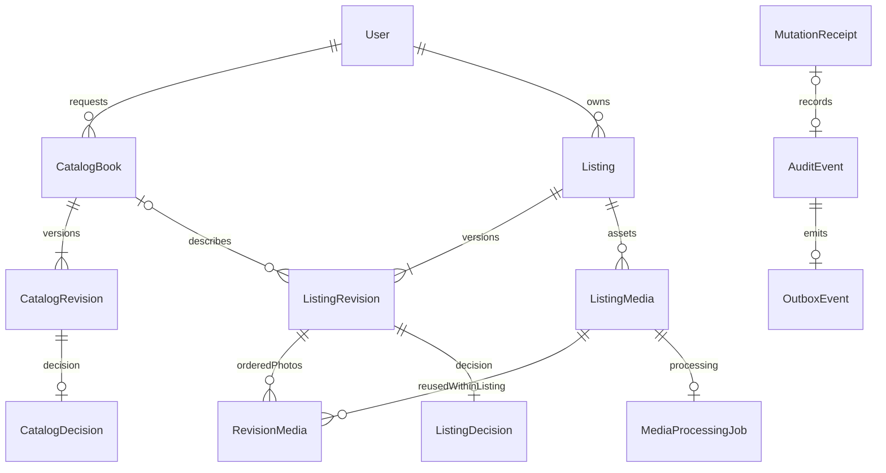

# Contract và dữ liệu catalog–listing

Ngày 26/09/2026 · Mốc 1 của [kế hoạch](LISTING_IMPLEMENTATION_PLAN.md).

Phạm vi nghiệp vụ hiện hành đã chuyển sang [SRS1.1](../SRS_V1_1.md).
Tài liệu này giữ thiết kế catalog/listing ban đầu; point/auction mới là
[thiết kế đích](LOCAL_TRANSACTION_DESIGN.md), chưa có migrations/handlers. Phần
reservation/lock/public predicate phải được mở rộng trước khi nối giao dịch mới.

Cập nhật0.10.0: nơi gửi DirectDelivery gắn revision đã có contract/migration/API/UI;
xem [ADR0015](../adr/0015-listing-delivery-origin.md) và [báo cáo](LISTING_FULFILLMENT_REPORT.md).
Không suy ra quote, giữ sách hay giao hàng đã được triển khai.

**Cập nhật API 0.8.0:** 34 operation đã có handler: 14 catalog/nháp, 7 media của chủ,
6 submit/review/operations media, 3 public listing/media và 4 lifecycle đã có handler. Xem [lifecycle report](LISTING_LIFECYCLE_REPORT.md).
`PublicListing.photos` chỉ chứa id/kích thước; lấy URL ký riêng sau kiểm tra điều kiện
hiện hành. Xem [ADR 0011](../adr/0011-public-shelf.md) và [báo cáo](PUBLIC_SHELF_REPORT.md).
Live Supabase và Android debug/UI emulator đã có bằng chứng; native picker/upload còn chờ.
Xem [catalog/draft report](CATALOG_DRAFT_API_REPORT.md), [media report](MEDIA_UPLOAD_REPORT.md)
và [review report](LISTING_REVIEW_API_REPORT.md).
Các bằng chứng ở mục 7 là kết quả mốc schema ban đầu; báo cáo mới ghi kết quả API.

Nguồn duy nhất cho HTTP là [openapi.yaml](../../packages/api-contract/openapi.yaml).
[Chỉ mục operation](LISTING_API_INDEX.md) giúp tìm request/response; types sinh
ở `packages/api-contract/src/schema.ts`, không sửa tay. Hành vi vẫn theo
[LISTING-SLICE-01](LISTING_SLICE.md). Quyết định kiến trúc: [ADR 0005](../adr/0005-listing-contract-and-storage.md).

## 1. Phân chia contract

- Public: catalog Confirmed, kệ/detail và URL ảnh thuộc revision đang đủ điều
  kiện. `PublicListing` không có nháp, email, địa chỉ hay quyết định kiểm duyệt.
- `/me`: dữ liệu chủ sở hữu, revision history và media. Chỉ đăng nhập không đủ
  để đọc ID của người khác; trả 404 chung cho đối tượng riêng không liên quan.
- `/operations`: catalog dành cho ADMIN; listing dành cho STAFF/ADMIN ACTIVE.
  Quyết định phải độc lập với chủ/người đề nghị, kể cả tài khoản nhiều role.
- Mỗi mutation miền nghiệp vụ trả HTTP 200 + `MutationReceipt`, cả lần đầu và
  replay; không trả 204 khiến client mất version. Header `Idempotency-Replayed`
  cho biết replay; receipt phản ánh thời điểm commit, không thay GET hiện trạng.
- Tất cả mutation có `Idempotency-Key`; command có target hiện hữu cần
  `expectedVersion`. Duyệt cần thêm `revisionId`. Finalize upload dùng version
  **media**, các lệnh listing dùng version **listing**.
- `DraftContent` là full replacement, có thể chưa đầy đủ. `SubmittedContent`
  chặt hơn về text, giá/chế độ, ảnh và lời khai. Client không gửi owner/state.
  Server trim trước validation, đếm Unicode code point; server là thẩm quyền.
  Tạo draft ban đầu chưa gắn mediaId: phải có listingId trước khi xin upload.
  Lịch sử revision trả cả quyết định/lý do tương ứng, không chỉ latestDecision.
- `ListingApiError` dùng enum code rõ ràng, giữ envelope auth cũ tương thích.
  `fieldErrors` là JSON Pointer + code + copy an toàn; không parse chuỗi message.
  Filter chỉ phát `fieldErrors` từ DomainError 422 đã kiểm soát; không truyền raw
  exception qua API. Runtime validator dùng schema OpenAPI trực tiếp.

GET upload-ticket chỉ cấp capability có hạn, không thay trạng thái/version;
do đó không phải mutation nhận receipt. Lệnh tạo upload trả Media receipt rồi
client lấy ticket. Mọi JSON response động `no-store`.

## 2. Mô hình dữ liệu

Catalog request không tạo thêm bảng sao chép metadata: `CatalogBook` là aggregate
ổn định từ Pending tới Confirmed/Rejected; `CatalogRevision` là nội dung từng
lần đề nghị. Resource HTTP `/catalog/requests` là góc nhìn riêng của aggregate.
Điều này giữ nguyên bookId cho listing đang chờ khi catalog được xác nhận.
Metadata mỗi lần gửi bất biến; `CatalogDecision` duy nhất cho revision đó.

| Bảng | Trách nhiệm/ràng buộc chính |
|---|---|
| catalog_books | Chủ đề nghị, version, current revision, status; confirmed ISBN-13 unique |
| catalog_revisions | Metadata bất biến, số revision duy nhất trong book; checksum ISBN |
| catalog_decisions | Một quyết định/revision; không tự duyệt; reject có lý do |
| listings | Chủ bất biến, version, ba chiều state, deletedAt, publishedAt |
| listing_revisions | Nội dung, book, hai giá, mô tả/tình trạng; đóng băng khi submittedAt có giá trị |
| listing_media | Asset thuộc listing duy nhất, version, trạng thái, hash, staging/pinned/derivative keys |
| revision_media | Vị trí 0–7 duy nhất; FK composite buộc revision và ảnh cùng listing |
| listing_decisions | Một quyết định/revision; approve đủ sáu checklist, reject có lý do |
| mutation_receipts | Unique actor + operation + key; hash payload; đúng một FK target listing/book/media |
| audit_events | Append-only, actor/requestId, đúng một target; không lưu raw form hoặc token |
| outbox_events | FK audit duy nhất; payload bất biến; lease/attempts/delivery metadata có thể đổi |
| media_processing_jobs | Một job/media; lease, attempts, completion cho finalize bền vững |

Không có cascade xóa lịch sử. Receipt/audit tham chiếu trực tiếp FK thay vì chỉ
giữ một entityId đa hình không được kiểm tra. JSON trong receipt/audit/outbox là
projection nhỏ; DB kiểm tra dạng object, handler phải kiểm tra schema/allowlist
chi tiết. Không đặt ảnh nháp hoặc signed URL vào outbox/receipt.

Không tạo bảng reservation/checkout/ledger trước nhu cầu. `TradeStatus` giữ từ
vựng SRS, nhưng không có endpoint v0.1 cho người dùng tự đổi trade/custody.

## 3. Trình tự ghi đúng với migration

Prisma không biểu diễn được CHECK, trigger bất biến và deferred constraint;
phần SQL viết tay ở cuối migration là một phần bắt buộc của thiết kế. Không
tái tạo DB bằng `db push` vì sẽ mất các bảo vệ đó.

Tạo listing/catalog dùng một transaction: tạo aggregate với pointer null →
tạo revision → cập nhật `currentRevisionId` trong cùng transaction. Constraint
deferred kiểm tra ở COMMIT; commit pointer null hoặc trỏ revision khác chủ thể
bị chặn. Việc gắn pointer khi tạo không phải mutation thứ hai; version vẫn là 1.

Gửi listing: giữ khóa → kiểm tra draft/ảnh/catalog → gắn đủ `RevisionMedia` →
set submittedAt/ownershipDeclaredAt → tăng aggregate version một lần và chuyển
PendingReview → ghi receipt/audit/outbox → commit. Không tạo revision đã đóng
băng rồi mới cố gắn ảnh: trigger chặn thay ảnh sau khi đóng băng.

Duyệt: insert decision khi aggregate còn PendingReview đúng revision → cập nhật
moderation/version/publishedAt → ghi receipt/audit/outbox → commit. Không đặt
Approved trước rồi mới insert decision. `publishedAt` là lần approve hiện hành,
được cập nhật khi duyệt lại để phục vụ sort mới nhất.

Sửa Approved/Rejected: tạo working revision mới, gắn ảnh giữ lại hoặc ảnh mới,
không ghi đè bản cũ. Sửa Approved phải validate đầy đủ và đóng băng ngay trong
lệnh; từ Rejected có thể lưu Draft để viết tiếp. Duyệt lại catalog tương tự nhưng
catalog revision luôn bất biến ngay khi tạo, không có catalog draft server.

## 4. Khóa, version và idempotency cho handler tiếp theo

DB unique và trigger không thay thế authorization ở service. Thuật toán dưới đây
đã áp dụng cho catalog/nháp qua CommandService; các handler còn lại phải tuân theo
[ADR 0006](../adr/0006-catalog-draft-commands.md) khi được triển khai:

1. Xác thực token/session; xác định target và các ID cần khóa. Không tin ownerId
   của client. Begin transaction và lấy advisory lock cho actor/operation/key.
   Hash collision chỉ được làm chậm lệnh, không được coi hai key là một.
2. Khóa User của actor/chủ theo UUID tăng dần, sau đó session của actor; kiểm tra
   lại phiên, role, status/email. Writer đổi role/status cũng phải khóa cùng User
   trước khi đổi UserRole/User. Guard đọc trước transaction chưa đủ bảo vệ race.
3. Khóa CatalogBook theo UUID, Listing theo UUID, ListingRevision theo UUID,
   ListingMedia theo UUID. Đọc sơ bộ để biết bookId trước khi khóa; sau khóa
   kiểm tra pointer/version không đổi. Nếu tập ID cần khóa thay đổi thì rollback
   và bắt đầu lại đúng thứ tự, không khóa ngược thứ tự giữa chừng.
4. Kiểm tra quyền đọc receipt hiện tại; tra actor/operation/key. Hash canonical
   payload gồm operationId (xác định method/route), path IDs, body đã chuẩn hóa (giữ thứ tự array, sắp object
   keys). Cùng key khác payload: 409 IdempotencyConflict. Đã commit thì trả receipt
   trước khi kiểm tra expectedVersion; phiên bản cũ trong retry là bình thường.
5. Với lệnh mới, kiểm tra version/state/quyền mutation và điều kiện nghiệp vụ,
   ghi dữ liệu + receipt + audit + outbox atomically. Tăng aggregate version đúng
   một lần. Optimistic update phải kiểm tra affected rows; 0 là VersionConflict.
6. Retry deadlock/serialization hữu hạn ở server (tối đa 3 lần), cùng key, không
   gọi storage hay gửi thông báo trong DB transaction. Hết retry: 503, không tự
   phát sinh key khác. Client timeout phải retry cùng ý định/key rồi refetch.

Chỉ cần khóa aggregate/media thực sự liên quan; tất cả writer phải giữ thứ tự
toàn cục trên. Khi cấp lại receipt, quyền đọc không đòi target còn ở state trước
lệnh: actor vẫn có thể đối chiếu kết quả archive đã commit. Quyền review đã bị
thu hồi không được vượt qua bằng replay.

Receipt chưa có cleanup TTL trong demo. HTTP tests hiện chứng minh key cùng actor/
operation, target và canonical body, replay trước kiểm tra version, rollback,
retry hữu hạn và kiểm tra lại quyền/phiên sau khi guard đã chạy.

## 5. Upload và tác vụ nền

Quy định wire: JPEG/PNG/WebP, tối đa **10.000.000 byte**, tối đa 40.000.000 pixel,
một frame. SHA-256 hex lowercase và số byte do client khai; server phải đo lại.
1–8 ảnh gắn trong revision. Baseline bảo vệ tài nguyên v0.1: tối đa 8 upload
Pending/Processing và 80 asset chưa purge mỗi listing, 2 upload đồng thời mỗi
client, 20 upload intents/giờ/actor. Backend quota phải kiểm tra dưới khóa listing;
rate limit cần bộ đếm bền vững/atomic khi implement, chưa có trong schema này.

Theo [ADR 0008](../adr/0008-free-private-media-storage.md), transport hiện tại là
PUT binary qua NestJS, không còn presigned POST MinIO. Token upload 600 giây gắn
actor/session/media; vẫn cần bearer auth. API đo đúng byte/hash, ghi create-only
vào input key riêng tư, rồi recheck quyền và commit acknowledgement. Client không
có credential kho ảnh. Cột stagingKey được giữ để tương thích migration, không
ghi object staging. Supabase không có S3 Versioning; key phía server là bất biến.

Finalize tạo Processing + MediaProcessingJob atomically sau khi upload được xác nhận.
Worker kiểm tra hash/byte lần nữa, decode/kiểm tra/chuẩn hóa hướng/bỏ metadata, ghi derivative key riêng cho mỗi attempt,
rồi transaction đổi Ready và hoàn tất job. Không phục vụ ảnh staging/original.
Processing chưa phải upload thành công; RN poll 2/4/8/15 giây khi màn hình focus,
pause khi background. Failed hiển thị mã an toàn và tạo upload intent mới nếu
người dùng chọn lại; không sửa bytes của asset Ready.

Timeout dự kiến khi implement: JSON 15 giây, upload 120 giây, worker lease 60 giây
có heartbeat, tối đa 3 attempts rồi Failed/ProcessingFailed. Đây là cấu hình,
không phải thời gian xử lý đã đo. Ticket expiry và upload expiry 24 giờ khác nhau.
Orphan chỉ purge sau 24 giờ cộng khoảng an toàn và không còn `RevisionMedia`; metadata giữ để receipt
còn FK. Không tự xóa ảnh đang nằm trong bản nháp đã lưu. Có giữ chỗ dung lượng
toàn hệ thống và tombstone trước khi xóa vật lý; chỉ trả dung lượng sau khi xóa thành công.
Sharp và HTTP/DB được kiểm thử; kết nối Supabase thật còn chờ cấu hình.

Outbox/job claim bằng `FOR UPDATE SKIP LOCKED`, lease và attempts trong PostgreSQL.
Crash sau external side effect phải retry theo event/media ID; consumer dedupe
bằng event ID. Redis nếu thêm sau không là nguồn sự thật của trạng thái job.
Chưa có notification/matching consumer; không tự đánh dấu event delivered nếu
chưa có consumer thật. Worker lifecycle/delivery tests còn ở mốc API.

## 6. Tìm kiếm và phân trang

Contract chốt `limit` 1–50, mặc định 20; cursor opaque base64url, ràng buộc filter,
sort và caller scope. Cursor malformed/mismatch trả 400. Server không tin cursor
để bỏ authorization; kiểm tra đủ eligibility mỗi trang. Dùng keyset và ID phân
giải trùng; không hứa snapshot khi dữ liệu thay đổi.

Sort mới nhất `(publishedAt,id)` DESC; sort giá `(giá,id)` cùng hướng, loại giá
null; hai cặp min/max giá áp AND, min > max trả 422. Tìm tên/tác giả bỏ khác biệt
hoa thường/dấu và chuyển đ/Đ khi chuẩn hóa `searchText`; escape `%`, `_`, `\` khi
LIKE để query là text literal. ISBN so theo canonical ISBN-13 sau check digit.
Catalog sort theo normalized title + ID; text sort này sẽ cần chỉ mục/query riêng
khi implement nếu kế hoạch query cho thấy scan lớn.

Index hiện có bảo vệ owner paging, moderation/public sort, giá từng revision,
book FK, thứ tự submit, media cleanup, worker queue và unique identifiers.
Substring search không được btree tăng tốc. Mốc API phải EXPLAIN trên dữ liệu
tham chiếu rồi cân nhắc pg_trgm/GIN; mốc này chưa cài extension, chưa tuyên bố đạt
p95 của SRS. Không tạo search service bên ngoài trước khi có số đo.

## 7. Bằng chứng đã chạy và giới hạn

Môi trường local: Windows, PostgreSQL 17.10 tại loopback 55432 (Docker Desktop
không hoạt động); database mới `latlai_listing_20260926_test`. Không migrate DB
dev/chung, không chạy seed hoặc thay mật khẩu. E2E schema tests tạo một schema
`listing_test_<uuid>` riêng và chỉ xóa schema do chính run tạo.

| Kiểm tra | Kết quả ngày 26/09/2026 |
|---|---|
| Prisma format/validate/generate | Đạt |
| Migrate deploy đầy đủ lịch sử trên DB test sạch | Đạt cả auth và listing migration |
| Introspection diff DB vừa migrate so với Prisma schema | Không khác biệt; custom SQL được test riêng |
| `pnpm contract:check` | Đạt, types đồng bộ |
| API unit tests | 9/9: 7 contract tests mới + 2 hiện có |
| API E2E | 22/22: 13 schema tests mới + 9 auth/health hiện có |
| API lint/typecheck/build; RN typecheck | Đạt |

Schema tests kiểm tra nâng từ auth còn nguyên dữ liệu; aggregate không mồ côi;
version/owner; giá và SQL null; ảnh khác listing; revision/ảnh bất biến; nội dung
gửi đầy đủ; self-review/catalog chưa Confirmed; hai connection thực sự chờ cùng
khóa; unique receipt cạnh tranh; rollback; audit/outbox bất biến; checksum ISBN
và bản ISBN-10/13 trùng; không purge ảnh đang tham chiếu.

Chưa chạy 32 ca nghiệp vụ LS-AC qua HTTP/UI vì chưa có handler. Role/status race,
storage fault injection, media worker, public eligibility query, hashing/replay
end-to-end và native vẫn cần implement/test. DB trigger không chứng minh các
permission check này đã tồn tại. Không có native build hoặc thay đổi UI trong mốc này.
