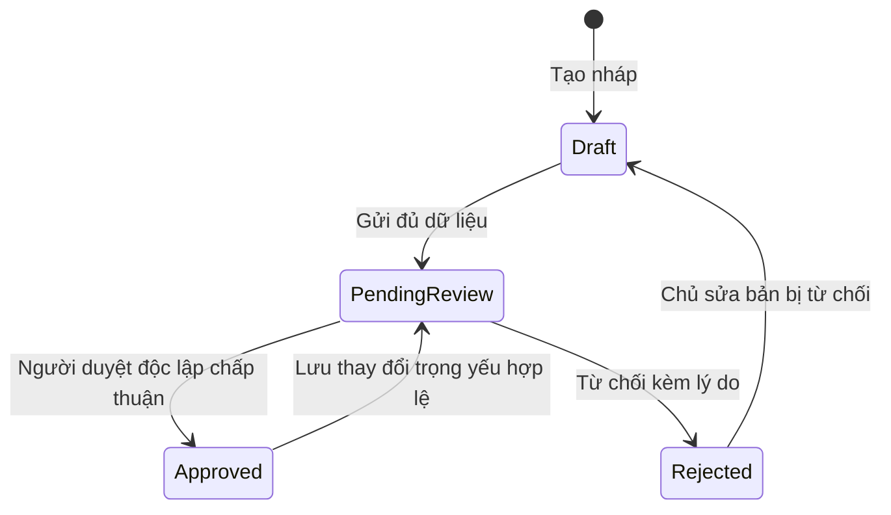

# Đăng sách, kiểm duyệt và đưa lên kệ

Mã: LISTING-SLICE-01 · Phiên bản 0.3 tài liệu · Cập nhật 27/09/2026.

**Trạng thái:** catalog, nháp, media, moderation và public listing có API thật;
RN và web vận hành đã nối luồng đăng/duyệt/xem và lifecycle sau duyệt. Native
workflow QA còn thiếu. [SRS1.1](../SRS_V1_1.md) và [phụ lục](LOCAL_HANDOVER_AUCTION.md)
là baseline nghiệp vụ hiện hành. Chủ dự án đã duyệt hướng TP.HCM/giữ ship/hai điểm/
đấu giá; quy tắc chi tiết được nhóm cụ thể hóa theo ủy quyền. SRS1.0 lưu trữ giữ nguyên.

## 1. Kết quả cần đạt

Một Member lưu bản nháp của **một cuốn sách vật lý**, thêm ảnh thật, gửi duyệt;
Staff độc lập xem đúng phiên bản và quyết định; listing được duyệt xuất hiện trên
kệ và trang chi tiết. Nếu bị từ chối, chủ sách thấy lý do, sửa và gửi lại. Tải lại
app vẫn đọc được dữ liệu đã lưu ở máy chủ.

React Native phục vụ Member. Một màn hình web vận hành tối thiểu phục vụ Staff
và Admin; không đưa quyền duyệt vào app Member. Duyệt bằng cập nhật SQL hoặc seed
không được tính là hoàn thành luồng.

**Trong lát cắt:** chọn/đề nghị đầu sách, Admin xác nhận đầu sách, lưu nháp, quản lý
ảnh, gửi/duyệt/từ chối, sửa sau duyệt, ẩn/mở, soft delete, gỡ có lý do khi chưa có
giao dịch, danh sách của tôi, tìm/lọc/phân trang và chi tiết công khai.

**Chưa trong lát cắt:** checkout, reservation thật, mua/đổi, tiền, vận chuyển,
dispute, rating, forum, wishlist/matching, thông báo push/email, gộp catalog và
banner, giao nhận tại điểm và đấu giá. Chúng thuộc SRS1.1 nhưng chưa thuộc lát cắt
listing đang triển khai. Không hiện nút mua/đổi/đấu giá hoạt động giả. `Sale/Exchange/Both` mới thể hiện
ý định của người đăng. Không tuyên bố hoàn thành toàn bộ FR-C/FR-L hoặc SRS.

## 2. Nguồn quyết định và hiện trạng

| Nguồn | Áp dụng |
|---|---|
| [SRS1.1](../SRS_V1_1.md), FR-C01–C06, FR-L01–L08, UC-02 | Catalog khác listing; duyệt trước công khai; trường dữ liệu và quyền |
| SRS §7.2, BR-01–BR-09 | Ba chiều trạng thái; một hiện vật; phiên bản và ranh giới reservation |
| SRS POL-16, §11.3 | 10.000–1.000.000 VND; 1–8 ảnh; mô tả 30–5.000 ký tự |
| SRS §2.5, §4, §12.2, AC-04–AC-06 | Cấm tự duyệt; quyền server; xung đột phiên bản; nghiệm thu |
| [Đối chiếu nguồn](../deliverables/Bao_cao_so_sanh_nghiep_vu.md), §2.2, §5.2 | Không dùng Available ngay sau khi đăng như bản nguồn cũ |
| [ADR 0003](../adr/0003-react-native-auth-foundation.md), AGENTS.md | RN trước; API dùng chung; session và quyền hiện hành |
| [Luật UI](../design/UI_CODING_RULES.md) | Giữ nhận diện, trạng thái lỗi đúng nơi, không bịa tín hiệu tin cậy |

Tại thời điểm viết bản 0.1 (25/09), Prisma mới có User/UserRole/AuthSession/LoginAttempt; OpenAPI
mới có health/auth. `features/design-preview/model.ts` là fixture, không phải
domain model. Form mẫu chưa có lưu nháp server, upload, revision hay kiểm duyệt;
validation mô tả mới kiểm tra không rỗng và `missingPages` còn gộp hai ý khác nhau.
Không dùng nguyên form mẫu làm bằng chứng đã đáp ứng SRS.

Cập nhật 27/09: [API catalog/nháp](CATALOG_DRAFT_API_REPORT.md), [media/worker](MEDIA_UPLOAD_REPORT.md)
và [submit/moderation](LISTING_REVIEW_API_REPORT.md), [kệ công khai](PUBLIC_SHELF_REPORT.md) đã triển khai. [Thiết kế bổ sung](LOCAL_TRANSACTION_DESIGN.md)
yêu cầu fulfillment options/vùng, shared commitment và badge inspection trong các
increment tiếp theo; chưa có các field đó ở OpenAPI0.8.0.

SRS gốc ghi phạm vi web; quyết định RN-first ở ADR 0003 là hướng triển khai hiện
hành. SRS ghi hạn chế tài khoản rộng hơn auth hiện có: LOCKED hiện không được xác
thực. Lát cắt này không thay auth hoặc tuyên bố đã hỗ trợ nghĩa vụ giao dịch cũ.

## 3. Quyết định cụ thể cho bản 0.1

| Mã | Quyết định | Cơ sở và giới hạn |
|---|---|---|
| LS-D01 | Giữ ba chiều moderation, visibility, trade | Theo SRS §7.2; không tạo enum trạng thái gộp |
| LS-D02 | Nháp lưu server bằng hành động “Lưu bản nháp”; không hứa autosave/offline sync | Bổ sung cách lưu rõ ràng; chỉ báo đã lưu sau server xác nhận |
| LS-D03 | Gửi catalog chưa xác nhận vẫn vào PendingReview; không được duyệt listing trước catalog | Diễn giải “catalog chưa duyệt giữ chờ” ở UC-02; queue ghi rõ đang chờ đầu sách |
| LS-D04 | Không sửa trực tiếp nội dung PendingReview; chờ quyết định để sửa bản bị từ chối | Bổ sung để Staff không duyệt một nội dung đang thay đổi; rút yêu cầu chưa thuộc v0.1 |
| LS-D05 | Lưu thay đổi trọng yếu của Approved đồng thời tạo revision PendingReview, ngừng công khai | Theo FR-L04; bản cũ giữ lịch sử, không tiếp tục nhận giao dịch |
| LS-D06 | Dùng POL-16 từ 10.000 đến 1.000.000 VND, số nguyên, cho từng giá bắt buộc | Baseline SRS và preview hiện tại; chưa phải chứng nhận giá thị trường |
| LS-D07 | Guest chỉ xem projection đủ điều kiện; URL khác trả 404 chung | Theo FR-C05 và nguyên tắc không lộ bản nháp/lý do kiểm duyệt |
| LS-D08 | Removed và soft-deleted không có thao tác tự khôi phục trong v0.1 | Không cho chủ sách vượt quyết định gỡ; chưa xây quy trình khiếu nại nội dung |
| LS-D09 | Không tự duyệt cả catalog do mình đề nghị lẫn listing của mình | Listing theo SRS; catalog là kiểm soát bổ sung cho đường xác nhận đầu sách |

Thay baseline phải ghi mã quyết định bị đổi và sửa ca nghiệm thu trước khi viết
contract. Không phải xin duyệt lại các lựa chọn triển khai thông thường; các giá
trị chính sách dùng baseline SRS1.1, không trình bày như cam kết vận hành thương mại.

## 3a. Điểm nối với SRS1.1

- Duyệt listing không phải kiểm tra hiện vật hay chứng nhận chính hãng; dùng đúng
  nhãn FR-T01–03. `ownershipDeclared` vẫn chỉ là lời khai.
- Khi bổ sung fulfillment options, người đăng chọn DirectDelivery/ViaPoint và các
  điểm có thể gửi; điểm/người trả phí được snapshot lúc giao kết, không ở catalog.
- Auction áp dụng Sale, là workflow riêng sau intake/Pass, không thêm giá trị Auction
  vào mode hoặc coi `trade=Available` là điều kiện public auction đang Active.
- Predicate public mua/đổi phải loại commitment/custody obligation khi miền giao
  dịch được triển khai. API draft hiện không được tuyên bố bảo vệ reservation chưa tồn tại.
- Thay contract/schema theo từng increment; không gắn label “đã kiểm tra” bằng fixture.

## 4. Dữ liệu bắt buộc và kiểm tra đầu vào

Nháp được thiếu trường, nhưng trường đã có vẫn phải đúng kiểu, giới hạn và quyền
sở hữu ảnh. Khi gửi hoặc sửa Approved, kiểm tra đầy đủ trong cùng lệnh server.
Riêng độ dài tối thiểu của text chỉ áp dụng khi gửi: bản nháp được lưu câu đang
viết dở, nhưng vẫn bị giới hạn độ dài tối đa. Giá đã nhập thành số vẫn phải hợp
lệ; ô giá chưa nhập được lưu null. Chuỗi đang gõ chưa parse được chỉ giữ ở form,
không báo đã lưu phần giá đó.

| Dữ liệu | Quy tắc tại thời điểm gửi |
|---|---|
| Đầu sách | `bookId` tồn tại: Confirmed hoặc đề nghị Pending của chính chủ; không dùng yêu cầu riêng của người khác |
| Catalog đề nghị | Tên 1–300; tác giả, ngôn ngữ, thể loại bắt buộc; ấn bản, NXB, năm, ISBN được để trống khi không biết; không bịa metadata |
| ISBN | Bỏ khoảng trắng/dấu gạch nối, kiểm tra ISBN-10/13 và check digit; không có ISBN vẫn hợp lệ; ISBN trùng đưa về đầu sách hiện có, không tự tạo bản trùng |
| Ảnh | 1–8 ảnh thật của hiện vật; thứ tự rõ, ảnh đầu là ảnh bìa; tất cả thuộc chủ, đã xử lý thành Ready và thuộc listing này |
| Tình trạng | Một trong LikeNew/Good/Fair/Worn, hiển thị Như mới/Tốt/Khá/Cũ |
| Chi tiết tình trạng | Trang, bìa, ghi chú, phụ kiện: mỗi phần 1–1.000 ký tự sau trim; ghi rõ “Không có” nếu áp dụng |
| Khả năng đọc | `readable=true`, khai riêng `hasMissingPages` và `missingEssentialContent=false`; thiếu trang phải mô tả; thiếu phần trọng yếu hoặc không đọc được bị chặn |
| Mô tả | 30–5.000 ký tự sau trim; plain text, giữ dấu; không render HTML |
| Chế độ/giá | Sale: salePrice bắt buộc, exchangeValue=null; Exchange ngược lại; Both cần cả hai; không suy luận giá này từ giá kia |
| Xác nhận | `ownershipDeclared=true` trước gửi; ghi người và thời gian; đây là lời khai, không phải xác minh quyền sở hữu |

Giới hạn 1–1.000 cho chi tiết tình trạng là bổ sung kỹ thuật v0.1. Đếm ký tự
Unicode code point nhất quán client/server; kiểm tra server là quyết định cuối.
Tiền là số nguyên VND, không float, không nhận chuỗi đã có dấu phân cách từ API.
Giá nằm ngoài chế độ phải là null; đổi chế độ cần UI giải thích giá nào sẽ bỏ.
Không có `quantity`, không cho client gửi `ownerId`, reviewer hoặc state tùy ý.

Catalog Pending/Rejected là riêng tư với người đề nghị và người vận hành đủ
quyền. Admin duyệt/từ chối có lý do, theo version. Yêu cầu bị từ chối cho người
đề nghị sửa và gửi lại; listing liên quan vẫn chờ, không tự Approved. Metadata
Confirmed chưa được sửa/gộp trong v0.1; tránh thay nội dung đã duyệt gián tiếp.
Các giới hạn độ dài metadata còn lại phải chốt trong OpenAPI bước tiếp theo.

## 5. Trạng thái và phiên bản

| Chiều | Giá trị | Ý nghĩa |
|---|---|---|
| Moderation | Draft, PendingReview, Approved, Rejected | Kết quả với revision hiện hành |
| Visibility | Visible, Hidden, Removed | Visible là ý định công khai, không tự chứng minh được lên kệ |
| Trade | Available, Reserved, Sold, Exchanged, ClosedUnavailable | v0.1 tạo Available, không cung cấp API tự đổi trạng thái giao dịch |
| Xóa mềm | deletedAt hoặc null | Chặn public và mọi mutation tiếp theo; giữ lịch sử |

Mặc định listing mới: Draft + Visible + Available + deletedAt=null. Draft vẫn
riêng tư. Không gán custody đã xác minh chỉ từ checkbox quyền sở hữu.

Sơ đồ chỉ mô tả moderation. Hidden/Removed/trade/deletedAt là các điều kiện độc
lập, không phải mũi tên tắt để bỏ kiểm duyệt.

**Điều kiện lên kệ và public detail:** revision hiện hành Approved, visibility
Visible, trade Available, chưa xóa, catalog Confirmed, ảnh Ready, chủ có MEMBER,
đã xác minh email và trạng thái ACTIVE. Chỉ Approved revision được serialize ra
public; lịch sử và dữ liệu nháp không nằm trong response này. Cả truy vấn danh
sách và detail áp dụng cùng predicate ở server; không chỉ lọc phía client.

**Hai loại version:** `version` tăng ở mỗi mutation listing; `revisionNumber`
tăng khi nội dung thay đổi. Một lệnh gửi `expectedVersion`; quyết định duyệt gửi
thêm `revisionId`. Draft có thể sửa revision làm việc; khi gửi, nội dung revision
được đóng băng. Sửa Rejected/Approved tạo revision mới, không ghi đè bản đã gửi,
ảnh hoặc lý do cũ. `approvedRevisionId` lịch sử không khiến bản cũ được công khai
khi current revision đang chờ. Một revision chỉ có một quyết định cuối.
Gửi lại từ Rejected luôn tạo revision mới, kể cả khi nội dung không thay đổi;
không tái sử dụng revision đã có quyết định. Đổi nội dung trọng yếu yêu cầu xác
nhận lại lời khai quyền đăng cho revision mới.

## 6. Quyền và chuyển trạng thái

Mọi lệnh cần xác thực trừ public reads đã khai báo `@Public()`. Role không có
phân cấp ngầm: Staff/Admin cần thêm MEMBER để đăng sách. TEST_OPERATOR không được
duyệt trừ khi có role vận hành tương ứng và thỏa điều kiện độc lập.

| Lệnh | Actor và điều kiện | Thay đổi nguyên tử |
|---|---|---|
| Tạo/lưu nháp | MEMBER ACTIVE đã xác minh; sửa là chủ; Draft/Rejected | Lưu trường hợp lệ, tăng version; Rejected → Draft, giữ lịch sử lý do |
| Gửi duyệt | Chủ đủ điều kiện; Draft/Rejected; đầy đủ nội dung/ảnh | Đóng băng revision, PendingReview, version++, audit |
| Approve | STAFF hoặc ADMIN ACTIVE; không là chủ; PendingReview đúng revision; catalog Confirmed, chủ vẫn đủ quyền | Approved, quyết định, version++, audit, outbox |
| Reject | Người duyệt độc lập như trên; PendingReview; lý do 10–1.000 ký tự | Rejected, quyết định/lý do, version++, audit, outbox; chủ bị hạn chế vẫn có thể nhận quyết định từ chối |
| Sửa Approved | Chủ ACTIVE; Available; chưa Removed/xóa; không reservation/nghĩa vụ giao dịch | Validate đầy đủ rồi tạo revision PendingReview; giữ visibility hiện tại; version++, audit |
| Ẩn | Chủ có phiên hợp lệ, ACTIVE hoặc RESTRICTED; Approved + Available + Visible; không reservation | Hidden, version++, audit |
| Mở lại | Chủ ACTIVE; Approved + Available + Hidden, catalog/ảnh còn hợp lệ | Visible, version++, audit; không bỏ bước duyệt |
| Xóa mềm | Chủ có phiên hợp lệ, ACTIVE hoặc RESTRICTED; Available; không reservation/nghĩa vụ giao dịch; chưa Removed/xóa | deletedAt, version++, audit; quyết định duyệt đang mở không còn được commit |
| Gỡ công khai | STAFF/ADMIN ACTIVE độc lập; current revision đã submit; chưa Removed/xóa; có lý do; trong v0.1 không có giao dịch | Removed, version++, audit, outbox; không đổi moderation/trade |

Member RESTRICTED được xem nháp/lý do và ẩn/xóa theo bảng; không tạo/sửa/gửi mới
hoặc mở lại. LOCKED/DISABLED hiện bị auth chặn. Danh sách vận hành và ảnh riêng
chỉ cho STAFF/ADMIN ACTIVE theo nhiệm vụ; không cấp cho mọi tài khoản đăng nhập.

Không hỗ trợ mutation trên Sold/Exchanged/ClosedUnavailable. Reserved không cho
chủ sửa/ẩn/xóa, kể cả qua endpoint cũ. Khi triển khai giao dịch sau này, gỡ bài
đang có giao dịch phải đi qua service điều phối hồ sơ/hủy an toàn theo FR-L07;
không chỉ cập nhật Removed rồi coi như đã xử lý giao dịch. Không expose luồng này
trước khi service đó có thật.

## 7. Cạnh tranh, retry và audit

- Kiểm tra version, state, quyền sở hữu, role/status hiện tại, catalog và ảnh
  **trong transaction**, không chỉ ở guard. Cập nhật có điều kiện hoặc khóa DB;
  hai người duyệt cùng version chỉ một người thành công, người kia nhận 409.
- Account eligibility và catalog cũng phải được bảo vệ trước ghi cạnh tranh.
  Chốt thứ tự khóa dùng chung cho cả lệnh thay role/status và listing trong bước
  thiết kế dữ liệu; chỉ đọc ACTIVE rồi ghi listing sau đó là chưa đủ. Public
  read vẫn kiểm tra trạng thái chủ hiện tại sau khi chủ bị hạn chế.
- Duyệt, xóa và sửa cạnh tranh không được tạo tổ hợp nửa thành công. Ghi dữ liệu,
  quyết định, audit và outbox cùng transaction; rollback tất cả nếu lỗi DB.
- Mọi mutation dùng Idempotency-Key UUID do client tạo cho **một ý định**. Scope
  theo actor + operation + key; unique ở DB. Cùng key/payload trả receipt của
  lệnh trước, không chạy lại; khác payload trả 409. Kiểm tra xác thực/quyền hiện
  tại trước trả receipt; receipt chỉ chứa ID và version đã commit, không trả
  nội dung riêng tư cũ. Sau replay, client fetch trạng thái hiện tại.
- Retain receipt suốt lát cắt demo, chưa cleanup để tránh duplicate sau timeout.
  Hai request đồng thời cùng key chỉ có một hiệu ứng và một audit/outbox. Nếu
  client mất key thì phải đối chiếu dữ liệu trước tạo lệnh mới; không hứa phát
  hiện một cuốn vật lý bị đăng hai lần với hai key khác nhau.
- Thứ tự xử lý retry: xác thực/quyền truy cập → tra key và so payload → nếu đã
  commit thì trả receipt; chỉ lệnh chưa xử lý mới kiểm tra expectedVersion và
  điều kiện chuyển trạng thái. Không kiểm tra version cũ trước receipt rồi biến
  một retry hợp lệ thành conflict. Quyền truy cập receipt không đòi đối tượng
  phải còn ở trạng thái trước lệnh; receipt xóa vẫn đọc được bởi đúng actor có
  phiên hợp lệ, nhưng không chứa nội dung đã xóa.
- Lưu audit append-only: actor, entity, revision, trước/sau, lý do, requestId,
  thời gian server. Không ghi token hoặc raw body. Revision lưu nội dung cần
  review; audit tham chiếu revision thay vì sao chép toàn bộ ảnh/nội dung.
- Outbox lưu các sự kiện tối thiểu ListingSubmitted/Approved/Rejected/Removed;
  đây là nền cho notification/matching sau này. v0.1 cập nhật qua refetch/poll
  khi màn hình có focus; chưa hứa gửi push/email hay SLA notification của SRS.

## 8. Ảnh và riêng tư

Kho tệp hiện hành: Supabase Storage riêng tư theo [ADR0008](../adr/0008-free-private-media-storage.md),
thay lựa chọn MinIO ban đầu; metadata và quyền ở PostgreSQL. Upload qua API có xác
thực, finalize và worker Sharp đã triển khai. Yêu cầu hành vi dùng chung RN/Flutter/web:

1. Tạo upload thuộc user và listing nháp; object key ngẫu nhiên, không nhận URL
   tùy ý từ client để server tải hộ. Upload chưa hoàn thành không tính là ảnh.
2. Kiểm tra nội dung thực, decode ảnh, giới hạn 10 MB/tệp, JPEG/PNG/WebP, tối đa
   40 megapixel sau decode (giới hạn bổ sung v0.1). Từ chối ảnh hỏng, sai loại,
   ảnh nhiều frame hoặc vượt giới hạn; không chỉ tin MIME/đuôi file.
3. Chuẩn hóa hướng ảnh rồi bỏ EXIF/metadata vị trí khỏi bản hiển thị. HEIC trên
   thiết bị phải được chuyển thành định dạng hỗ trợ hoặc báo cách chọn lại;
   không báo upload thành công cho file server không đọc được.
4. Chỉ ảnh Ready gắn đúng listing mới được gửi. Giữ ảnh của revision đã gửi bất
   biến; thay ảnh là object mới. Không xóa object còn được revision tham chiếu.
5. Bucket không public. API cấp quyền đọc ảnh nháp cho chủ/người vận hành phù
   hợp; người duyệt chỉ đọc ảnh gắn revision đã gửi, có audit. Ảnh public chỉ cấp
   qua listing còn đủ điều kiện (endpoint public đã triển khai). URL ký hiện tại 120 giây,
   không đưa key riêng hoặc URL nháp vào public DTO. Gỡ bài chặn cấp URL mới;
   URL đã cấp có thể còn dùng tới hạn, không hứa thu hồi tức thì trên máy đã tải.
6. Upload lỗi cho retry riêng từng ảnh; xử lý file storage/DB không nguyên tử
   bằng trạng thái Pending/Processing/Ready/Failed và job dọn orphan sau 24 giờ
   nếu không có tham chiếu. Dọn lặp phải an toàn; không xóa revision đã gửi.

## 9. Luồng màn hình và phản hồi

| Màn hình | Nội dung/hành động | Trạng thái quan trọng |
|---|---|---|
| Kệ sách | Tìm tên/tác giả/ISBN, lọc chế độ/tình trạng/giá; card ảnh thật | Loading khác empty; lỗi refresh giữ dữ liệu cũ và báo chưa cập nhật |
| Chi tiết | Ảnh nguyên tỷ lệ, lỗi sách cụ thể, giá bán/đổi tách, tên người đăng | 404 khi không còn public; không bịa rating, số giao dịch, huy hiệu hay nút mua giả |
| Sách của tôi | Nháp/chờ duyệt/bị từ chối/đã duyệt/đã ẩn/bị gỡ | Nhãn từ tổ hợp trạng thái; mở lý do không cần modal |
| Đăng/sửa | Chọn catalog → ảnh/tình trạng → chế độ/giá/mô tả → xem lại/xác nhận | Lưu nháp rõ trạng thái; lỗi field, ảnh riêng; giữ nội dung chưa lưu trong phiên |
| Đề nghị đầu sách | Metadata, ISBN hoặc không ISBN, trạng thái xét | Catalog trùng gợi ý chọn đúng; không tạo listing khác chỉ để vượt kiểm duyệt |
| Hàng chờ vận hành | Bộ lọc, chủ, revision, tuổi yêu cầu, chờ catalog | Empty khác lỗi tải; refetch sau quyết định; 409 bắt buộc đọc phiên bản mới |
| Review | Toàn bộ ảnh/tình trạng/giá/catalog, checklist, lịch sử; duyệt/từ chối | Không tự duyệt; lý do bắt buộc khi từ chối/gỡ; thất bại giữ dữ liệu và dialog |

Checklist review phải có bằng chứng đọc được: catalog/ấn bản đúng; ảnh thật rõ;
trang/bìa/lỗi khai đủ; sách đọc được; chế độ và giá hợp lệ; nội dung phù hợp.
Staff không sửa giá thay chủ. Nếu chưa đủ căn cứ, từ chối nêu yêu cầu bổ sung,
không gắn “đã xác minh sách” chỉ vì đã duyệt nội dung.

Nhấn rời form có thay đổi chưa lưu: cho ở lại, lưu nháp, hoặc bỏ thay đổi cục bộ;
không gọi DELETE server khi chỉ bỏ chỉnh sửa. Đang gửi thì chặn nhấn trùng. Timeout
không được khẳng định “chưa gửi”: hiển thị đang kiểm tra kết quả, dùng lại key để
đối chiếu. 401 đi qua session owner; 403 dừng lệnh; 409 giữ bản nhập để đối chiếu,
không tự ghi đè; 422 đặt lỗi đúng field; 429 chờ; 5xx/network cho retry có key.
TanStack Query quản lý server data; không tự persist query cache chứa nháp/ảnh
riêng. Chỉ ghi “Đã lưu” với dữ liệu server đã xác nhận, không hứa giữ qua crash
cho thay đổi chưa lưu.

Nhãn chính trong Sách của tôi ưu tiên: đã xóa → bị gỡ → trạng thái giao dịch đã
đóng/giữ chỗ → chờ duyệt/bị từ chối/nháp → đã ẩn → đang trên kệ. Trạng thái phụ
vẫn hiện khi có ý nghĩa, ví dụ “Chờ duyệt · Đang ẩn”. Approved nhưng chủ bị hạn
chế hiển thị “Đã duyệt · Tạm ngừng hiển thị”, không gọi là đang trên kệ. Không
đổi enum server chỉ để tạo một badge đơn giản hơn.

## 10. Ranh giới API và tiêu chí bàn giao

Đây là yêu cầu hành vi, **chưa phải OpenAPI thứ hai**. Bước tiếp theo mới sửa
`packages/api-contract/openapi.yaml`, generate types rồi implement. Cần operation
cho public catalog/listings/detail; catalog requests và Admin decisions; listing
của tôi/draft/edit/submit/visibility/delete; review queue/detail/decision/removal;
upload/finalize/read media. Private và public DTO phải tách rõ.

Reads có phân trang ổn định theo sort key + ID; giá bán và giá trị đổi là hai
filter/sort khác nhau, giá null không bị coi bằng 0. Mọi trang áp lại predicate
eligibility; cursor không đóng băng quyền hoặc bảo đảm snapshot khi dữ liệu đổi.
Không trả email, địa chỉ, private revision hay reviewer notes ra public.
v0.1 dùng `Cache-Control: no-store` cho JSON listing/catalog động và response
riêng; không đặt cache CDN khiến bài đã gỡ còn được API trả như đang public.
TanStack Query có thể giữ dữ liệu trong phiên nhưng phải refetch khi focus và
sau mutation; server vẫn là nguồn quyết định khả dụng.

Writes trả ID, version, revisionId khi phù hợp, trạng thái và serverTime. Lỗi
giữ envelope hiện có (`statusCode/code/message/requestId`); cần thiết kế thêm
fieldErrors typed trong contract, không parse message. Phân biệt 401, 403, 404,
409 version/state/idempotency, 422 validation, 413 file lớn, 415 sai loại, 429.
Đối tượng riêng của người khác trả 404; không có role vận hành trả 403.

Nghiệm thu theo [ma trận ca kiểm thử](LISTING_ACCEPTANCE.md) và
[thứ tự triển khai](LISTING_IMPLEMENTATION_PLAN.md). Chỉ coi hoàn thành khi
Member và Staff đi được luồng thật, dữ liệu qua restart còn đúng, ca quyền/race
đạt và có bằng chứng native. Tài liệu, fixture và export không thay thế các mốc đó.
