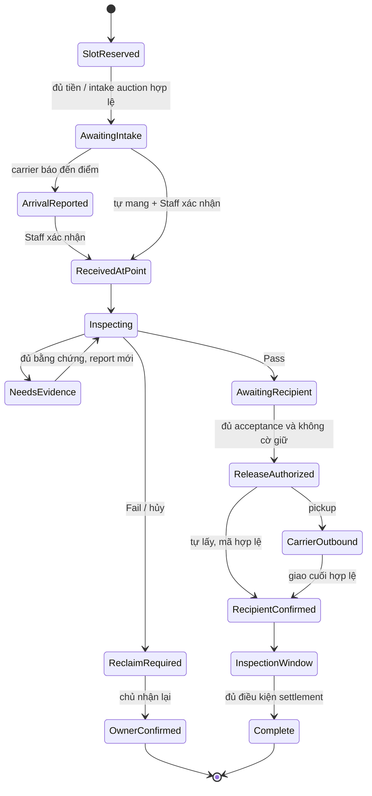
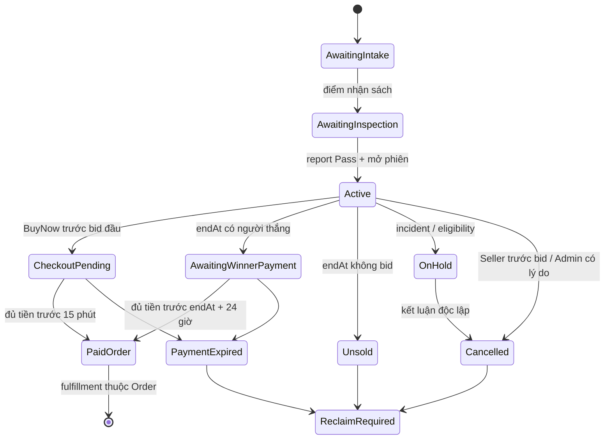

# Thiết kế logic cho giao nhận nội thành và đấu giá

Ngày 26/09/2026 · Thiết kế đích của [SRS 1.1](../SRS_V1_1.md), chưa là schema/API đã triển khai.
Quy tắc chuẩn nằm ở [LOCAL-AUCTION-01](LOCAL_HANDOVER_AUCTION.md). Không sửa Prisma/OpenAPI
để đánh dấu các luồng này implemented trước khi có handler và kiểm thử.

Cụ thể hóa ngày 27/09/2026: [ADR 0013](../adr/0013-exclusive-commitment-foundation.md),
[thiết kế cam kết](COMMITMENT_DESIGN.md), [32 ca CM-AC](COMMITMENT_ACCEPTANCE.md) và
[thứ tự triển khai](TRANSACTION_FOUNDATION_PLAN.md). Các tài liệu này chốt thêm
cardinality, lock order, system principal và deadline; vẫn là thiết kế, chưa có API.

## 1. Ranh giới miền nghiệp vụ

| Module dự kiến | Sở hữu | Phối hợp bắt buộc |
|---|---|---|
| service-area / points | Vùng phục vụ, điểm, assignment, lịch và capacity slots | Booking nguyên tử với giao dịch, kiểm tra current assignment |
| catalog / listings | Đầu sách, hiện vật, revision, duyệt thông tin | Không nhầm Approved với inspection Pass; eligibility dùng exclusive commitment |
| reservations | Cam kết độc quyền listing xuyên Order/Exchange/AuctionIntake | Một unique constraint chung, chuyển chủ cam kết nguyên tử |
| custody / inspections | Receipt nhận, vị trí lưu, report, handover, incident | Event carrier không thay Staff receipt; nhận cuối cùng thông báo transactions |
| auctions | Phiên, bid/manual/Auto, thứ tự, người thắng | Chỉ tạo Order qua OrdersService, không sửa bảng tiền hoặc Order trực tiếp |
| orders / exchanges | Snapshot thỏa thuận, obligation, barrier release, inspection window | Ledger và reservations qua dịch vụ rõ ràng trong cùng DB transaction |
| shipments | Chặng có origin/destination, payer, fee snapshot, carrier events | FeeHold, pickup, custody; self handover không tạo tracking giả |
| wallet / ledger | Hold, journal, carrier settlement, quỹ incident | Atomic, idempotent, không coi Redis là nguồn số dư |
| disputes / incidents | Claim giao dịch hoặc intake, kết luận, loss reference | Giữ settlement/release, nguồn allocations có thật, người xử lý độc lập |

Module có thể gộp triển khai ban đầu khi cùng trách nhiệm; bảng này quy định quyền
sở hữu dữ liệu, không yêu cầu tạo microservice hoặc module rỗng ngay hôm nay.

## 2. Thực thể và ràng buộc bổ sung

| Thực thể logic | Trường chính | Bất biến |
|---|---|---|
| ServiceAreaVersion | code, label, locality IDs, effectiveAt | Snapshot ID/version; vùng phục vụ tách khỏi cư trú tài khoản |
| HandoverPoint | serviceAreaId, displayAddress, hours, capacity, status, demoOnly | Active/Paused/Closed; no coordinates giả; không xóa khi còn custody |
| PointStaffAssignment | pointId, userId, validFrom/To | Role STAFF và assignment hiện hành; không xử lý hồ sơ mình tham gia |
| ListingFulfillmentOptions | listingRevisionId, directAllowed, eligiblePointIds | Đổi lựa chọn khi có cam kết bị chặn; chốt vào snapshot |
| FulfillmentPlan | transaction/intake context, method, pointId?, areaVersion, leg choices | Direct không point; ViaPoint đúng một point; auction luôn ViaPoint |
| PointSlot | pointId, listingId, workflowContextId, reservedAt, releasedAt, reason | Một slot chưa release/cuốn; count<=capacity kể cả outbound inspection |
| WorkflowContext | id, type, orderId/exchangeId/auctionIntakeId | Exactly one typed FK; không polymorphic ID không kiểm chứng |
| ExclusiveCommitment | listingId, workflowContextId, status, version | Unique active listing xuyên cả ba loại; không tự hết vì auction endAt |
| CustodyEvent | listingId, contextId, from/to custodian, point/shipment, actor, evidence, occurred/receivedAt | Append-only; projection hiện hành cập nhật cùng event |
| PointIntake | bookingId, revisionId, carrierArrival?, staffReceipt, shelfCode, protectiveValue | Một receipt thực nhận; Staff khác chủ; shelf code riêng tư |
| InspectionReport | intakeId, reportRevision, checklist, outcome, inspector, evidence | Pass/Fail/NeedsEvidence; report cũ bất biến; current report mới vô hiệu release cũ |
| RecipientAcceptance | reportId, recipientId, planVersion, acceptedAt | Đúng phiên bản; Exchange cần hai acceptance đúng hai sách |
| ReleaseAuthorization | contextId, reportIds, version, issued/revokedAt | Không vượt funding/claim/incident; mỗi handover vẫn recheck |
| Handover | listingId, pointId, recipientId, authorizationVersion, codeHash/expiry, attempts, receiptId | Code gắn đúng đích; dùng một lần; mã nhận không log/public |
| ShipmentLeg | contextId, listingId, from/to, direction, feePayerId, amount, originalLegId? | Direct Order 1, Exchange 2; ViaPoint tối đa 2/cuốn; return là leg mới |
| ShipmentFeeHold | legId, payerId, holdId, pickupJournalId | Một phí/chặng; pickup retry không thu lặp |
| Auction | intakeId, revisionId, startPrice, step, buyNow?, starts/endsAt, status, currentPrice, leaderId?, version | Chỉ mở sau Pass; prices trên lưới; một active auction/intake |
| BidCommand / BidderCommitment | auctionId, bidderId, kind, amount/max, active, effectiveSequence, key | Lưu lịch sử bất biến; projection hiện hành một/bidder; max private |
| AuctionOutcome | auctionId, winnerId?, winningPrice?, orderId?, effectiveAt | Unique auction; tối đa một Order; worker retry không tạo thêm |
| CustodyIncident | contextId, listingId, lossReference, liableParty, evidence, decision, status | Hỗ trợ pre-Order; không cascade mất bằng chứng |
| PlatformCompensationAllocation | incidentId, sourceAccount, recipient, purpose, amount, journalId | Nguồn quỹ hữu hạn, tổng không vượt nguồn, không trùng loss |

Auction là cách hình thành Order, không là TransactionType thứ ba cho settlement.
Intake cần WorkflowContext trước khi tồn tại Buyer; khi thắng chuyển commitment/slot
sang Order cùng transaction và giữ liên kết history về auction/intake. Không release
rồi tạo lại vì khoảng trống đó có thể cho checkout khác chiếm cuốn sách.

Ba chiều listing hiện có vẫn giữ. `trade=Reserved` là projection của exclusive
commitment, không thêm `Auctioning` vào enum trade. Auction có trang/kết quả tìm riêng:
predicate Active + Pass + đủ quyền cho phép xem/bid dù listing không Available.
Kệ mua/đổi thường loại sách đang cam kết; không làm auction biến mất chỉ vì áp
dụng predicate Available của kệ thường. Sách giữ tại điểm chờ reclaim tiếp tục bị
chặn bởi custody obligation sau khi giao dịch đã hủy.

## 3. Máy trạng thái đích

### Ánh xạ lên Order/Exchange tổng

DirectDelivery giữ `InTransit` trong SRS. ViaPoint bổ sung `Fulfilling` ở aggregate
để không gọi sách đang nằm trên kệ là “đang vận chuyển”. UI đọc thêm trạng thái
intake/inspection/handover của từng cuốn; không suy ra cả tiến độ từ một enum tổng.

| Aggregate | Trước / sự kiện | Sau |
|---|---|---|
| Order ViaPoint thường | AwaitingPayment → trả P/outbound | PendingSellerConfirmation |
| Order ViaPoint thường | Seller xác nhận và giữ inbound đã chọn | Preparing |
| Order ViaPoint thường | Inbound pickup hoặc Staff receipt self-dropoff hợp lệ | Fulfilling |
| Order từ auction | AwaitingPayment → trả đủ trước hạn, sách đã ở điểm | Fulfilling; không quay lại SellerConfirmation/Preparing |
| Exchange ViaPoint | AcceptedAwaitingFunding → đủ cọc/Δ/phí | Preparing |
| Exchange ViaPoint | Cuốn đầu có pickup inbound hoặc Staff receipt | Fulfilling |
| Order ViaPoint | RecipientConfirmed cuối cùng, không blocker | Inspection |
| Exchange ViaPoint | Cả hai RecipientConfirmed, không blocker | Inspection; hạn cuốn nhận trước đã chạy từ mốc riêng |
| Order/Exchange ViaPoint | Claim/incident hợp lệ khi Preparing/Fulfilling/Inspection | ResolutionPending |
| Order/Exchange | Hết inspection và mọi nghĩa vụ đủ | SettlementPending → Completed nếu journal thành công |

Không có Order trước auction close/BuyNow; AuctionIntake có state riêng. Hủy trước
pickup/dropoff đã xác minh về SettlementPending/Cancelled theo nguồn giữ. Đã nhận
sách tại điểm thì return/reclaim và đối soát custody trước khi kết thúc nghĩa vụ;
không đi đường hủy trước giao chỉ vì chưa đến Buyer. Sau kết luận dùng resume_stage
của phương thức hiện hành, không mặc định resume InTransit cho ViaPoint.

### Điểm và sách

Incident/Claim có thể chặn từ bất kỳ trạng thái đang mở; đây là cờ/aggregate riêng,
không nối đồ thị thành một enum khổng lồ. Return có hành trình mới. `InspectionWindow`
ở đây là inspection của recipient; `Inspecting` là công việc Staff tại điểm.
Exchange release kiểm tra hai cuốn, không chỉ một node Pass trong sơ đồ.
Nếu chưa ai nhận/pickup inbound, booking hết hạn có thể Cancelled và giải phóng;
nếu đã pickup/Unknown thì exception resolver xác định sách trước khi release.

### Auction

Không dùng chuyển Completed auction để ngụ ý Order đã Delivered/settled.
Trước Active, Fail/NeedsEvidence hết hạn/hủy cũng chuyển ReclaimRequired hoặc
IncidentHold; sau PaidOrder, hủy/claim thuộc Order. Chưa có resume/auto-relist.

## 4. Transaction và concurrency

Kế thừa CommandService/ADR 0006 về key, canonical payload, replay được phân quyền,
version, audit/outbox cùng commit. Các domain mới phải mở rộng typed error contract
trước implementation; tài liệu này không tự định nghĩa một HTTP contract thứ hai.

Quy ước khóa đích cho writers mới: advisory key → tập User/role owners theo UUID →
session → points theo UUID → catalog → listings theo UUID → workflow/auction/order/
exchange → revisions/media/slots/custody → ledger accounts/holds theo UUID. Nếu cần
participant khác sau đọc discovery thì rollback/retry với tập đầy đủ, không thêm
user lock ở cuối. Close auction phải tính cả leader hiện hành và snapshot bidder
set/version; bidder mới thay tập sau discovery làm retry. Không khóa mọi user trên
hệ thống; rate limits và max participant load phải được đo trước tối ưu giao thức.

| Cạnh tranh | Kết quả cần có trong một commit |
|---|---|
| Checkout / accept Exchange / auction intake | Chính xác một commitment Active/cuốn; Exchange không giữ một nửa |
| Hai booking lấy slot cuối | Một booking thành công, còn lại không mất tiền/khóa listing |
| Bid / BuyNow / close | Một thứ tự hợp lệ theo lock + server deadline, không hai người thắng |
| Hai max bằng nhau | effectiveSequence duy nhất phân giải, key retry không đổi thứ tự |
| Payment / payment timeout | Một kết quả; event muộn không hồi sinh Order/auction |
| Handover / incident / revoke assignment | Recheck dưới khóa; không giao sau cờ giữ hoặc mất quyền đã thắng trước |
| Pickup / refund fee | Một disposition cho fee hold, không vừa hoàn payer vừa trả carrier |
| Settlement / claim | Claim hợp lệ dừng release; ledger commit/idempotent như SRS |
| Incident allocation / bồi thường carrier muộn | Một loss reference không bồi thường hai lần; journal đảo/bù có audit |

Hệ thống kiểm tra auth/eligibility tại hành động quan trọng. Nghĩa vụ của tài khoản
bị LOCKED còn mở cần kênh xử lý Staff/claim được phân quyền; auth hiện hành chặn login
LOCKED nên phải thiết kế contract hỗ trợ nghĩa vụ hoặc Staff-assisted workflow trước
khi nghiệm thu SRS, không giả định handler hiện tại đã đáp ứng trường hợp này.

## 5. Tác động API, UI và migration

OpenAPI khi viết bản thiết kế ban đầu là **0.4.0**; hiện **0.8.0** đã có listing
lifecycle nhưng vẫn chưa có transaction/point/custody/auction. Chưa đổi version, thêm route
giả hoặc sửa generated types trong lần cập nhật tài liệu này. Khi triển khai từng
lát cắt phải thêm request/response/error cụ thể và migration được kiểm thử.

| Phần hiện có | Thay đổi cần thiết, chưa thực hiện |
|---|---|
| Listing contract | Vùng gửi, lựa chọn fulfillment/điểm; không thêm Auction vào Sale/Exchange/Both; badge evidence tách moderation |
| Public catalog/listings | Bộ lọc/kệ auction riêng; không công khai mã kệ, max, report evidence riêng |
| Orders/Exchange planned | method/point/fee breakdown, nhiều leg, recipient acceptance, point barriers và deadline cụ thể |
| Schema SQL | Giữ lịch sử CHECK/triggers; thêm FK context/commitment/capacity/ledger với migration riêng |
| RN | Lựa chọn giao nhận, phí từng chặng, điểm, biên bản, mã nhận; màn auction hiển thị max riêng và cam kết khi tắt Auto |
| Operations web | Assignment theo điểm, nhận/kiểm tra/bàn giao, tồn đang giữ và slots đã cam kết, incident/reclaim |
| Worker/simulator | Fee capture, close auction, timeout, no-show, delivery/return và dedupe; không update DB bằng UI test |

API auth/catalog/draft đã chạy vẫn được kiểm chứng bằng báo cáo riêng. Không migrate
DB hoặc thay behavior code chỉ để “đồng bộ” với các thực thể logic chưa triển khai.
