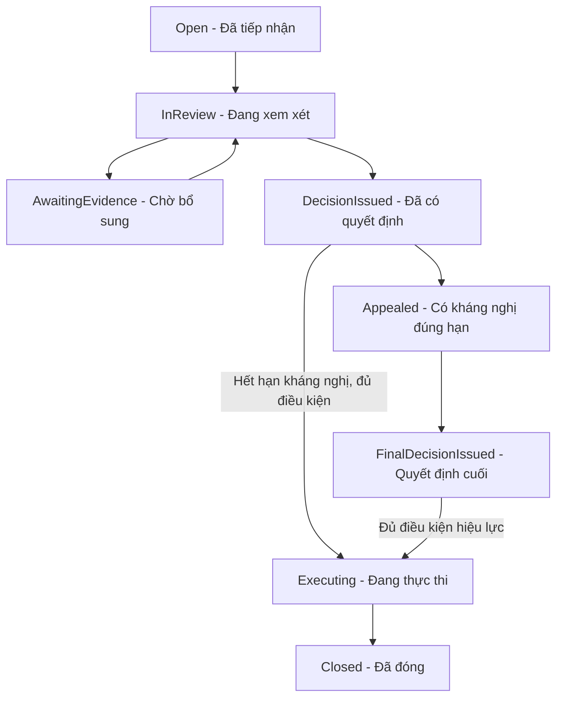

# Đặc tả đánh giá, phản ánh và khiếu nại trên web

Ngày 02/11/2026. Source khảo sát: `2ae2212b` trên `main`.
Owner chọn Member web React/Vite (`apps/user-web`) và Admin web
(`apps/admin-web`), yêu cầu đặc tả hành trình của cả hai vai trò trước triển khai.
Tài liệu này là phạm vi đề xuất để triển khai, không là bằng chứng feature đã có,
quyết định thay SRS/ADR hoặc quyền mở các gate tiền/giao nhận.

Triển khai tiếp theo02/11: [báo cáo chức năng web](WEB_SUPPORT_CENTER_REPORT.md)
và [ADR0062](../adr/0062-web-support-cases.md) ghi phần đã nối, evidence và giới
hạn. State dispute/W4 bên dưới vẫn là đích nghiệp vụ, không là feature đã mở.

## 1. Nguồn và phạm vi

- [SRS 1.1](../SRS_V1_1.md): FR-D01–D09, FR-R01–R05, FR-N03–N04,
  FR-G01, BR-31–BR-41, BR-45; [phụ lục điểm/đấu giá](LOCAL_HANDOVER_AUCTION.md).
- [ADR0052](../adr/0052-transaction-reviews-and-reputation.md): đánh giá và uy tín;
  [ADR0057](../adr/0057-exchange-resolution-safety.md): giới hạn phân xử trao đổi;
  [READINESS](../handoff/READINESS.md): gate giao nhận/tiền còn mở.
- [Contract hiện hành](../../packages/api-contract/openapi.yaml) là nguồn API.
  Route hoặc mô hình mới ghi **đề xuất** dưới đây chưa tồn tại trong contract.
- Tận dụng hai web app, API chung và SessionClient. Không triển khai RN/Flutter,
  thay carrier/GHN/Driver, mở Forum, reset DB hoặc đưa vào sử dụng tiền thật.
- Admin là người phụ trách tiếp nhận, trả lời và quyết định trong luồng mới.
  Không tự thu hồi quyền Staff hiện có. Staff tại điểm vẫn xác minh/nhận trả sách
  đúng assignment và nghiệp vụ hiện hành; Admin không thay xác nhận custody.

## 2. Bốn loại yêu cầu

| Loại | Đối tượng và người gửi | Kết quả cho Member | Tác động nghiệp vụ |
| --- | --- | --- | --- |
| Đánh giá giao dịch | Participant của DirectOrder, Exchange, PointOrder đã Completed | Đánh giá của mình, hạn sửa, thời điểm được công khai, phản hồi được duyệt | Điểm uy tín từ review công khai hợp lệ; không thay tiền/trạng thái giao dịch |
| Báo cáo vi phạm | Member báo đánh giá công khai, listing, hồ sơ/hành vi có đối tượng xác định | Hồ sơ riêng và kết luận có nội dung trả lời | Chỉ áp dụng xử lý nội dung/tài khoản theo quyền và căn cứ tương ứng |
| Khiếu nại giao dịch | Participant phản ánh không gửi/nhận, sai sách/tình trạng, vấn đề hoàn hàng | Tranh chấp chung, phần chứng cứ được phép xem, quyết định, nghĩa vụ và kháng nghị | Claim hợp lệ giữ tiền chưa quyết toán và ngừng tự hoàn tất; không freeze toàn ví |
| Góp ý / báo lỗi | Member góp ý trải nghiệm hoặc báo lỗi sử dụng | Tiếp nhận, trao đổi bổ sung, kết quả xử lý | Không tự thay tiền, điểm uy tín hay tạo vi phạm |

Hồ sơ hỗ trợ không thay đánh giá hoặc tranh chấp. Nếu Member gửi nhầm loại,
Admin liên kết/chuyển xử lý có lý do và lịch sử. Chỉ command miền giao dịch đã
kiểm quyền/state mới được mở claim và giữ tiền; một ticket chung không đủ bảo vệ
tiền. UI phải nói rõ claim đã được tiếp nhận hay vẫn chưa thể mở khiếu nại.

## 3. Hiện trạng đối chiếu source

| Phần | Đã có trong source | Phần cần triển khai / giới hạn |
| --- | --- | --- |
| Đánh giá ba loại giao dịch | [API review](../../apps/api/src/modules/reviews/transaction-reviews.controller.ts), [Member /reviews](../../apps/user-web/src/pages/ReviewsPage.tsx), [panel giao dịch](../../apps/user-web/src/features/reviews/TransactionReviewPanel.tsx) | Tái sử dụng; bổ sung điểm vào báo cáo và kết quả kiểm duyệt gửi Member |
| Kiểm duyệt đánh giá | [Admin /transaction-reviews](../../apps/admin-web/src/features/reviews/TransactionReviewsPage.tsx), hide/restore, evidence hold, duyệt/ẩn reply, revisions | Chưa có workflow report/appeal riêng cho review; command moderation hiện không tạo thông báo Member trong service |
| Mua bán DirectOrder | [OrdersController](../../apps/api/src/modules/orders/orders.controller.ts) có `POST orders/:orderId/non-receipt` | Chỉ intake không nhận quá hạn theo điều kiện hiện hành; chưa là claim chất lượng/phân xử đầy đủ. [Khảo sát BuyNow](CORE_BUY_NOW_AUDIT_2026_11_01.md) ghi khoảng thiếu khi Buyer phủ nhận Delivered; phải kiểm và bảo vệ trước mở hậu kiểm |
| Trao đổi Exchange | Member có dispute; [Admin hàng đợi](../../apps/admin-web/src/features/operations/exchange-disputes.tsx) xem tình trạng hai chiều | ADR0057 giữ chỉ đọc, chặn mọi phán quyết mới tại route resolve cũ; không bật lại bằng nút UI |
| Đấu giá / PointOrder | [Claim](../../apps/api/src/modules/auctions/auctions.controller.ts), [hàng đợi/phân xử](../../apps/api/src/modules/auctions/auction-operations.controller.ts), return/custody source | Phải nối đúng PointOrder và nghiệp vụ điểm; có source không chứng minh full acceptance hoặc cho phép mở rộng gate |
| Thông báo | Hộp thư bền, phân trang, đọc/chưa đọc; [Member /notifications](../../apps/user-web/src/pages/NotificationsPage.tsx) | [useOpenNotification](../../apps/user-web/src/hooks/useOpenNotification.ts) hiện xử lý Order/Exchange, còn lại đi auction; cần target riêng cho hỗ trợ, không để target mới rơi vào auction |
| Hồ sơ hỗ trợ chung | Chưa có module riêng trong phạm vi source khảo sát | API, persistence, hàng đợi Admin, hội thoại hỗ trợ, entry Member và thông báo cần xây |

Đây là khảo sát tĩnh, không chạy lại API/browser để xác nhận runtime.

## 4. Màn hình và điều hướng đề xuất

Các đường dẫn **mới đề xuất**, cần thêm router/API tương ứng khi triển khai:

| Vai trò | Điểm vào / trang | Nội dung và việc chính |
| --- | --- | --- |
| Member | Menu tài khoản → Hỗ trợ & phản ánh → `/support` | Yêu cầu của tôi; lọc loại, trạng thái, giao dịch; tải tiếp; nút Gửi yêu cầu |
| Member | `/support/new` hoặc nút trong trang đối tượng | Form gắn sẵn loại/ID từ ngữ cảnh; server đọc lại quyền và snapshot |
| Member | `/support/:caseId` | Mã hồ sơ, đối tượng liên quan, ai đang cần phản hồi, hạn, timeline, bổ sung và kết luận |
| Member | `/reviews` hiện có | Đánh giá cần viết/đã viết; mở đúng giao dịch; báo cáo ở review công khai |
| Member | `/notifications` hiện có | Thông báo mở đúng hồ sơ; login giữ đích; Back về danh sách và bộ lọc trước đó |
| Admin | Menu Trung tâm xử lý → `/support` | Hàng đợi theo loại, trạng thái, người phụ trách, thời gian và hạn gần nhất |
| Admin | `/support/:caseId` | Hồ sơ xử lý, chứng cứ, trao đổi, ghi chú riêng, tiếp nhận/phân công, kết luận |
| Admin | `/transaction-reviews` hiện có | Kiểm duyệt review/reply; mở từ hồ sơ báo cáo và quay lại đúng hồ sơ |

Hai app có origin riêng nên `/support` không xung đột. Route công khai hiện có
vẫn giữ: `/books/:id`, `/members/:id`, `/exchange/:id`, `/auctions/:id`,
`/orders/:orderId` (hiện mở Order conversation). Thông báo khiếu nại đấu giá phải
gắn `PointOrder` thật; không suy `auctionId = orderId` hoặc dựng route chưa có.

Member dùng DashboardLayout/brand hiện hành. Admin giữ shell, bảng và component
của app vận hành. Danh sách ưu tiên đối tượng, trạng thái, việc tiếp theo và hạn;
không thêm số liệu demo hoặc biểu đồ không phục vụ xử lý. Chi tiết có phần tóm
tắt và timeline; màn hẹp chuyển một cột, giữ nhãn nút, keyboard/focus, chữ lớn.

## 5. Luồng đánh giá và báo cáo đánh giá

### 5.1 Member đánh giá giao dịch

1. Từ giao dịch Completed hoặc `/reviews`, mở form đúng transaction type/ID.
   Server trả khả năng đánh giá và deadline; client không tự mở quyền theo nhãn.
2. Buyer chấm sách và đối tác; Seller chỉ chấm đối tác; Exchange hai bên chấm
   sách nhận và đối tác. Điểm nguyên 1–5; không ép Seller chấm sách từ Buyer.
3. Gửi một lần mỗi participant/giao dịch trong 168 giờ từ Completed. ACK mới
   báo đã gửi; trang hiển thị bản mình và deadline sửa/xóa 48 giờ từ lần tạo đầu.
4. Công bố khi cả hai đã gửi và hết cả hai hạn sửa, hoặc hết hạn gửi và hết mọi
   hạn sửa phát sinh. Chưa đủ điều kiện thì đối phương không thấy nội dung/điểm.
5. Cho sửa/xóa trong hạn, giữ revision; không đặt lại hạn khi sửa/xóa/tạo lại.
   Bản đang được giữ làm bằng chứng không sửa/xóa được.
6. Người được đánh giá có một phản hồi sau công bố, chờ kiểm duyệt. Pending/Hidden
   chỉ người viết reply và reviewer độc lập được xem; tác giả review/Guest chưa thấy.

### 5.2 Member báo cáo → Admin xử lý

1. Trên review công khai, chọn Báo cáo đánh giá. Form gắn reviewId/version,
   lý do, mô tả và bằng chứng nếu có. Không cho dùng đường này đọc review chưa công bố.
2. ACK tạo hồ sơ riêng; review không tự bị ẩn hoặc bị sửa điểm vì có báo cáo.
3. Admin độc lập nhận hồ sơ, xem bản review/reply liên quan và revision theo quyền,
   yêu cầu bổ sung hoặc chọn giữ nguyên/ẩn nội dung theo policy đã thống nhất.
4. Quyết định moderation và cập nhật hồ sơ phải nhất quán, có lý do và audit.
   Nếu command moderation chưa thành công, không đánh dấu báo cáo đã xử lý xong.
5. Gửi kết luận cho người báo cáo; nếu thay đổi review/reply thì thông báo người
   bị tác động với nội dung phù hợp. Giữ riêng danh tính người báo cáo và ghi chú nội bộ.
6. Người bị đánh giá vẫn có quyền phản hồi theo ADR0052. Admin không viết reply
   thay Member, đổi sao của tác giả hoặc ẩn đánh giá chỉ vì đánh giá bất lợi.

Báo cáo listing/hành vi dùng cùng hồ sơ tiếp nhận nhưng xử lý qua service miền
hiện có; hồ sơ báo cáo không tự cấp quyền gỡ listing/khóa tài khoản. Tiêu chí vi
phạm, cách tái xét moderation và hạn xử lý loại này cần được chốt trong gói policy;
không áp ngầm thời hạn kháng nghị tiền/hàng cho mọi loại báo cáo.

## 6. Luồng khiếu nại giao dịch

### 6.1 Khác biệt giữa ba loại giao dịch

| Giao dịch | Entry Member | Điều kiện và nội dung phải xác minh |
| --- | --- | --- |
| Mua bán | Chi tiết Order → Cần hỗ trợ / Khiếu nại khi server cho phép | Chặng shipment, không nhận hay chất lượng, snapshot nguyên bộ nếu có, hold và hạn; ngoài khả năng hiện có chỉ hiển thị hỗ trợ, không hứa đã mở claim giữ tiền |
| Trao đổi | Chi tiết Exchange → Báo cáo khiếu nại / Xem hồ sơ | Hai chiều gửi/nhận, hai sách, cọc, bù tiền, phí; claim của cả hai bên gộp cùng dispute. Giữ ResolutionPending và giới hạn ADR0057 |
| Đấu giá | Đơn nhận sách từ phiên đã thắng → Khiếu nại | Dùng PointOrder, report revision, kiểm tra/nhận sách, custody điểm hoặc chặng ship. Chưa phát sinh đơn thì báo cáo phiên/hành vi, không tạo review hoặc claim của một đơn không tồn tại |

Hạn và trạng thái mở claim do policy/contract từng lane quyết định. Không dùng
168 giờ của review hoặc một thời hạn nhận hàng chung cho cả ba lane.

### 6.2 Hành trình hai vai trò

| Vai trò → entry | Điều kiện / command | Kết quả và side effect | Bước tiếp / phục hồi |
| --- | --- | --- | --- |
| Member → chi tiết giao dịch | Participant, current state/deadline cho phép → gửi claim | Một dispute đang mở mỗi giao dịch; bổ sung claim hai bên. Claim hợp lệ giữ tiền chưa quyết toán và chặn tự hoàn tất trong transaction dữ liệu | Mở hồ sơ, thấy ACK và việc đang chờ; mất ACK retry đúng intent |
| Admin → hàng đợi mới | Có quyền hiện tại, độc lập với participant → nhận phụ trách | Lưu người xử lý và timeline; hai Admin tranh nhận chỉ một người thắng version | Mở snapshot, shipment/custody/hold và chứng cứ; người còn lại refetch |
| Admin → yêu cầu bổ sung | Ghi bên cần trả lời, câu hỏi và deadline theo POL-09 | Thông báo đúng bên; hiện Chờ bạn bổ sung hoặc Chờ bên còn lại | Member trả lời trong hồ sơ; không buộc liên hệ ngoài hệ thống |
| Member → hồ sơ | Được quyền xem/bổ sung theo vai trò trong dispute | Chứng cứ bổ sung append-only; không sửa gốc, không lộ dữ liệu riêng của bên kia | Chờ Admin; quá hạn không tự mất tiền/cọc hoặc bị coi gian lận |
| Admin → ra quyết định | Đủ căn cứ và thẩm quyền; mọi command miền phải được cấp phạm vi | Kết luận, custody từng sách, allocations/nguồn tiền, phí hoàn, người thực hiện và thời hạn; gửi hộp thư bền cho từng bên | Chờ hiệu lực/kháng nghị; chưa giải ngân hoặc báo hoàn tiền thành công |
| Mỗi bên → kháng nghị | Một lần mỗi bên trong 48 giờ từ quyết định có trong hộp thư nội bộ | Gộp cùng dispute; tiếp tục giữ tiền; phân công Admin khác độc lập | Theo dõi kết quả cuối; thiếu Admin độc lập thì chờ phân công, không tự duyệt |
| Admin độc lập → xét lại | Không là người ra quyết định ban đầu hoặc participant | Quyết định cuối và lý do, lịch sử đầy đủ; thông báo hai bên | Thực thi khi đủ điều kiện hiệu lực theo SRS và gate |
| Hệ thống / người có quyền → thực thi | Có quyết định hiệu lực, căn cứ custody/return, phân bổ hợp lệ | Theo dõi từng nghĩa vụ sách/tiền, retry chống lặp; lỗi giữ trạng thái đang xử lý | Đóng sau hoàn thành hoặc có phần không thể thu hồi được Admin chấp nhận đúng phạm vi |

POL-09 là 48 giờ từ yêu cầu bổ sung. POL-10 là 48 giờ từ quyết định có trong hộp
thư, không từ lúc Member bấm đọc. Không tự đặt SLA phản hồi đầu tiên của Admin.

### 6.3 Trạng thái đích theo SRS

Đây là state machine đích, chưa là enum/API mới. Khi bác claim nhưng giao nhận
vẫn tiếp tục, đóng dispute sau quyết định có hiệu lực và xác định `resume_stage`
từ shipment; giữ escrow đến điều kiện bình thường. Khi có nghĩa vụ trả hàng,
Executing có bước chờ hoàn; không báo “Đã giải quyết” chỉ vì Admin đã gửi câu trả lời.

## 7. Góp ý / báo lỗi và báo cáo không có nghĩa vụ tiền/hàng

Member vào Hỗ trợ & phản ánh → Gửi yêu cầu, chọn loại, nhập nội dung và đối tượng
liên quan nếu có. ACK xong mở hồ sơ để bổ sung. Admin nhận, trả lời hoặc yêu cầu
thông tin, gửi kết quả và đóng có lý do. Member vẫn xem được lịch sử sau đóng.

Trạng thái đề xuất: Đã tiếp nhận → Đang xử lý ↔ Chờ bổ sung → Đã phản hồi → Đã đóng.
Không dùng state này thay state dispute; không tự sinh kháng nghị hay SLA mới.
Trường hợp phát sinh vấn đề mới sau đóng có thể gửi hồ sơ liên quan, không ghi
đè quyết định cũ hoặc mở lại nghĩa vụ tiền từ ticket chung.

## 8. Màn chi tiết và mẫu phản hồi

**Member:** mã/loại hồ sơ; sách/giao dịch liên quan; trạng thái; bên đang cần hành
động; hạn server; timeline công khai theo quyền; vùng gửi bổ sung; kết luận và
nút bước tiếp. Phân biệt lời nhắn hỗ trợ, quyết định nghiệp vụ và kết quả thực thi.

**Admin:** tóm tắt, người phụ trách, deadline; snapshot giao dịch; trạng thái từng
hiện vật/nguồn tiền khi cần; chứng cứ theo quyền; hội thoại; ghi chú chỉ nội bộ;
form phản hồi/quyết định. Tách rõ nút Gửi phản hồi, Yêu cầu bổ sung, Ra quyết định
và Đóng hồ sơ; không để một nút “Giải quyết” vừa gửi lời nhắn vừa tự chuyển tiền.

Phản hồi Member tối thiểu gồm: vấn đề được xem xét; kết luận/căn cứ có thể công
khai; việc hệ thống đã thực hiện; việc còn chờ; người cần làm gì trước thời điểm
nào; quyền kháng nghị nếu có. Không hứa bồi thường khi chưa có nguồn.

Ví dụ cho claim tiền/hàng: “Đã có quyết định yêu cầu trả sách. Tiền giao dịch
tiếp tục được giữ trong thời gian kháng nghị. Xem quyết định và hạn kháng nghị
trong hồ sơ.” Chỉ dùng khi quyết định/hộp thư thực sự đã lưu thành công.

## 9. Quyền, dữ liệu và khôi phục

- Server kiểm current session/role/status, participant, assignment, independence
  trước read/mutation và trước receipt replay. Link/menu không cấp quyền.
- Member chỉ đọc hồ sơ của mình hoặc phần dispute mình tham gia. Không mặc định
  chia sẻ toàn bộ ticket người báo cáo cho người bị báo cáo. Ghi chú Admin riêng;
  chứng cứ nhạy cảm hạn chế đúng tác vụ, ghi truy cập/tải, không có URL public.
- Tạo review yêu cầu Member ACTIVE như ADR0052. Quyền đọc/bổ sung nghĩa vụ cũ của
  tài khoản LOCKED/RESTRICTED phải được định nghĩa method-level theo contract;
  không mở blanket ExistingObligation cho mọi hỗ trợ hoặc report mới.
- Đề xuất dữ liệu hồ sơ: kind, reporter/participants, target type/ID, transaction
  link nếu có, assignee, state/version, deadline. Messages có audience rõ ràng;
  evidence gốc bất biến; decision/revision/appeal/execution lưu và liên kết riêng.
  Không tạo state machine tài chính thứ hai trong support case.
- File mới cần private upload/authorize/finalize/retention đúng nghiệp vụ; không
  tái dùng URL ảnh public hoặc listing cleanup để giữ chứng cứ tranh chấp. Giới
  hạn loại/kích thước/số lượng file phải chốt trong contract trước xây upload.
- Mỗi command giữ Idempotency-Key/body/expectedVersion và receipt. Double click,
  stale version và hai Admin cạnh tranh không tạo nhiều quyết định/thông báo.
  Mất phản hồi: giữ intent theo protocol trong phiên, read/replay đúng command;
  không đổi key/version/quyết định để ép thành công. Không persist token/chứng cứ
  nhạy cảm trong browser storage; giữ session memory-only hiện có.
- Form giữ dữ liệu khi lỗi; đang gửi hoặc chưa rõ kết quả thì chặn thao tác ngược.
  Back/remount khôi phục intent phù hợp; đổi account xóa draft/cache của account cũ.
- Lưu thông báo bền cùng kết quả nghiệp vụ hoặc durable outbox có bảo đảm tương
  đương; dedupe theo event/người nhận. Email/realtime lỗi không rollback kết quả.
  Notification đọc lại quyền tại target; target không hỗ trợ không rơi vào auction.
- Loading không hiển thị zero, lỗi không là danh sách rỗng; lọc/tổng/phân trang
  phải có phạm vi rõ. Deep link đọc đúng ID kể cả hồ sơ ngoài trang đầu.

## 10. Gói triển khai và điều kiện mở

| Gói | Kết quả có thể nghiệm thu | Dependency / ranh giới |
| --- | --- | --- |
| W1 — Hồ sơ hỗ trợ hai web | Member tạo/xem/bổ sung; Admin nhận/trả lời; hộp thư, deep link và audit | Contract-first, migration mới, quyền/audience/retention. Ticket chung chưa có tác dụng giữ tiền |
| W2 — Báo cáo và moderation | Báo cáo review/listing/hành vi, liên kết công cụ hiện có, phản hồi kết quả | Chốt policy vi phạm/tái xét; giữ bí mật review trước công bố, không tự đổi sao/strike |
| W3 — Nối intake khiếu nại | Từ mỗi giao dịch mở đúng hồ sơ; hai bên theo dõi; yêu cầu/bổ sung chứng cứ | Claim hợp lệ và hold phải nguyên tử ở miền giao dịch; DirectOrder cần xử lý khoảng thiếu claim trước mở hậu kiểm; không thay bằng support ticket |
| W4 — Phán quyết, kháng nghị, thực thi | Quyết định đủ custody/allocations, hiệu lực, Admin độc lập, nghĩa vụ return/tiền và đóng | Gói riêng đáp ứng ADR0057, READINESS, permission/ledger review người thật. Không bật route resolve cũ bằng UI/env |

W1/W2 có thể triển khai mà không mở settlement. W3 không được hiển thị là bảo vệ
tiền nếu lane chưa có claim command đủ điều kiện. W4 không thuộc quyền mở gate
tự suy từ yêu cầu đặc tả web. Không sửa SRS/ADR để hợp thức hóa phần source còn thiếu.

Các quyết định sản phẩm còn cần khóa khi vào từng gói: policy nội dung vi phạm
và tái xét moderation; giới hạn file/retention; SLA hỗ trợ nếu muốn cam kết;
phân công Admin độc lập khi kháng nghị. Không chặn việc đặc tả hoặc khảo sát API
độc lập vì các mục này, nhưng không tự gọi chúng là policy đã được phê duyệt.

## 11. Tiêu chí nghiệm thu khi triển khai

1. Member đi từ menu hoặc đúng giao dịch/đánh giá tới form và hồ sơ, quay lại đúng
   nơi; Admin từ hàng đợi mở cùng hồ sơ, gửi phản hồi, Member nhận và mở đúng kết quả.
2. Hai tài khoản không đọc được hồ sơ/chứng cứ riêng của nhau bằng đổi ID/cursor;
   sai role, revoked session, participant tự xử lý và Admin tự xét kháng nghị bị từ chối.
3. Review giữ 168h/48h, bảo mật hai chiều, reply chờ duyệt, evidence hold và điểm
   tổng đúng sau hide/restore; điểm thấp không tự trở thành vi phạm.
4. Cả ba lane dùng đúng target/deadline; auction chưa có PointOrder không mở review;
   DirectOrder thiếu claim không bị trình bày là đã giữ tiền nhờ ticket hỗ trợ.
5. Claim hai chiều gộp một dispute; chặn auto-complete và giữ hold nguyên tử. Không
   nhận bằng chứng/chat/label làm xác nhận custody hoặc cộng số dư trực tiếp.
6. Concurrent assignment/decision, stale version, double submit, key khác body,
   mất ACK rồi Back/remount/retry chỉ có một kết quả; không gửi thông báo lặp.
7. Quyết định dispute chưa hiệu lực không chuyển tiền; kháng nghị đúng hạn giữ
   tiền; thiếu người độc lập không tự thông qua; refund/return lỗi vẫn còn nghĩa vụ.
8. Notification lưu bền, lỗi email/realtime không mất quyết định; deadline kháng
   nghị từ hộp thư; unknown target an toàn; pagination/deep link ngoài trang đầu đúng.
9. Web loading/empty/error/retry, dữ liệu form, text dài, 320px, chữ lớn và keyboard
   hoạt động trên cả hai app; không có badge, số tiền hay tiến độ demo trên dữ liệu thật.
10. Check theo diff: contract/routes, API/Mongo/auth/replay/race khi đổi server;
    lint/types/unit/build hai web; browser hành trình trên QA replica set/DB `_test`,
    private storage QA. Ghi riêng fake/live provider và human acceptance.

## 12. Kiểm chứng gói đặc tả

- Chỉ thay tài liệu; không thêm route/API/migration hoặc đổi business source.
- Kiểm source/contract hiện hành và các đường vào trên hai web; runtime/browser,
  upload, ledger và trải nghiệm người thật **NOT RUN** cho feature đề xuất.
- Kết quả `docs:check` và `git diff --check` ghi tại checkpoint phiên trong
  [SESSION_STATE](../handoff/SESSION_STATE.md). READINESS không thay đổi.
