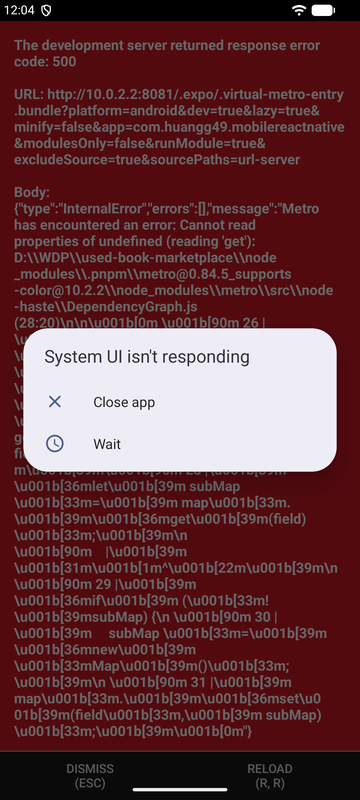
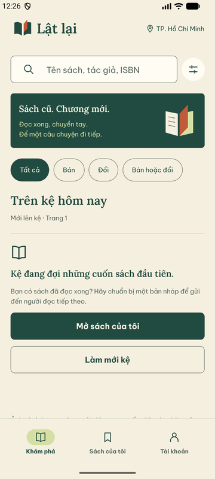
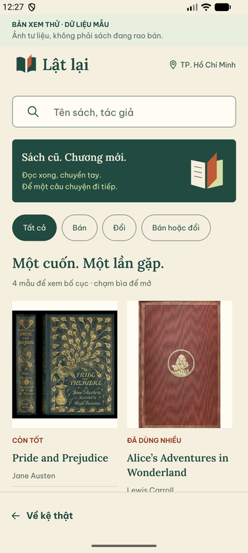

# A00 — Khởi động Android sau khi chuyển máy

29/09/2026, khoảng 00:00–00:27 (Asia/Saigon). Gói A00 trong
[CONTINUATION_PLAN](CONTINUATION_PLAN.md). Nhánh `codex/a00-android-startup`
từ `main` `382dda2`. **Kết luận chỉ áp dụng cho máy, APK và cấu hình ghi dưới đây.**

## Môi trường thực chạy

- Windows 10 19045, Node 25.0.0 (`.nvmrc` ghi 24.15.0; `engines >=24.15.0` vẫn
  thỏa; Prisma cảnh báo lúc install nhưng generate/migrate/seed chạy được),
  pnpm 11.19.0, JDK 21.0.10, Docker 29.7.2, Ninja 1.12.1 (SHA-256 khớp tài liệu).
- AVD `Medium_Phone`, Android 17 (API 37, image `google_apis_playstore_ps16k`),
  x86_64, RAM 2 GB, `emulator-5554`. Không phải Pixel_7/Android 15 của máy cũ.
- DB local mới qua Compose (port 5433), 17 migration, seed 4 tài khoản.
  `pnpm doctor:local`: mọi mục PASS; WARN URL localhost được xử lý bằng
  `adb reverse` 8081/3000, không sửa `.env`.
- APK debug x86_64 build mới: `pnpm build:android --emulator`, 39m46s,
  SHA-256 `c5d55846acc8aedc47b34558fa7333587ac253e5ad6dd58dd2be3187e8f9299c`.
  JS phục vụ qua Metro từ working tree của nhánh này (chưa đổi code app).
- API và hai worker chạy từ cùng một `nest build` (`start:prod`,
  `worker:media:prod`, `worker:orders:prod`).

## Kết quả theo DONE của A00

| Bước | Kết quả |
|---|---|
| Cold start từ launcher | PASS — splash → kệ `/` với font/logo Lật lại; `Running "main"` trong log |
| Mở `/` khi API chạy | PASS — kệ rỗng đúng dữ liệu, CTA “Mở sách của tôi” |
| Mở `/` khi API chết | Hành vi đúng — lỗi “Chưa kết nối được máy chủ” + nút thử lại, không kẹt splash |
| Force-stop → mở lại | PASS — `am start -W` Status ok, TotalTime ≈10,2 s trên AVD này |
| Deep link `mobilereactnative:///showcase` khi app đang chạy | PASS — nhãn “Bản xem thử · dữ liệu mẫu”; Back về kệ thật |
| Deep link `/showcase` **cold** sau force-stop (tình huống kẹt ở máy cũ) | PASS — render showcase, không kẹt splash |
| Back từ showcase mở cold | Thoát về launcher: màn duy nhất trong stack, hành vi Android chuẩn; màn có nút “Về kệ thật”. Ghi nhận, không sửa |

Không thấy `AndroidRuntime` lỗi của app hoặc lỗi `ReactNativeJS` trong các lượt trên.

## Cơ chế tìm được (nguyên nhân có bằng chứng trên máy này)

1. **Metro báo “running” nhưng không bundle được.** Metro khởi động lúc Gradle
   đang build làm máy quá tải. Windows không có Watchman nên `@expo/metro-file-map`
   dùng FallbackWatcher, đặt `fs.watch` cho từng thư mục (~18.400 thư mục trong
   monorepo). Khởi động watcher vượt giới hạn cứng 240 s →
   `Failed to construct transformer: Failed to start watch mode`. Sau đó
   `/status` vẫn trả `packager-status:running` nhưng mọi request bundle trả 500
   (`Cannot read properties of undefined (reading 'get')`). App debug hiện màn đỏ.
2. **Bundle đầu tiên sau khi xóa cache rất chậm.** Metro khởi động lại khi máy rảnh:
   bundle Android đầu tiên 200, 8,6 MB, 1.782 module, mất **103 s**. Trong thời
   gian này app debug chỉ hiện splash. `expo export --clear` xóa cache transform
   dùng chung nên lần mở lại đầu tiên sau export phải chờ build lại toàn bộ.
3. **Emulator hết tài nguyên.** Lượt đầu cài/mở trong lúc host còn ~1,5 GB RAM
   trống: `pm install` streamed lỗi `Broken pipe`, sau đó system_server chết
   (`DeadSystemException` ở nhiều app hệ thống) và AVD khởi động lại. Cài bằng
   `adb push` + `pm install` thành công. Dừng Gradle daemon của lượt build này
   trước khi QA.

Máy cũ: không tái hiện được trên máy cũ nên **không kết luận chắc nguyên nhân**.
Triệu chứng “đứng logo, `/status` running, log không lỗi” khớp với (2) và có thể
(1); không có bằng chứng về lỗi logic splash/font trong app. Không thêm timeout
ẩn splash vì không có lỗi code để sửa.

## Thay đổi đi kèm

- `scripts/build-android.mjs`: gọi `.\gradlew.bat` thay vì `gradlew.bat`. Khi môi
  trường đặt `NoDefaultCurrentDirectoryInExePath=1` (hardening Windows), cmd không
  tìm lệnh ở thư mục hiện tại và build dừng sau prebuild với
  `'gradlew.bat' is not recognized`. Đường dẫn tường minh không đổi hành vi build.
- [ANDROID_QUALITY](../ANDROID_QUALITY.md): thêm cách kiểm Metro bằng request
  bundle thật và các bước xử lý ở trên.

## Giới hạn

- Chỉ AVD x86_64 API 37; chưa chạy ARM, điện thoại thật hoặc iOS.
- Launcher icon/splash lúc cold launch quan sát qua ảnh chụp; chưa đo thời gian
  splash bằng công cụ hiệu năng. N01 trong NATIVE_ACCEPTANCE vẫn cần phiếu riêng.
- Kệ rỗng: chưa có listing công khai trên DB mới để kiểm chi tiết sách thật.
