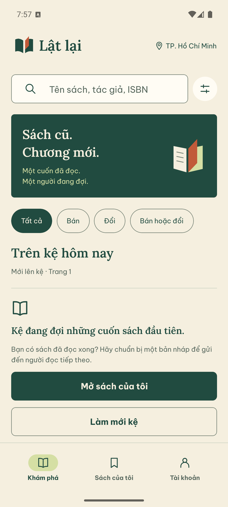
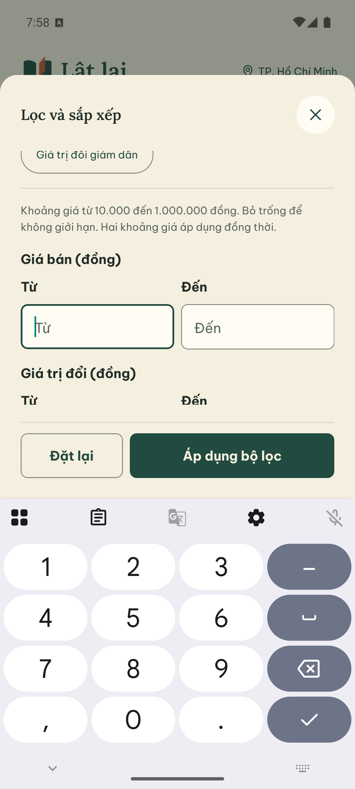
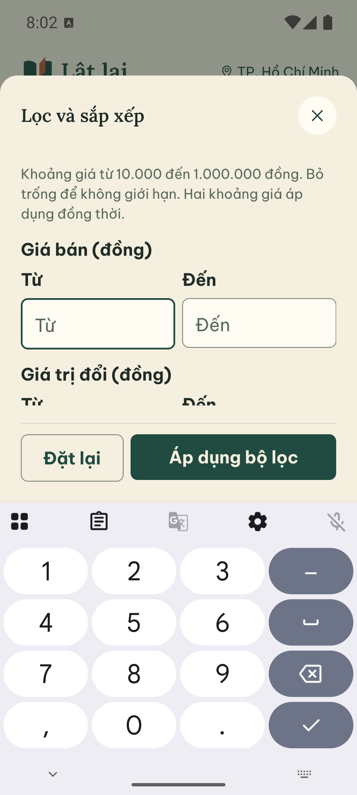
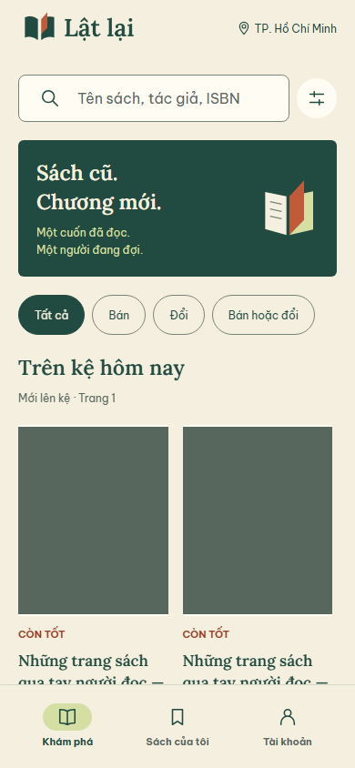
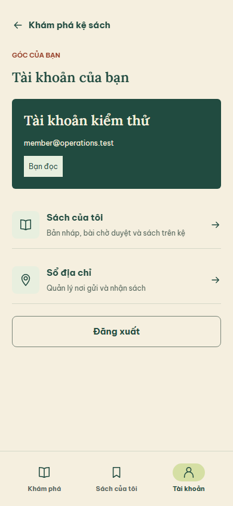
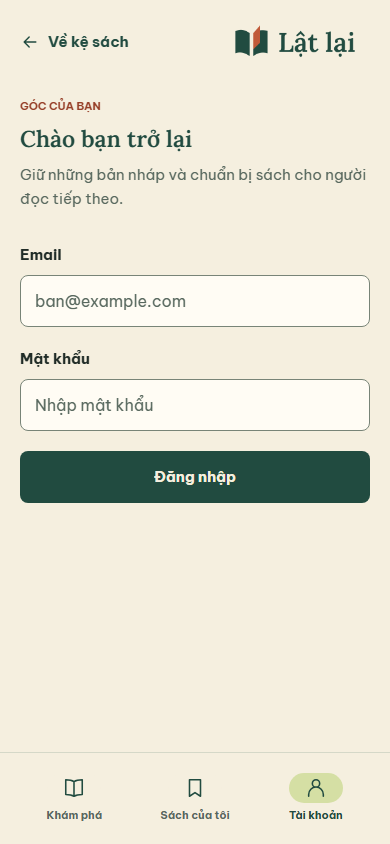
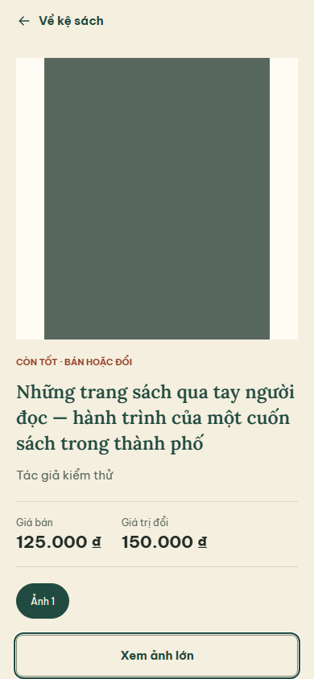
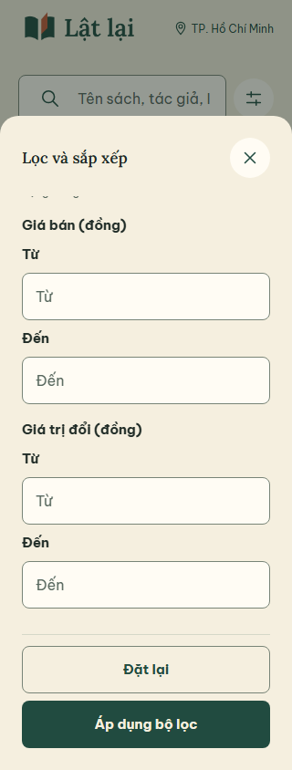
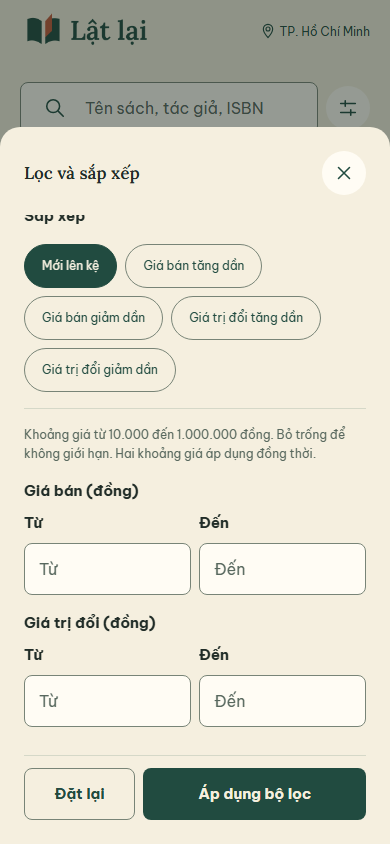

# Cải thiện trải nghiệm mobile trước bàn giao

28/09/2026. Nhánh `codex/mobile-experience`, tiếp nối `97c2e6a`.
Người dùng đánh giá UI cũ còn thô, giống form web và phải cuộn quá lâu để áp dụng
bộ lọc. Đây là vòng sửa trải nghiệm theo phản hồi đó, không phải release đã được
người dùng duyệt về thẩm mỹ. Giữ F2h/OpenAPI 0.20.0 và các workflow hiện có.

## Đã thay đổi

- Kệ: tìm kiếm gọn, hình minh họa trang lật theo brand, lọc nhanh hình thức,
  thẻ sách hai cột; chuyển một cột khi viewport nhỏ/chữ lớn theo kích thước RN.
  Tên dài xuống dòng, giá bán và giá trị đổi giữ nhãn riêng. Không thêm số liệu,
  rating hoặc ảnh sản phẩm giả. Kệ local hiện rỗng được trình bày đúng trạng thái.
- Thanh điều hướng dưới: Khám phá, Sách của tôi, Tài khoản, dùng route và session
  hiện có. Không đặt trong editor để không vượt cảnh báo dữ liệu chưa lưu.
  Guest vào sách riêng qua cổng đăng nhập; role/account guards vẫn giữ nguyên.
- Bộ lọc: `Sheet.footer` giữ Đặt lại/Áp dụng ngoài vùng cuộn, có tránh bàn phím.
  Nhóm giá dùng Từ/Đến với tên accessibility đầy đủ. Lỗi ở ngay trên nút áp dụng.
  Chọn trong bảng chỉ là lựa chọn tạm; đóng/Back không áp dụng ngầm khi tìm kiếm.
- Login thu gọn tiêu đề; tài khoản có khối profile và các hàng điều hướng có mô tả.
  Danh sách sách giảm phần mở đầu; chi tiết ưu tiên ảnh và giữ Back ở đầu màn hình.
- `/ui` có bảng dài với footer, ActionRow và tìm kiếm bằng nút biểu tượng.
  Hợp đồng mới được ghi ở [UI_COMPONENTS](../design/UI_COMPONENTS.md) và ADR 0004.

## Bằng chứng kiểm tra

- RN typecheck/lint PASS trên nguồn cuối; 61 unit/9 file và contract check PASS.
  Không đổi nghiệp vụ backend, migration hoặc OpenAPI; không chạy lại 480 API E2E.
- Export web PASS. Browser regression cuối PASS trên HTTP/Nest/PostgreSQL test
  riêng: kệ/chi tiết/phân trang/tìm/lọc, lỗi ảnh/offline, địa chỉ, nháp/upload/
  submit/reject/resubmit/approve, hide/reopen/archive, retry mất phản hồi và quyền
  RESTRICTED/LOCKED. Storage của suite này là fake, không là Supabase evidence.
- Thêm regression chứng minh nút Áp dụng luôn trong viewport và giữ vị trí khi
  cuộn nội dung ở 320/390 px; đóng lựa chọn sort chưa áp dụng rồi Search vẫn gửi
  sort đã áp dụng. Các selector được cập nhật theo tên truy cập mới của thẻ sách/tab.
- Pixel_7 AVD Android 15 x86_64: nguồn JS mới chạy qua Metro hiện có, không build
  APK mới. Kiểm kệ rỗng, mở/cuộn bộ lọc, bàn phím số docked, nhập 100000 và áp dụng
  khi bàn phím đang mở: bảng đóng, kệ ghi đúng giá từ 100.000 đồng.
- OS font_scale 1.3: kệ, tab, nhãn lọc đọc được; cuộn bảng và mở bàn phím số vẫn
  thấy nút Áp dụng. Ảnh dưới ghi trạng thái thực tế, không suy từ web export.
- Đã trả font_scale về 1.0 và khôi phục cấu hình handwriting của AVD sau kiểm tra.
  Không tạo listing, tài khoản hoặc dữ liệu nghiệp vụ mới trên DB app trong vòng UI này.

## Ảnh Android

## Ảnh kiểm thử web

Ảnh sách xanh trơn là fixture kỹ thuật có chủ đích; không phải bìa thật hoặc dữ liệu
đưa vào app/demo. Không dùng ảnh này để kết luận kệ có sách thật đã hoàn thiện thẩm mỹ.

## Người tiếp nhận làm tiếp

1. Review hướng thị giác này trực tiếp với người dùng trên Android. Đây là vòng
   cải thiện đầu, chưa có xác nhận rằng đã đạt mong muốn “lung linh”. Không ghi
   toàn bộ app đã được thiết kế lại hoặc đã hoàn tất nghiệm thu.
2. Đánh giá kệ/chi tiết với bìa sách hợp lệ và dữ liệu thật; không publish ảnh tư liệu
   trong nháp QA từ vòng trước như một cuốn sách đang bán.
3. Áp dụng nhịp bố cục mobile cho form địa chỉ và editor dài ở vòng sau. Giữ nguyên
   validation, expectedVersion, idempotency/retry và dirty guard khi chỉnh trình bày.
4. Kiểm TalkBack, iOS/ARM, focus modal và đầy đủ native listing acceptance còn mở
   trong [NATIVE_RUN_2026_09_28](NATIVE_RUN_2026_09_28.md). Vòng này chỉ thay bằng
   chứng cho màn/hành vi đã ghi; không đóng các ca native còn thiếu hoặc review độc lập.

Mốc nguồn trước `97c2e6a` và bundle native cũ giữ nguyên. Gói UI mới:
`.tmp/latlai-mobile-experience.bundle`, checksum `.sha256` bên cạnh; clone với
`git clone --branch codex/mobile-experience ./latlai-mobile-experience.bundle latlai`.
Không kèm `.env`, DB, APK hoặc dependency. Chưa push/PR.
