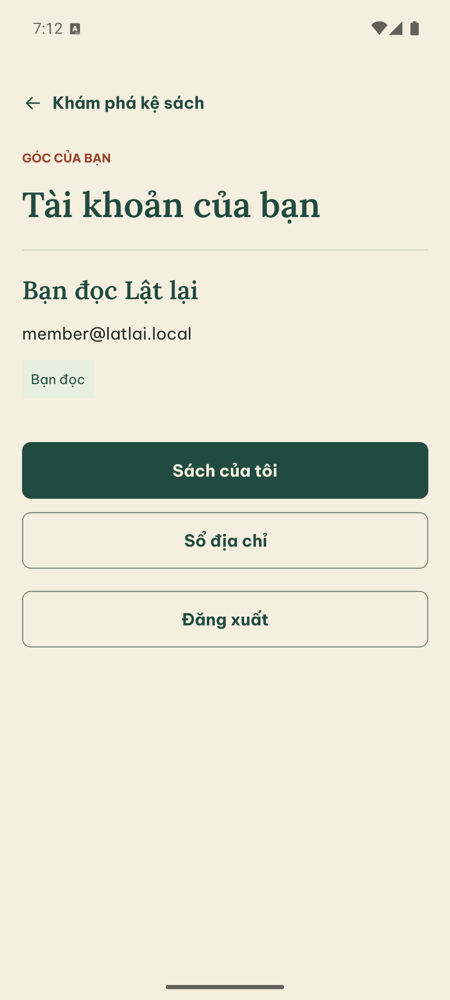
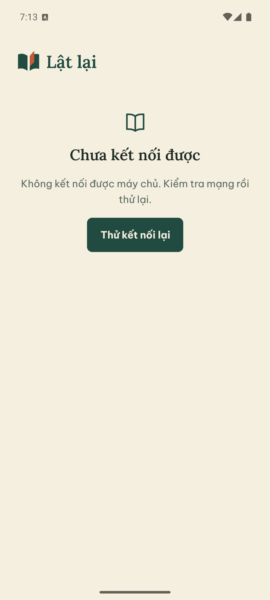
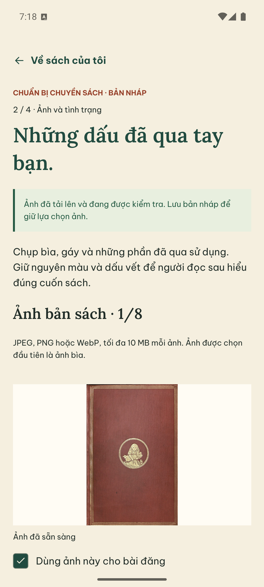
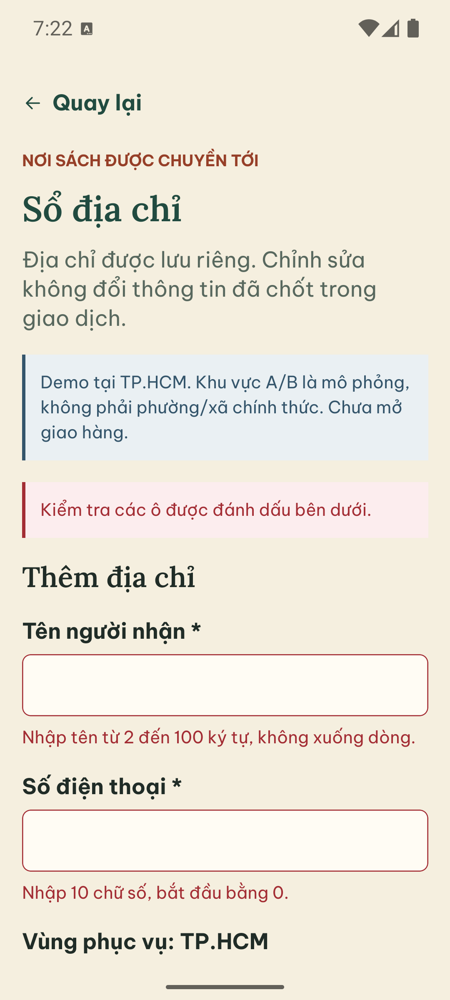
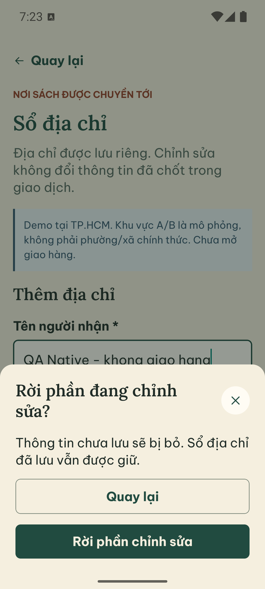
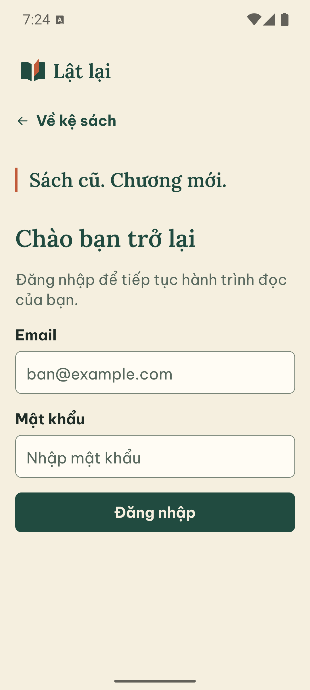

# Android: phiên đăng nhập và upload thật

28/09/2026, khoảng 19:05–19:24 (Asia/Saigon). Vòng thực thi tiếp nối
[NATIVE_ACCEPTANCE](NATIVE_ACCEPTANCE.md), không thay phiếu review độc lập.
**Đã chạy một phần native; chưa đóng toàn bộ 21 ca.**

## Môi trường và nguồn

- Nhánh `codex/native-handoff-qa`, base `7b40e00`. RN/brand/API business code
  không đổi trong lượt này; chỉ sửa lệnh khởi động media worker bên dưới.
- Pixel_7 AVD, Android 15, x86_64, `emulator-5554`. APK debug đã cài thành công;
  SHA-256 `6CBE6646C80013B27D8F06E3799855EA2CC6E9664BE337E7CF12B8FEA945A039`.
  Không build APK mới, ARM hoặc iOS trong lượt này.
- Người dùng đã mở Android Studio; AVD và Metro của project đang chạy sẵn khi
  kiểm tra. Không chạy lại lệnh Metro từng bị policy chặn. Metro PID 26536;
  API cổng 3000 PID 28384 là process có sẵn. Không khởi động lại chúng.
- Cấu hình RN localhost được nối bằng `adb reverse` cổng 8081 và 3000.
  Doctor đạt DB, 17 migration checksum, private bucket và readiness. WARN
  localhost được xử lý bằng mapping thiết bị; không sửa `.env`.
- Tài khoản seed Member local, API/DB local hiện hành; đây không phải schema
  fixture của E2E. Đã tạo **một nháp riêng, một ảnh**, chưa gửi duyệt/công khai.
  Không reset DB, seed lại, đổi mật khẩu/quyền hoặc sửa trạng thái bằng SQL.
- Ảnh QA là `apps/mobile-react-native/assets/design/alice.jpg`, 1.319.776 byte;
  public-domain theo [hồ sơ asset](../../apps/mobile-react-native/assets/design/README.md).
  File được đưa vào thư viện AVD với tên `latlai-qa-alice-public-domain.jpg`.
  Đây là ảnh tư liệu để kiểm pipeline, không là ảnh bằng chứng của sách đang bán.
- Upload dùng API → adapter Supabase thật → Sharp worker → signed preview trên
  Android. Không chạy fake storage hoặc browser fixture trong lượt này.
- Gboard: trường password mở bàn phím docked, form cuộn tới nút đăng nhập được.
  Trường văn bản thường dùng thanh handwriting/floating của AVD; không gán kết
  quả đó thành đã kiểm docked keyboard cho toàn bộ form.

## Lỗi tìm được: worker không khởi động qua lệnh hướng dẫn

`pnpm --filter @used-books/api worker:media` trước sửa chạy `tsx src/media-worker.ts`
và thoát 1 với `TypeError: Cannot read properties of undefined (reading 'getOrThrow')`
tại constructor DatabaseService. Nest không nhận constructor dependency metadata
trong đường chạy tsx này. Vì worker không chạy, upload có thể chờ Processing mãi
nếu không có process worker khác.

Sửa `apps/api/package.json`: `worker:media` dùng
`nest start --entryFile media-worker`, giống cách chạy Order worker. Nest biên dịch
theo tsconfig có `emitDecoratorMetadata` trước khởi động. Giữ nguyên
`worker:media:prod` cho dist đã build, không sửa DI/service hoặc policy ảnh.

Bằng chứng sau sửa: Nest CLI khởi động được child `dist/media-worker`; ảnh chọn
từ Android đạt Ready và preview hiển thị. Đây là kiểm chứng startup + xử lý job
thật, không chỉ thấy process sống. API lint/typecheck, 33/33 unit và
`contract:check` đều qua. Không chạy lại 480 API E2E vì không đổi domain/schema.
Lệnh Nest start đã compile backend; không tuyên bố có native build mới.

## Kết quả theo từng ca

PASS chỉ áp dụng đúng phạm vi ghi trong hàng. PARTIAL giữ gate còn mở.

| Ca | Trạng thái | Bằng chứng / phần còn thiếu |
|---|---|---|
| N01 | PARTIAL | Cài APK, mở app và mở lại thành công, logo/giấy/font của app hiển thị; chưa quan sát đủ launcher icon/splash lúc cold launch |
| N02 | PARTIAL | Kệ thật rỗng, mở filter và Android Back đóng sheet; chưa có public listing để kiểm detail/ảnh lớn/tên dài |
| N03 | PARTIAL | Login Member đúng thành công và profile thật hiển thị; chưa thử sai mật khẩu trong lượt này |
| N04 | PASS | Force-stop không xóa data → mở app → account đúng Member, không nhập lại credentials |
| N05 | PASS (API offline) | Gỡ riêng reverse 3000, giữ Metro 8081; force-stop/mở account thấy “Chưa kết nối được”; nối lại 3000 và retry → đúng Member không login lại. Không là cold start hoàn toàn offline |
| N06 | PASS | Logout → login trống; force-stop/mở account vẫn login trống, không trở lại profile hoặc ảnh riêng |
| N07 | PARTIAL | Địa chỉ rỗng, DEMO-A/B rõ; lưu form thiếu dữ liệu hiện summary + lỗi tại trường, nhập tên rồi hủy rời form giữ giá trị; chưa tạo/sửa/default địa chỉ hoàn chỉnh |
| N08 | PARTIAL | Tạo nháp thật, chuyển đầu sách → ảnh; chưa chọn/request catalog hoặc kiểm Back của catalog sheet |
| N09 | PASS | Mở photo picker rồi Android Back: về form 0/8, không ảnh mới; mở lại picker dùng được |
| N10 | PARTIAL | Android Photo Picker cho chọn ảnh riêng, không hiện prompt quyền thư viện toàn phần; chưa kiểm từ chối/hạn chế quyền trên OS khác |
| N11 | PARTIAL — JPEG PASS | Chọn JPEG → Ready + preview đúng chiều → lưu nháp → rời/mở lại → danh sách ghi một ảnh và preview vẫn tải được. Chưa chạy PNG/WebP trên native |
| N12 | NOT_RUN | Chưa thử ảnh quá giới hạn hoặc MIME không hỗ trợ từ picker |
| N13 | NOT_RUN | Chưa cắt kết nối trong upload; N05 chỉ là session restore, không được dùng thay ca này |
| N14 | NOT_RUN | Chưa kiểm background + preview expiry/error một cách có kiểm soát |
| N15 | NOT_RUN | Chưa hoàn thiện listing/gửi thiếu trường trên native |
| N16 | PARTIAL | Android Back ở nháp có ảnh chưa lưu mở cảnh báo; hủy giữ ảnh, sau đó lưu thành công. Địa chỉ có tên chưa lưu cũng được bảo vệ; đồng ý rời bỏ phần chưa lưu. Chưa đủ tổ hợp docked keyboard + Back ở editor |
| N17 | NOT_RUN | Chưa submit/reject/resubmit/approve trên native |
| N18 | NOT_RUN | Chưa native Approved edit/visibility/archive |
| N19 | NOT_RUN | Chưa thay địa chỉ nơi gửi qua phiên thứ hai |
| N20 | PARTIAL | OS font_scale 1.3, khởi động lại app: profile/login/address/form lỗi/dirty dialog đọc được, cuộn được. Không dùng `/ui` giả lập 135%; chưa đủ mọi màn + docked keyboard |
| N21 | NOT_RUN | TalkBack/VoiceOver chưa kiểm; screenshot không chứng minh thứ tự đọc/focus accessibility |

Không thấy AndroidRuntime/ReactNativeJS error trong phần log lọc đã xem. Đây là
quan sát trong lượt chạy, không phải chứng minh mọi log/nhánh ứng dụng không lỗi.

## Ảnh đã lưu

Ảnh chỉ chứa tài khoản seed và dữ liệu QA; không chụp token, password rõ,
signed URL hoặc khóa provider. Ảnh bìa là tư liệu QA, không phải listing công khai.

## Trạng thái để tiếp tục

Đã trả font_scale về 1.0, giữ API/Metro/AVD của người dùng và mappings 8081/3000
để dùng tiếp. Media worker khởi động trong lượt QA vẫn chạy phục vụ preview.
App ở trạng thái đăng xuất; nháp có một ảnh được giữ riêng để mở lại kiểm tra,
không được gán là cuốn sách thật để gửi duyệt. Form địa chỉ QA chưa lưu đã được bỏ.

Tiếp tục N12/N13/N14 và luồng catalog–listing N08/N15/N17 trước khi mở rộng
N18/N19; thực hiện TalkBack riêng. N11 còn PNG/WebP; N20 còn docked keyboard
trên form dài. Gate native và review độc lập vẫn mở trong [READINESS](READINESS.md).
