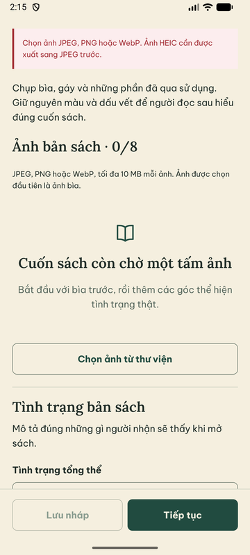
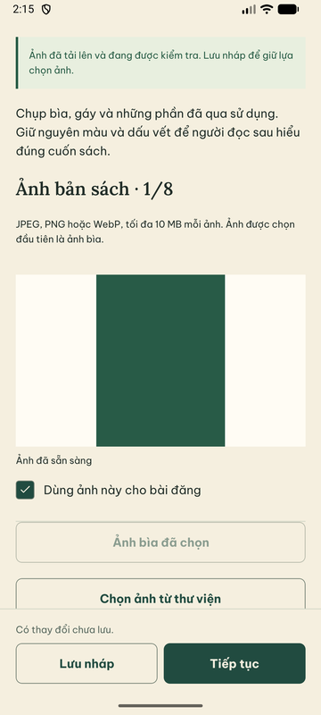
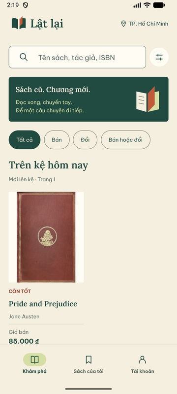
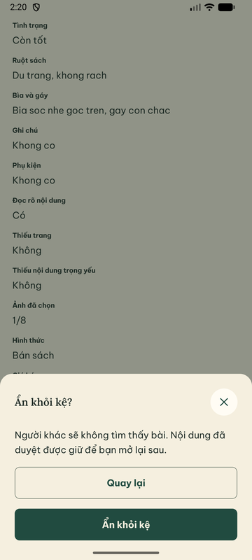
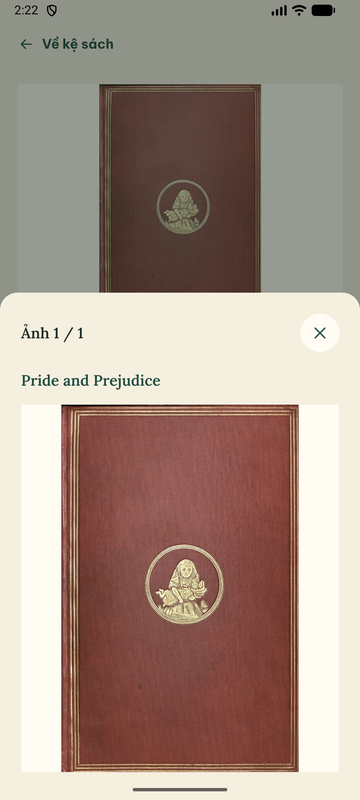

# Android: lượt nghiệm thu native 29/09/2026 (máy tiếp nhận)

Phiếu theo [NATIVE_ACCEPTANCE](NATIVE_ACCEPTANCE.md); tiếp nối
[lượt 28/09](NATIVE_RUN_2026_09_28.md). **Không thay review độc lập; chưa đóng đủ 21 ca.**

```text
Người thực hiện / ngày giờ / người review: agent Claude trong phiên tiếp nhận, 29/09/2026 00:00–02:25 (Asia/Saigon) / chưa có reviewer người
Commit app / commit API-worker: JS Metro từ working tree nhánh codex/u02 → codex/u06 → codex/q01-native (d9ede16 và các thay đổi U02–U06 đã commit); API/worker từ `nest build` trên cùng nhánh, backend không đổi so với main 382dda2
Thiết bị / AVD / ABI / OS / bàn phím / cỡ chữ / TalkBack: AVD Medium_Phone, x86_64, Android 17 (API 37, ps16k), Gboard docked, chữ 1.0 và 1.3 (đã trả 1.0), TalkBack không chạy
Artifact APK hash / loại / commit JS Metro: app-debug.apk SHA-256 c5d55846acc8aedc47b34558fa7333587ac253e5ad6dd58dd2be3187e8f9299c, debug, JS qua Metro từ working tree
Môi trường dữ liệu / storage / API reachability: Postgres local mới (Compose 5433, seed 4 tài khoản), Supabase Storage thật (bucket private), adb reverse 8081/3000
Preflight / worker / offline: doctor:local PASS; media worker và order worker chạy từ dist; không mô phỏng offline trong lượt này
```

| Ca | Trạng thái | Quan sát |
|---|---|---|
| N01 | PASS (AVD này) | Cold start launcher, force-stop/reopen, deep link `/showcase` nóng và cold; icon/splash Lật lại. Xem [A00](A00_ANDROID_STARTUP.md) |
| N02 | PASS | Kệ thật có 1 bài duyệt; chi tiết ảnh thật, “CÒN TỐT · BÁN”, giá 85.000 ₫; “Xem ảnh lớn” mở sheet có tên; Back đóng sheet trước, Back lần hai về kệ. Chưa có tên dài thật trên kệ (tên dài đã kiểm ở showcase 28/09) |
| N03 | PARTIAL | Login Member đúng → profile thật. Chưa thử sai mật khẩu để không tốn lượt limiter |
| N07 | PASS | Form trống báo lỗi đúng ô + tóm tắt; bàn phím số cho điện thoại, footer trên bàn phím; tạo 2 địa chỉ (A/B có nhãn mô phỏng); tên dài xuống dòng; mặc định phân biệt. Xem [U03](U03_ADDRESS_BOOK.md) |
| N08 | PASS | Tạo nháp → sheet đề nghị đầu sách: thiếu tác giả/ngôn ngữ báo đúng ô, sửa rồi gửi; đầu sách “Chờ xác nhận” được trình bày là chưa xác nhận |
| N11 | PASS JPEG+PNG | JPEG (U02) và PNG 600×800 qua Supabase thật → Sharp → “Ảnh đã sẵn sàng” + preview. WebP chưa chạy |
| N12 | PASS | JPEG nhiễu 34,9 MB → “Ảnh quá lớn. Chọn ảnh không quá 10 MB.”; GIF → “Chọn ảnh JPEG, PNG hoặc WebP…”. Picker trả đúng loại gốc; không có request tạo media mới (log API: số POST media không đổi) |
| N14 | PASS | Background: Home 20 s → mở lại, preview ký lại một lần, giữ thay đổi chưa lưu, không lưu/submit. Lỗi preview: gỡ `adb reverse tcp:3000` → ảnh hiện “Chưa tải được ảnh xem trước.” + “Tải lại ảnh”; nối lại và bấm → ảnh hiển thị, lỗi mất |
| N15 | PASS | Gửi khi thiếu ảnh/tình trạng → mở bước 2 và cuộn tới ô lỗi đầu; lỗi tự mất khi sửa. Xem [U02](U02_LISTING_FORM.md) |
| N16 | PARTIAL | Back ở editor có thay đổi → dialog “Rời bài đăng”; chưa ghi đủ tổ hợp bàn phím mở + Back |
| N17 | PASS | Gửi duyệt → Staff từ chối có lý do (operations) → Member thấy lý do, sửa, gửi bản 2 → Admin xác nhận đầu sách → duyệt → sách xuất hiện trên kệ thật |
| N18 | PASS (trừ archive) | Ẩn (dialog nêu hậu quả) → kệ rỗng, dòng “Đã được duyệt · Đang ẩn”; Mở lại → về kệ. Sửa bài đã duyệt: footer chỉ còn “Tiếp tục” (không lưu nháp riêng), đổi giá, dialog “Gửi bản sửa để duyệt lại?” nêu sách ngừng công khai → Đang chờ duyệt, kệ rỗng → Admin duyệt → kệ hiện giá mới. Archive không chạy để giữ dữ liệu demo (browser suite có) |
| N20 | PARTIAL | Chữ OS 1.3: editor, tab bước, footer đọc được, không cắt. Chưa đủ mọi màn + bàn phím |
| N04–N06, N09, N10 | Không chạy lại | PASS/PARTIAL từ 28/09; code session/picker không đổi |
| N13 | PASS (mất mạng trước khi gửi) | Gỡ `adb reverse tcp:3000`, chọn PNG → app giữ lần tải, hiện “Thử lại ảnh vừa chọn”/“Bỏ lần tải chưa hoàn tất”, 0 media tạo; nối lại, thử lại → đúng 1 media mới, Ready, 2/8 ảnh. Cắt giữa PUT không canh được (JPEG 6,2 MB qua localhost xong trước khi gỡ reverse); lost-ack sau commit vẫn dựa vào browser/transport suite |
| N19 | PASS | Nháp chọn nơi gửi mặc định, lưu → phiên thứ hai (API, cùng Member) sửa địa chỉ đó → sau lượt làm mới 30 s editor báo “Nơi gửi đã được sửa hoặc xóa. Chọn lại…”; API xác nhận nháp vẫn ghim version 1 trong khi địa chỉ là version 2 |
| N21 | NOT_RUN | TalkBack chưa chạy |

Phát hiện: operations mở lại hồ sơ đã quyết định trong cùng phiên hiển thị bản cũ, không có form duyệt, dù hàng chờ có bản mới. Đã sửa trên nhánh `codex/ops-detail-reopen-fresh` (`40253c5`), xem [OPERATIONS_UI_QA](OPERATIONS_UI_QA.md).

Phát hiện phụ: sau khi app trở lại từ nền, dev client hiện cảnh báo nối lại Metro
(`10.0.2.2:8081`) — thuộc công cụ debug, không phải hành vi app/release.







Dữ liệu QA còn lại trên DB local: listing “Pride and Prejudice” (Approved bản gửi 4, 95.000 ₫, Visible,
ảnh tư liệu public-domain), một nháp chưa lưu ảnh PNG, 2 địa chỉ thử, catalog đã xác
nhận. Không reset DB, không sửa SQL, không đổi mật khẩu/quyền.
