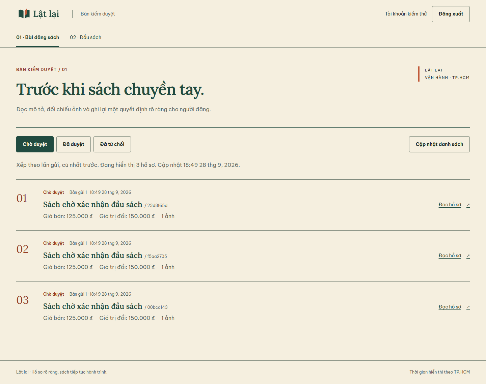
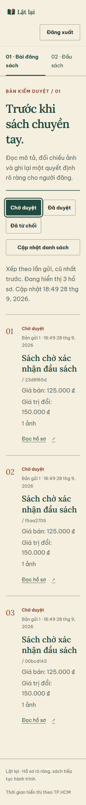
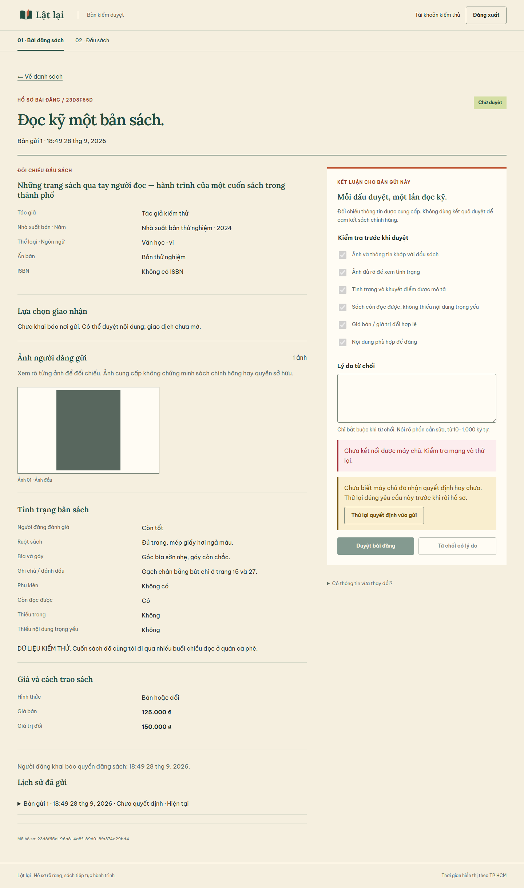

# Operations: giao diện và bàn phím trước bàn giao

28/09/2026 · Nhánh `codex/operations-ui-qa`, tiếp nối checkpoint
`checkpoint/f2h-handoff-2026-09-28`. Giữ F2h/OpenAPI 0.20.0.

## Phát hiện và sửa

1. Hàng chờ dùng `salePrice ?? exchangeValue`, nên bài “Bán hoặc đổi” chỉ hiện
   một số tiền không có nhãn. Nay hiện riêng **Giá bán** và **Giá trị đổi** khi có
   dữ liệu, xuống dòng ở màn hẹp; không đổi dữ liệu hay cách tính giá.
2. “Đến nội dung chính” cuộn trang nhưng không đặt focus vào main.
   Thêm `tabIndex=-1`: Enter chuyển tới main, Tab tiếp theo tới bộ lọc.
   Assertion focus thất bại trước sửa và qua sau sửa.
3. Khi quyết định lỗi/mất phản hồi, dialog đóng nhưng nút mở đã bị khóa;
   bàn phím mất điểm tiếp tục. Nay focus tới nút thử lại/đối chiếu khi xử lý xong.
   Test mất ack thất bại trước sửa và qua sau sửa; conflict 409 cũng kiểm focus
   vào “Tải kết quả mới nhất”. Button operations nhận DOM ref theo React 19.
   Không đổi payload/key, quyền hoặc quy tắc replay.

## Kiểm thử và xem ảnh

Runner `apps/admin-web/tests/browser.mjs` dùng Chromium headless trên Windows,
API NestJS/PostgreSQL thật trong schema QA riêng và storage fixture. Đây là
browser tự động + xem screenshot, không thay kiểm thử native, screen reader
hoặc storage Supabase thật.

| Trạng thái | Kết quả |
|---|---|
| Queue 1440px | Hai giá có nhãn; trạng thái/mã/thứ tự hồ sơ rõ; giữ nhận diện giấy–rừng, dấu cam |
| Queue 320px, chữ 135% | Không tràn ngang; giá/mã/bộ lọc xuống dòng; focus bộ lọc nhìn thấy |
| Loading → lỗi lần đầu → retry | Loading riêng, lỗi không thành rỗng; Enter retry tải được dữ liệu |
| Queue rỗng | Có hướng dẫn, không tạo hồ sơ/số liệu để lấp đầy |
| Refresh lỗi | Giữ hồ sơ và thời điểm cập nhật cũ, lỗi cạnh danh sách; retry phục hồi |
| Dialog quyết định | Focus ở quay lại; Tab/Shift+Tab giữa hai nút; Escape trả focus về nút mở |
| Ảnh lớn/rời hồ sơ | Escape đóng ảnh/trả focus; hủy rời hồ sơ giữ đủ 6 checkbox và trả focus |
| Lý do sai | Focus vào textarea, aria-invalid và hướng dẫn tại trường |
| Mất ack | Lỗi + hướng dẫn retry cùng yêu cầu; focus recovery; hai POST cùng key, đối chiếu thành công |
| Conflict 409 | Hai phiên thật cùng phiên bản; lỗi, khóa quyết định cũ, focus tải kết quả; tải được kết quả mới |
| Detail 390px và 320px/chữ 135% | Tên dài, tình trạng, hai giá, lý do từ chối và form gỡ bài vẫn đủ; ca chữ lớn không tràn ngang |

Suite còn giữ Staff/Member, không tự duyệt, phân trang, refresh token, hết phiên,
logout, browser storage rỗng và gỡ bài mất ack. Kết quả cuối **PASS**, pageerror=0.
Log local `.tmp/operations-ui-browser.log`; log đỏ focus recovery
`.tmp/operations-ui-focus-before.log`. Log không là dependency bàn giao.

`contract:check`, operations lint, **13/13 unit**, build TypeScript/Vite đều qua.
Backend/RN không đổi nên không chạy lại 480 API E2E/native trong lát cắt này;
kết quả trước ở [REBUILD](REBUILD.md). Warning pg concurrent query của fixture
vẫn xuất hiện; không che warning hoặc coi storage fake là bằng chứng provider.

Tái tạo bằng phần PostgreSQL QA/browser regression trong [START_HERE](START_HERE.md).
Runner xuất ảnh vào `apps/admin-web/test-results/`. Ảnh chọn dưới đây lưu trong
Git, chỉ chứa dữ liệu kiểm thử; khối xanh là ảnh fixture.

## Phạm vi nghiệm thu

Đóng lát cắt operations trong vòng handoff: queue/detail/reason/checklist,
loading/empty/error/retry/conflict, bàn phím được liệt kê và responsive chữ lớn.
Không là chứng nhận accessibility toàn diện hoặc mọi trình duyệt.
Native Android/iOS và review độc lập vẫn mở trong [READINESS](READINESS.md).
Checkpoint cũ giữ nguyên; nhánh này lưu phần bổ sung, chưa push/merge/release.

Nguồn bổ sung được đóng vào `.tmp/latlai-operations-ui-source.bundle` cùng file
`.sha256`, chứa nhánh này và tag checkpoint cũ. Nhận bằng
`git clone --branch codex/operations-ui-qa ./latlai-operations-ui-source.bundle latlai`.
Bundle cũ `latlai-f2h-source.bundle` vẫn giữ nguyên và chưa có ba sửa UI trên.
Kiểm tra clone sạch trong REBUILD áp dụng checkpoint cũ; phần bổ sung này đã qua
các kiểm tra liên quan ghi trên, chưa lặp toàn bộ clean-clone/native acceptance.
