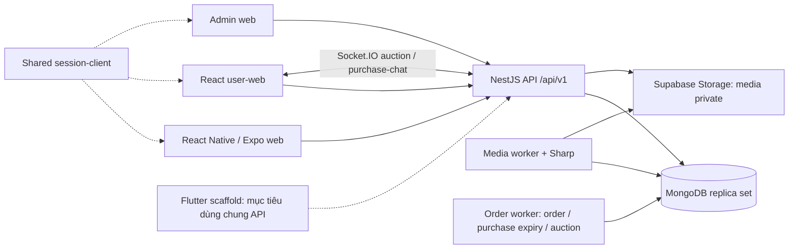

# Context bàn giao Lật lại cho AI/chat mới

Snapshot **09/10/2026**, sau khi pull `main` từ `5badc90` lên **`da59199`**.
Bản này tổng hợp yêu cầu, code và bằng chứng lưu trong repo để tiếp nhận công việc;
không thay SRS/ADR/contract, không tự cấp quyền mở feature, merge hoặc deploy.

Đợt [dọn docs09/10](DOCS_AUDIT_2026_10_09.md) đã cập nhật các hướng dẫn hiện hành.
Mục10 giữ các khác biệt phát hiện trước đợt dọn để truy vết; đọc audit để biết phần
đã sửa trong tài liệu và phần code/gate còn cần xử lý. Source sản phẩm không đổi.

## 1. Cách dùng và nguồn của bản bàn giao

- Mở [prompt tiếp nhận](NEXT_SESSION_PROMPT.md) để khởi động chat mới có quyền đọc repo.
- Đọc bản này để hiểu toàn cảnh; dùng [inventory kỹ thuật](PROJECT_CONTEXT_INVENTORY.md)
  khi cần danh sách API, migration, collection, test, script, biến cấu hình và ADR.
- Nếu AI không truy cập repo, gửi cả context và inventory; mọi kết luận chỉ đúng
  tại snapshot này. Khi có nhiệm vụ cụ thể, cung cấp thêm source liên quan.
- Trước sửa, kiểm lại Git và source hiện hành. Không dùng SHA/ngày trong bản này
  làm bằng chứng rằng máy nhận, DB hoặc remote CI vẫn ở đúng phiên bản đó.

Nguồn đã đối chiếu: Git log/branch/stash, manifest các package/workspace, SRS 1.1,
phụ lục TP.HCM, DOMAIN_RULES, ADR Mongo/đấu giá/realtime/thông báo, source API và
client, contract, migration registry, test source, workflow CI và tài liệu handoff/UI.
Đây là khảo sát tĩnh cùng kiểm tra tài liệu; phiên này **không chạy lại test sản phẩm,
không chạy app/worker, không đọc nội dung `.env` thật hoặc dữ liệu nghiệp vụ**.
Thông tin trong chat riêng, issue chưa truy cập và các file chưa có trong Git không
được mặc định là đã thu thập. Remote CI/review hiện tại chưa xác minh.

| Cần quyết định gì | Nguồn phải dùng |
| --- | --- |
| Nghiệp vụ mục tiêu | [SRS 1.1](../SRS_V1_1.md) + [LOCAL-AUCTION-01](../features/LOCAL_HANDOVER_AUCTION.md) |
| Thiết kế/chuyển trạng thái mục tiêu | [Local transaction design](../features/LOCAL_TRANSACTION_DESIGN.md), [acceptance](../features/LOCAL_TRANSACTION_ACCEPTANCE.md), ADR liên quan |
| API được khai báo | [OpenAPI](../../packages/api-contract/openapi.yaml), types sinh ở `packages/api-contract/src/schema.ts` |
| Phần thực sự được code | Controller/service, migration registry, client route/service và test tại đúng SHA |
| Việc và gate đang ghi nhận | [SESSION_STATE](SESSION_STATE.md), [READINESS](READINESS.md); đối chiếu Git khi ghi chú cũ |
| Setup và code map | [TEAM_WINDOWS](TEAM_WINDOWS.md), [START_HERE](START_HERE.md), [DEVELOPMENT](../DEVELOPMENT.md), [ENV_HANDOFF](ENV_HANDOFF.md) |
| Quy tắc cho AI/nhóm | [AGENTS](../../AGENTS.md), [AI_WORKFLOW](../AI_WORKFLOW.md), [CONTRIBUTING](../../CONTRIBUTING.md), [TEAMWORK](../TEAMWORK.md) |
| Tìm tài liệu/bằng chứng cũ | [CATALOG](../CATALOG.md), [docs README](../README.md); HISTORY/báo cáo có ngày là evidence lịch sử |

Code mô tả hành vi thực tế, không tự chứng minh hành vi đó đúng SRS hoặc đã được
duyệt. Nếu code và quy tắc khác nhau, ghi hai phía và làm rõ trong nhiệm vụ liên quan.

## 2. Project là gì?

**Lật lại — Used-Book Marketplace**, tagline **“Sách cũ. Chương mới.”**, là nền tảng
đồ án cho mua bán, trao đổi và đấu giá từng bản sách đã qua sử dụng. Giao diện chính
bằng tiếng Việt, tiền VND, lưu thời gian UTC và hiển thị theo Asia/Ho_Chi_Minh.
Repo remote: [huangg49/used-book-marketplace](https://github.com/huangg49/used-book-marketplace).

Phạm vi sản phẩm đã chọn: giao dịch trong vùng phục vụ TP.HCM; giữ giao trực tiếp
qua carrier mô phỏng; hai điểm giao nhận mô phỏng do Lật lại quản lý. ViaPoint là
lựa chọn cho mua/đổi thường, nhưng sách đấu giá bắt buộc được điểm nhận và kiểm tra
trước mở phiên. RN là client Member ưu tiên; các client dùng cùng API.

SRS mục tiêu còn gồm đăng ký/xác minh/khôi phục tài khoản, catalog/listing, giỏ hàng,
mua một listing mỗi Order, đổi một cuốn lấy một cuốn có/không bù tiền, ví/nạp/rút
mô phỏng, vận chuyển, claim/return/settlement, đánh giá, chat/forum/wishlist,
thông báo và vận hành. Danh sách này **không phải danh sách đã hoàn thành**.

Ngoài baseline: tiền/payment gateway/ngân hàng/carrier thật, COD, giao ngoài vùng,
đổi nhiều cuốn cùng lúc, đấu giá nâng cao/auto-relist/giá sàn bí mật, chuyển sách
giữa các điểm, chứng nhận chính hãng, miễn cọc theo uy tín và chatbot. Trợ lý gợi ý
giá có increment riêng với ADR Proposed và các điều kiện còn mở; không suy thành
chức năng định giá thị trường đã nghiệm thu.

Các actor: Guest, Member, Staff, Admin, System; source có quyền **TEST_OPERATOR**
cho simulator. Staff/Admin có thể đồng thời mang vai Member nhưng phải độc lập
với hồ sơ được duyệt/xử lý. Assignment đúng điểm là điều kiện thêm cho Staff;
ADMIN đơn thuần không được nhận/kiểm tra/bàn giao thay Staff.

## 3. Snapshot Git và tích hợp gần nhất

Khi bắt đầu thu thập, local `main` sạch, khớp `origin/main` `da59199`. Lượt pull
trước đó fast-forward 28 commit, không có local commit riêng trên main. Gói context
được làm trên nhánh riêng `codex/project-context-handoff`, không đổi runtime.

| Mốc trên first-parent của main | Ý nghĩa từ Git/source |
| --- | --- |
| `3492ac3` / PR18, `02112cb` / PR20 | Đăng sách + trợ lý giá, rồi bổ sung Gemini/tra giá |
| `e250c8e` / PR19 | Wishlist API/RN |
| `ccdee17` / PR21, `9399e12` / PR22 | Client user-web và tích hợp mua/bán thật từng phần |
| `78c9a8d` / PR23 | Backend đấu giá, gồm các commit completion/claim/violation |
| `cbeafa6` / PR24, `5badc90` / PR25 | Gộp giao diện Minh với API Nhật, checkpoint handoff |
| `070949e` / PR26 | Purchase conversations giữ sách 24 giờ + chat |
| `37512c0` / PR27, `b2bba54` / PR29 | Tìm kiếm/giao diện user-web, auth/navbar/favicon |
| `da59199` / PR28 | Đấu giá web, realtime, thông báo và sửa race/bước giá |

Tên PR/mốc merge lấy từ lịch sử Git và diff. Không suy CI xanh/human review từ
việc commit merge đã có. Một số mục SESSION_STATE/ADR vẫn ghi “chưa push/merge”;
xem mục 10 trước dùng chúng làm tình trạng tích hợp.

Local work đang bảo toàn: stash `e9a4e80` của `codex/openai-price-provider`, stash
`e988200` của `codex/system-architecture`; nhánh RN `codex/listing-ux` tại `891e851`
có các thay đổi UX chưa nhập main. Không pop/drop/reset/merge các phần này chỉ để
“khôi phục context”. Chi tiết môi trường riêng nằm ở local notes, không đưa secret
hoặc snapshot cấu hình vào Git.

## 4. Kiến trúc và stack thực tế

Monorepo pnpm; backend là **NestJS modular monolith**, dùng **MongoDB replica set**
và official Node driver, không dùng Mongoose/Prisma Mongo. PostgreSQL schema và
17 migration SQL giữ làm lịch sử/nguồn import, không là runtime API hiện tại.

| Thành phần | Stack/entrypoint tại source |
| --- | --- |
| API | NestJS 12, TypeScript 6, MongoDB driver `7.6.0`, Ajv/class-validator, JWT/Argon2; [app.module](../../apps/api/src/app.module.ts), [configure-app](../../apps/api/src/configure-app.ts) |
| RN + Expo web | Expo SDK 57, React Native `0.86.3`, React `19.2.3`, Expo Router, TanStack Query; `apps/mobile-react-native/src/app/`, `src/features/`, `src/core/` |
| User web | App riêng đã có: React 19, Vite 8, React Router 7, TanStack Query, Zod, React Hook Form, CSS Modules/Tailwind, Framer Motion, Socket.IO; [router](../../apps/user-web/src/app/router.tsx) |
| Admin web | React/Vite, TanStack Query, shared session; [App.tsx](../../apps/admin-web/src/App.tsx), `src/features/review/`, `users/`, `dashboard/` |
| Flutter | Riverpod/Dio/GoRouter có dependency và kiến trúc đề xuất; [main.dart](../../apps/mobile-flutter/lib/main.dart) mới là scaffold |
| Shared packages | `packages/api-contract`, `packages/session-client`, `packages/brand` |
| Media | Supabase private storage, metadata/quyền/budget/jobs trong Mongo; Sharp xử lý ở [media-worker](../../apps/api/src/media-worker.ts) |
| Deadline worker | [order-worker](../../apps/api/src/order-worker.ts) chạy Order expiry, purchase conversation expiry, auction/point-order sweep; loop khoảng 60 giây |
| Redis/BullMQ | Có dependency/hạ tầng, không là nguồn số dư hoặc engine của hai worker hiện tại |

API prefix `/api/v1`, Swagger `/docs` đọc YAML contract. Middleware cấp request ID,
`Cache-Control: no-store`, `X-Content-Type-Options: nosniff`, log metadata request.
CORS phải khớp origin thật. Không ghi body/token/contact/ảnh vào log.

## 5. Tính năng: code có gì và giới hạn ở đâu?

| Miền | Có trong source main | Giới hạn cần giữ |
| --- | --- | --- |
| Auth/session | Login, refresh, logout, current profile; auth/role guards, shared session transport | Chưa có API đăng ký/email verification/reset password và admin lock/unlock đầy đủ |
| Catalog | Public books, Member catalog request/resubmit, operations review | Catalog là đầu sách/ấn bản, không là từng cuốn hiện vật; không suy đã có mọi chức năng merge/catalog admin của SRS |
| Listing | Draft/revision, condition/mode/giá, ảnh, submit/review, sửa bài đã duyệt, hide/reopen/archive/remove, public shelf/detail | Reserved cấm sửa nghiệp vụ; badge duyệt thông tin không là chứng nhận chính hãng |
| Wishlist | API lưu catalog/listing + RN screen; listing projection có book/photos | Matching/notification wishlist chưa là workflow hoàn chỉnh |
| Địa chỉ/quote | Address book/default/revision, vùng HCM-DEMO-v1, listing delivery origin, DirectDelivery sale quote | Quote không giữ sách/tiền; địa bàn demo không là danh mục hành chính thật |
| DirectDelivery Order | Tạo unpaid, giữ listing độc quyền, expiry/cancel; pay từ ví, seller accept/reject, packaging, shipment label, simulator pickup, InTransit, overdue/non-receipt review | Lane DirectDelivery vẫn dừng F2h; chưa có Delivered/inspection/settlement hoàn chỉnh và UI checkout/fulfillment đầu-cuối |
| Wallet/simulator | Ledger immutable, nguồn mô phỏng hữu hạn, topup intents/events, balances/history/reconciliation | Chưa có withdrawal workflow; RN C01 chỉ đọc dưới cờ nội bộ, không là topup/checkout UI |
| Purchase conversations | Sale/Both đủ điều kiện: participant chat không giữ listing; buyer có thể gửi địa chỉ/báo giá, seller chọn một hội thoại và nhập giá đã thỏa thuận để tạo Order | Chỉ tạo Order unpaid mới chuyển listing Reserved; buyer thanh toán sau. Listing Reserved bởi Order vẫn hiển thị đang giao dịch. Migration 0028 giữ expiry 24h cho hội thoại cũ đã tồn tại trước thay đổi |
| Auction/points | Hai điểm, slot, Staff assignment, Sale intake, receive/inspect/open, manual/Auto/BuyNow/close, winner ViaPoint Order/pay, report/code/handover | Chỉ self dropoff/self collect; ordinary ViaPoint sale/exchange, carrier legs, point admin CRUD và nhiều incident flows chưa hoàn chỉnh |
| Completion ViaPoint | Source có inspection claim, Admin resolution/return, Staff receive-return, worker settlement, listing Sold | Code tồn tại nhưng mâu thuẫn gate/tài liệu cũ; chưa có evidence đóng release/human gate, xem mục 10 |
| Auction live | Public read-only Socket.IO; cache update, reconnect ack, REST fallback | Auto ceiling/private participation không public; RN/Flutter chưa subscribe |
| Notifications | Durable auction inbox, mark read, unread count; bell và `/notifications` trên web | Chỉ auction events; không có email, wishlist matching, opt-out hoặc thông báo đầy đủ cho bước sau payment |
| Price assist | API + RN panel + operations view, provider Anthropic/Gemini, references/lookup/import/eval | Tắt mặc định; live eval/nguồn giá reviewed còn thiếu; search quota BLOCKED trong report lịch sử |
| Exchange | UI web discovery/compose/mine/detail và mock chat/actions | Không có module/contract Exchange workflow thật; mock compose cho nhiều cuốn/meetup còn lệch SRS |
| Admin | Catalog/listing review, private media review, user directory | Dashboard dùng dữ liệu mẫu; chưa có operations UI đầy đủ cho auction/point completion/disputes |
| Flutter | Một màn scaffold | Không có parity auth/listing/giao dịch với RN |
| Forum/reviews/cart rộng | Có yêu cầu SRS | Chưa tìm thấy workflow API tương ứng trong inventory source hiện tại |

Điểm bắt đầu khi sửa backend: `apps/api/src/modules/<feature>`. Inventory có 17
thư mục module; các module nội bộ như commands/reservations/price-assist không
nhất thiết được import trực tiếp ở AppModule.

### 5.1 Các luồng cần phân biệt

**Listing:** catalog → owner draft → ảnh xử lý Ready → save/submit → Staff/Admin
độc lập review → Approved/Visible/Available lên kệ. Một Book có thể có nhiều
Listing; mỗi Listing là một bản vật lý. Moderation, visibility và trade là các
chiều trạng thái riêng. Sửa dữ liệu trọng yếu sau duyệt tạo revision và duyệt lại.

**DirectDelivery:** quote → unpaid Order + exclusive commitment → pay hold P+S →
seller nhận Preparing → packaging + label → independent pickup InTransit →
overdue/non-receipt ResolutionPending khi cần. Sau seller acceptance không gọi
nhánh refund trước acceptance. Ảnh/label/report không tự chứng minh custody hoặc
cho phép trả tiền/restock. F2h review là intake điều tra, không là xử lý tranh chấp xong.

**Purchase chat:** `POST /listings/{id}/purchase-conversations` với listing
expectedVersion + key → conversation Active, không reserve listing; nhiều Buyer
có thể chat cùng Seller/listing. Buyer gửi địa chỉ và báo giá giao nhận qua
`POST /me/purchase-conversations/{id}/quote`; Seller chọn một chat và `POST /orders`
nhập giá đã thương lượng để tạo unpaid Order, snapshot giá và reserve listing.
Buyer xác nhận thanh toán sau. Order-reserved listing vẫn public với trạng thái
InNegotiation; migration 0028 duy trì expiry chỉ cho chat cũ có 24h hold. Lệnh gửi
qua `/purchase-chat` dùng messageId để dedupe; kiểm tra gateway/service thay vì
suy rằng HTTP global guards kiểm quyền socket.

**Auction:** Sale đã duyệt/Available → intake giữ commitment + slot → Staff nhận
và Pass → Active 24h → bid/Auto hoặc BuyNow → ViaPoint Order giữ commitment được
transfer → buyer pay → accept report → mã nhận → Staff handover → Inspection.
Source completion hiện có thêm claim/return/settlement. Nếu không bán/quá hạn
thanh toán/inspection Fail, thường phải ReclaimRequired; chỉ Staff ghi reclaim
mới trả listing/slot theo điều kiện. Không tự chuyển người đứng thứ hai hoặc relist.

### 5.2 Realtime và thông báo

- [ADR 0031](../adr/0031-live-auction-updates.md): namespace `/auctions` public,
  chỉ đọc. `auction:watch/unwatch`, `auctions:watch/unwatch`; push
  `auction:update`, `auction:summary`. Ack khi reconnect là điểm resync.
  API nudge sau commit; poll version 2 giây khi có watcher để bắt worker/operations.
  Detail REST fallback 10 giây khi socket down, 60 giây khi live; list fallback 30 giây.
  Bid/payment vẫn là REST command, không xử lý qua public socket.
- [ADR 0032](../adr/0032-member-notification-inbox.md): `member_notifications`
  ghi cùng transaction với event, unique dedupeKey; GET `/me/notifications`,
  POST `/me/notifications/read`. Mark-read cần key nhưng naturally idempotent,
  không lưu mutation receipt. Nội dung không có OTP/address/Auto ceiling.
- [Purchase gateway](../../apps/api/src/modules/purchases/purchase.gateway.ts):
  namespace `/purchase-chat`, auth bearer access token, `purchase:join`,
  `purchase:send`, push `purchase:message`; room gắn conversation participant.
  WebSocket semantics không được mô tả hết bởi inventory HTTP.

## 6. Những invariant AI phải giữ

Đọc [DOMAIN_RULES](../architecture/DOMAIN_RULES.md), [ADR 0027](../adr/0027-mongodb-persistence-protocol.md)
và [model map](../refactor/MIG02_MODEL_MAP.md) trước thay đổi tiền/quyền/DB.

1. **Quyền ở server:** auth mặc định; `@Public()` chỉ route cố ý public;
   role guard không thay owner/participant/eligibility/state checks. Quyền hiện
   tại kiểm trước receipt replay. `ExistingObligation` chỉ method đúng phạm vi;
   LOCKED/RESTRICTED không có quyền giao dịch mới chỉ vì đã login.
2. **Một sách, một cam kết:** giữ nguyên authority/commitment/projection giữa
   Order, auction intake/point Order và purchase conversation. Không chỉ đổi
   `listing.trade` để giả giữ hoặc mở lại sách; checkListing kiểm chủ giữ hợp lệ.
3. **Snapshot:** book/listing revision, contact/address revision, policy, fee,
   deadline chốt khi giao kết. Edit config hiện tại không sửa nghĩa vụ cũ.
4. **Idempotency:** giữ key/body/receipt và expectedVersion theo contract từng
   command. Mất ACK/503/unknown commit → retry cùng ý định; không sinh key/version
   mới để ép thành công. Auction bid/Auto không có expectedVersion: kiểm locked
   state và trả minimum mới khi BidTooLow. Notification mark-read và chat send
   có cơ chế riêng; không áp máy móc một protocol cho mọi mutation.
5. **Atomicity/lock:** cross-module write qua explicit services trong command
   transaction. Key lock → user/session và auth → replay → resource locks →
   server decision clock → effect/receipt/audit/outbox + commit checks. Đọc lock
   order của từng service; không ghép các write rời rạc hoặc đảo thứ tự khóa.
6. **Mongo protocol:** snapshot read, majority write; lock bằng `$inc lockSeq`
   theo thứ tự xác định. Retry transient có budget 5s/60 attempts; unknown commit
   retry commit tối đa 3 lần rồi 503. Callback có thể chạy nhiều lần: không đặt
   network/storage side effect trực tiếp vào callback giao dịch.
7. **Ledger:** immutable journal/entry là nguồn số dư; integer VND, journal/hold
   có purpose và reference. Không sửa balance/entry, refill nguồn hoặc dùng Redis
   thay ledger. Review/claim unresolved phải giữ đúng hold và commitment.
8. **Deadline:** giờ server sau locks; đúng deadline là hết quyền, worker chậm
   không gia hạn. Countdown/ảnh/email/push không quyết định state nghiệp vụ.
9. **Media/custody:** bucket private, signed access theo quyền; quote, label,
   ảnh, report và inspection Pass không tự chứng minh đã bàn giao hay chính hãng.
   Không cho restock khi hiện vật chưa thu hồi hợp lệ.
10. **Migration:** hiện có source `0001`–`0015`; thêm migration mới khi đổi
    validator/index/reference, không sửa checksum đã áp dụng. API từ chối pending
    migration. Bootstrap quyền collection mới theo quy trình, không reset DB chung.
    API đổi request/response phải sửa YAML trước rồi `pnpm contract:generate`;
    commit cả YAML và generated types, không sửa tay `schema.ts`.
11. **Session:** một shared session client mỗi app. Browser token memory-only;
    native chỉ persist refresh token bằng SecureStore, access token memory.
    Đổi identity xóa query cache. Không thêm token store thứ hai.
12. **Evidence/authorization:** code merged, build xanh, fake storage và AI review
    không đóng native/live storage/human/release gates. Lượt này chỉ thu thập context;
    không cấp quyền khôi phục WIP, bật provider, sửa nghiệp vụ hoặc deploy.

Collection types hiện có **70** tên; migrations Mongo **15**. `_id` chủ yếu UUID
string lowercase hoặc khóa deterministic đã định nghĩa, không ObjectId tùy ý;
date có millisecond precision; cursor v2/normalized title key thay ordering PG.
Validators/indexes/quyền append-only và commit-time invariant checks cùng bảo vệ
dữ liệu; Mongo không tự có toàn bộ foreign key/constraint trigger tương đương SQL.

## 7. Chính sách nghiệp vụ cần nhớ

Đây là baseline SRS/phụ lục; cần kiểm constant/snapshot của lane được sửa, không
coi mọi chính sách đã được hiện thực ở mọi workflow.

| Nhóm | Baseline |
| --- | --- |
| Giá | 10.000–1.000.000đ; commission Order 5% tiền sách; ship demo DirectDelivery 30.000đ |
| Order trực tiếp | Checkout 15 phút, seller confirm 48h, pickup 48h, delivery overdue 240h |
| Inspection/claim | 72h từ nhận hợp lệ; bấm nhận/accept report không tự bỏ thời gian còn lại |
| Exchange mục tiêu | Một cuốn ↔ một cuốn; mỗi bên cọc 100% giá trị sách sẽ nhận; delta bên sách thấp trả; phí đổi 0đ, ship riêng |
| Điểm | HCM-DEMO-01/02, capacity 20 sách/điểm; giờ 09:00–18:00, slot giữ và custody đều tính sức chứa |
| Auction | Sale only; 24h không gia hạn; bước 10.000/50.000, `start + n*step`, Auto max private, ưu tiên sequence khi hòa |
| Giới hạn auction | Tối đa 2 intake/auction chưa kết thúc mỗi seller theo predicate hiện hành, 5 cam kết bid, 30 lệnh bid/Auto/phút |
| Winner/BuyNow | Winner pay 24h; BuyNow trước bid đầu, pay 15 phút; không runner-up tự động |
| Nhận tại điểm | Dropoff/recipient decision/collection 72h theo bước; mã 6 số/10 phút, 5 lần sai/15 phút |
| Vi phạm | 3 sự kiện verified trong 720h → hạn chế 168h; source `member-violations.ts` hiện áp cho hoạt động auction mới, chưa toàn bộ DirectDelivery/Exchange |
| Tiền mô phỏng | Nguồn ví 100M hữu hạn; quỹ incident 2M là yêu cầu riêng, không đồng nhất hai nguồn |

Order DirectDelivery mục tiêu giữ P+S; seller ứng ship và settlement P−C+S.
Order ViaPoint mục tiêu giữ P, phí mỗi carrier leg riêng; seller P−C. Bounded
auction đang SelfCollect nên outbound fee 0. Không ghép hai công thức hoặc thu
một chặng hai lần. Fees carrier thật/quỹ incident/ordinary ViaPoint đầy đủ không
được suy đã chạy từ mô hình yêu cầu.

## 8. Client, route và UI context

**RN:** route compose screen ở `src/features`, transport/session/UI ở `src/core`;
server data TanStack Query. Main route `/`, `/book?id=...`, `/account`, `/drafts`,
`/addresses`, `/wishlist`; `/wallet` opt-in `EXPO_PUBLIC_INTERNAL_MEMBER_VIEWS=1`.
`/ui`, `/design` và showcase là công cụ nội bộ/fixture, không chứng minh API.

**User-web:** `/`, `/books`, `/books/:id`, `/sell`, `/login`, `/register`, `/profile`,
`/chat[/:roomId]`, `/exchange[/new|/mine|/:id]`, `/auctions[/:id]`, `/notifications`.
Listing/search/detail/sell/purchase chat/auction/notification có service thật;
Exchange dùng `src/lib/mock`, `services/exchange*.ts`. Profile TODO, register form
preventDefault và chưa có backend register. Sell flow 5 bước giữ snapshot/key
trong phiên gửi; recovery sau reload và xử lý ảnh hỏng vĩnh viễn còn gap đã ghi.

**Admin:** entry router ở `src/App.tsx`; review queue/detail/decision và user
directory dùng API; `DashboardMock` ghi dữ liệu mẫu. UI auction intake/point
handover/Admin resolution chưa được tìm thấy trong các feature admin hiện tại.
**Flutter:** chỉ `lib/main.dart`; đừng dùng README kiến trúc để suy có implementation.

RN vẫn là lane ưu tiên. `apps/user-web` React/Vite riêng đã tồn tại và đã merge;
các hướng dẫn cũ “Member web chỉ Expo web/không tách app” cần quyết định làm rõ
khi thay architecture. Nhiệm vụ tiếp theo nên sửa đúng app được giao, không tự
xóa user-web hoặc tạo thêm client/framework.

Nguồn thiết kế: [DESIGN](../DESIGN.md) ưu tiên định hướng UI-1 khi mâu thuẫn thẩm
mỹ cũ; [UI_CODING_RULES](../design/UI_CODING_RULES.md), [UI_COMPONENTS](../design/UI_COMPONENTS.md),
[brand v1.1](../../packages/brand/v1.1/README.md). Logo gốc, forest/paper/terracotta,
Lora + Be Vietnam Pro; giá dùng Be vì Lora trong repo thiếu glyph đồng.
RN lấy token/core component qua `src/core/ui`; web dùng primitive/CSS hiện có của
app. Lora cho title, giữ ảnh sách nguyên màu/chi tiết lỗi, không tạo rating/trust
badge/số dư/custody chứng nhận giả.

Giữ loading/empty/error/offline/retry, form data khi lỗi, focus/keyboard/safe area,
Back/Escape, font scaling/chữ lớn, reduced motion. Touch tối thiểu 44px, control
chuẩn 52px; text contrast 4.5:1, control boundary 3:1. Chỉ API quyết quyền; không
thêm UI action khi chưa có contract/workflow. RN export không là native acceptance.

## 9. Setup, chạy và kiểm tra

Node theo `.nvmrc` **24.15.0**, engine **>=24.15.0**; pnpm **11.19.0**. Phiên thu
thập thấy Node mặc định máy là **24.12.0**, thấp hơn engine; đã chọn runtime cài
sẵn **24.19.0** cho kiểm tài liệu. Không đổi version repo/PATH hệ thống để né engine.

Máy mới: `pnpm install --frozen-lockfile` → `pnpm setup:local` → Docker Mongo
replica set → `pnpm db:bootstrap` → `pnpm db:migrate` → `pnpm db:seed` theo
START_HERE. `setup:local` chỉ tạo root/API/admin/RN env còn thiếu; user-web có
`.env.example` riêng, script hiện chưa tạo env cho app này. Upload cần Supabase
private bucket và server key ở backend. Server key không đưa vào VITE/EXPO_PUBLIC.

DB đang có: kiểm migration/readiness và backup theo quy trình trước thao tác;
collection mới cần role bootstrap sau migrate như ADR 0032. **Không chạy migrate/
seed chỉ vì đang đọc context.** Không copy credential/dump của chủ máy vào chat/Git.

Chạy hằng ngày ở root: terminal 1 `pnpm dev:api`; terminal 2 chọn `pnpm dev:rn`
(A Android dev APK, W Expo web), `pnpm dev:admin`, hoặc **`pnpm dev:user`** cho app
React web. API thường 3000, admin 5173, user-web 5174/preview4174, Metro thường8081;
port thực tế phải kiểm trước. CORS mặc định trong code chỉ có admin/Expo origins,
user-web5174 phải được cấu hình tương ứng. Emulator dùng `10.0.2.2` hoặc adb reverse;
phone dùng LAN phù hợp. Sau đổi worker/revision cần restart API và worker cùng source.

QA dùng `infra/docker-compose.mongo-test.yml`, replica set riêng và DB `*_test`.
`MONGO_TEST_URL` không là app `MONGODB_URL`; không chạy test ghi/xóa trên DB/bucket
local chính. Port57017 là default tài liệu, không áp cứng khi Windows reserved
range hoặc môi trường đang dùng port khác. PG QA/failover có điều kiện riêng;
skip không tính PASS. Đừng chạy hai suite vào cùng database.

Tooling demo H01 có `demo:books`, `demo:funding`, `demo:orders`, đọc
[DEMO_SCENARIOS](DEMO_SCENARIOS.md) trước dùng. Nó dựng kịch bản qua API/role độc
lập và lưu intent/key/body để recovery, không là quyền chèn Approved/InTransit/
balance trực tiếp. Các mốc funding/unpaid/Preparing/InTransit là dữ liệu demo
theo phạm vi đã code; full CLI crash recovery vẫn có giới hạn đã ghi. Manifest/
private state của run không tự là tài liệu an toàn để gửi chat hoặc commit.

| Loại thay đổi | Checks cần chọn theo phạm vi |
| --- | --- |
| Context/docs | `pnpm docs:check`, `git diff --check`, đọc lại nguồn/claims/link |
| API/contract | `pnpm contract:check`, `pnpm contract:routes`, API lint/typecheck/test/build, E2E liên quan |
| Mongo/schema/invariant | Các check API + `pnpm test:api:mongo`; import/failover nếu chạm cơ chế đó |
| Quyền/session/tiền | Ca deny/sai owner/state, stale version, replay/body conflict/lost ACK, race thật phù hợp |
| RN/Expo | RN lint/typecheck/test; export khi bundling ảnh hưởng; thao tác nền tảng bị sửa, native build nếu dependency/config đổi |
| User web | User-web lint/typecheck/test/build; `test:browser` khi flow integration ảnh hưởng, API build/QA prerequisites |
| Admin | Admin lint/typecheck/test/build; browser review/session/command và UI thật |
| Shared session | `pnpm --filter @used-books/session-client test` + consumer bị ảnh hưởng |
| Flutter | `dart format --output=none --set-exit-if-changed .`, `flutter analyze`, `flutter test`, thiết bị phù hợp |

CI source có 9 workflow: API, RN, admin, operations/public-browser, demo, docs,
developer launcher, infrastructure, Flutter. **Chưa thấy workflow nào chạy
`@used-books/user-web` hoặc path filter dành cho `apps/user-web`** ở snapshot.
CI admin/operations không tự chứng minh user-web đã được kiểm. Mỗi kết quả phải
gắn SHA/source/môi trường; remote status và branch protection chưa kiểm trong phiên này.

## 10. Những khác biệt tài liệu/code phải truyền sang AI sau

| Ghi chú đang có | Source thực tế tại `da59199` | Cách xử lý context |
| --- | --- | --- |
| README/START_HERE/docs README/NEXT_SESSION_PROMPT cũ nói API0.21, Mongo3 migrations | YAML0.30.0, registry15 migrations, 70 collection types | Dùng inventory và registry hiện hành; không sửa báo cáo lịch sử thành kết quả mới |
| SESSION_STATE nói purchase/auction “not merged/chưa push PR”, header07/10 | Main Git có PR23/26/28 và 27/29 | Dùng Git xác định tích hợp; giữ evidence từng source riêng |
| Architecture README/SRS phần “hiện trạng” nói points/auction/transactions chưa code | Các module/service/controller/migrations tương ứng đã có | Giữ SRS làm yêu cầu; status paragraph lịch sử không là inventory hiện tại |
| AGENTS/READINESS và ADR0030/report nói inspection/settlement bị chặn, dừng Inspection | `point-order-completion.service.ts` có claim/receive-return/settle; AuctionWorker quét Inspection hết hạn và gọi settle, module/worker đã wire | **Khác biệt gate nghiêm trọng:** code có behavior, chưa có evidence đóng gate. Không chạy worker để thử trên DB chính; không tự sửa nghiệp vụ/READINESS hoặc suy chủ dự án đã duyệt |
| Hướng dẫn Member web chỉ Expo web, không tách framework | `apps/user-web` React/Vite riêng đang trong workspace/main | Ghi cả định hướng và hiện trạng; cần làm rõ khi đổi kiến trúc, không xóa/migrate app tự ý |
| ADR0031 “no durable inbox” và report backend “no UI/notifications” | ADR0032 + inbox/web/auction pages đã có | ADR mới/source bổ sung phạm vi; point steps sau pay vẫn chưa đủ UI/thông báo |
| DOMAIN_RULES/comment nói collection commands cho nghĩa vụ LOCKED | `AuctionsController` accept/reject/code/claim/read hiện không có `@ExistingObligation`, trong khi global guard deny LOCKED; notification controller có decorator | Cần review quyền khi nhiệm vụ đụng lane này; không ghi LOCKED point flow đã hoạt động đúng chỉ dựa report |
| Exchange UI cho chọn nhiều cuốn và meetup | SRS một-cuốn-đổi-một, DirectDelivery/ViaPoint | Đây là mock lệch baseline; không dùng làm contract cho backend Exchange |
| Vi phạm POL-17 nêu hạn chế giao dịch mới tổng quát | `member-violations.ts` ghi scope auction intake/bid/BuyNow, chưa áp cho các lane khác | Không tuyên bố global restriction đã hoàn chỉnh |

Nguồn completion: [service](../../apps/api/src/modules/auctions/point-order-completion.service.ts),
[worker](../../apps/api/src/modules/auctions/auction-worker.service.ts),
[module](../../apps/api/src/modules/auctions/auctions.module.ts),
[migration0012](../../apps/api/src/database/mongo/migrations/0012-point-order-settlement.ts),
[controller](../../apps/api/src/modules/auctions/auctions.controller.ts).
Các nhận xét trên là đối chiếu source tĩnh, **chưa là một đợt review/test toàn sản phẩm**.

## 11. Bằng chứng đã ghi và gate còn mở

Các con số dưới là **evidence kế thừa**, không phải test chạy lại trong phiên này.

| Gói/source báo cáo | Evidence đã ghi | Giới hạn |
| --- | --- | --- |
| Mongo integration PR5/6, cutover30/09 | CI/parity/import/backup-restore và live media riêng trong hồ sơ Mongo | Không là production deploy hoặc full native/review |
| UI/dev workflow PR15 head79c5370 | 8workflow/9job CI PASS, RN99 tests, session20, admin13, export/public browser, Android debug/launcher checks | TalkBack/ARM/iOS/FPS/release còn mở; OS dark AndroidAPI35 ba nút có lỗi tương phản đã ghi |
| PR24 head966ce35 | 6 CI job PASS; user-web11 tests/typecheck/build/browser, submit lost-ACK một listing, viewport390/chữ130 | Fake storage browser; reload recovery chưa có; exchange/mock scaffold giữ giới hạn |
| Purchase checkpoint trong SESSION_STATE | Contract/routes, API unit106, Mongo schema16, RN typecheck, user-web build/typecheck; browser và local API happy path | Chưa có suite riêng purchase negative/race/socket recorded; native/review/CI hiện tại chưa xác minh |
| Auction backend report08/10 | APIunit102, auctionE2E17, fullE2E521, Mongo39+4skip ở source ghi | Report cũ chỉ tới0011, không bao phủ mặc nhiên completion0012/13 hoặc main mới |
| Auction web checkpoint09/10 | AuctionE2E lần sau47, APIunit115 ở mốc ghi, Mongo39+4skip, contract/routes; web16 tests, fixture Chromium375px/lost-ACK/realtime | Browser fixture không backend thật; có lần full E2E shipments lỗi rồi suite riêng31PASS; không suy toàn main PASS |
| Price assist report05–06/10 | Một provider live call, RN native với provider giả; fake lookup/unit checks | Live34-case eval/nguồn reviewed chưa có; GoogleSearch grounding429 là blocker ghi lịch sử, chưa probe lại |

[READINESS](READINESS.md) vẫn ghi: Mongo integration PASS trong phạm vi, dữ liệu
local DONE, setup guide READY; Android PARTIAL; TalkBack/ARM/iOS OPEN;
review tiền/quyền/UX người thật OPEN; release/hậu-F2h BLOCKED. Các evidence riêng
không cộng gộp để tự đóng gate. Quy tắc TEAMWORK: reviewer độc lập; tiền/settlement/
permissions/disputes cần reviewer thứ hai. AI review không là chữ ký người thật.

Chưa biết từ phiên này: test/CI của head main mới, migration đã áp dụng ở DB,
provider quota/config hiện tại, assignment người thật/reviewer đầy đủ, production
hosting/deploy, thời hạn demo mới. Mốc demo06/10 trong tài liệu là lịch sử, không
dùng làm deadline hiện tại09/10. Nhóm5 người/bạn+Bảo phụ trách phần khó là bối cảnh
đã ghi; Minh/Nhật được nhắc ở PR24, các owner khác không được tự suy thêm.

SESSION_STATE PR24 còn ghi việc loại script `apps/api/test-wishlist.mjs` chứa
credential khỏi source, nhưng credential có trong lịch sử và chủ máy cần đổi
theo quy trình riêng. Phiên này chưa xác minh việc đổi; không trích credential
hoặc chạy script lịch sử. Đây là việc tồn đọng đã ghi, không là secret scan mới.

## 12. Cách AI sau nhận việc

1. Kiểm Git và đọc AGENTS, context, SESSION_STATE, READINESS; giữ local work.
2. Nhận nhiệm vụ cụ thể và acceptance từ chủ dự án. Nếu chưa được giao feature,
   có thể giải thích/lập kế hoạch, không tự mở CONTINUATION_PLAN thành quyền code.
3. Chọn skill repo: [UI workflow](../design/UI_SKILLS.md) (UI/UX Pro Max, Taste,
   Impeccable),
   [API/Mongo](../../.agents/skills/latlai-api-mongo/SKILL.md),
   [verify/handoff](../../.agents/skills/latlai-verify-handoff/SKILL.md).
4. Đi từ inventory → contract → controller/service/client → test/ADR phần liên
   quan; không cần nạp lại mọi báo cáo cũ hoặc phục hồi stash.
5. Khi đụng khác biệt ở mục10, xác định yêu cầu và source cụ thể trước sửa. Context
   collection không giải quyết thay quyết định sản phẩm hoặc release gate.
6. Một gói/nhánh, checks theo rủi ro, evidence đúng nền tảng/môi trường; update
   SESSION_STATE phần mình, không đổi gate nếu không có evidence mới.
7. Commit scope rõ; push/PR/merge/deploy theo quyền của nhiệm vụ mới, không kế thừa
   quyền từ PR trước. Không gửi secret/PII qua prompt, repo, log hoặc artifact.

Context này đã gom toàn cảnh và đường truy nguồn đang có trong repo. Để làm tiếp,
AI cần nhiệm vụ mới và phải xác minh lại phần source/environment mà nhiệm vụ chạm tới.
