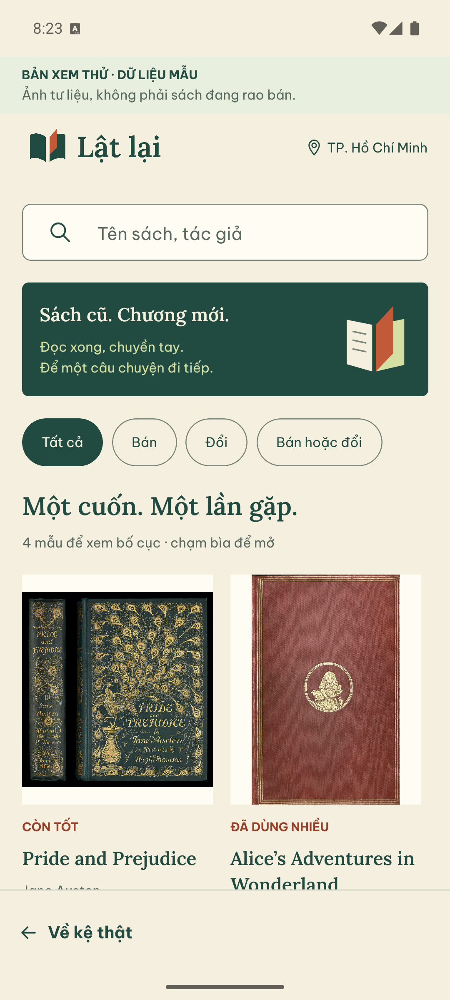
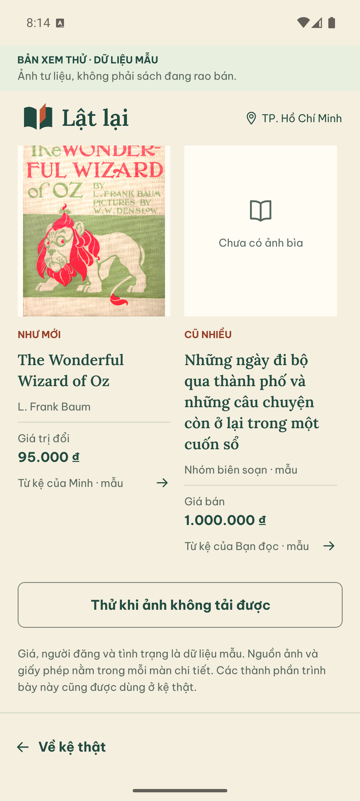
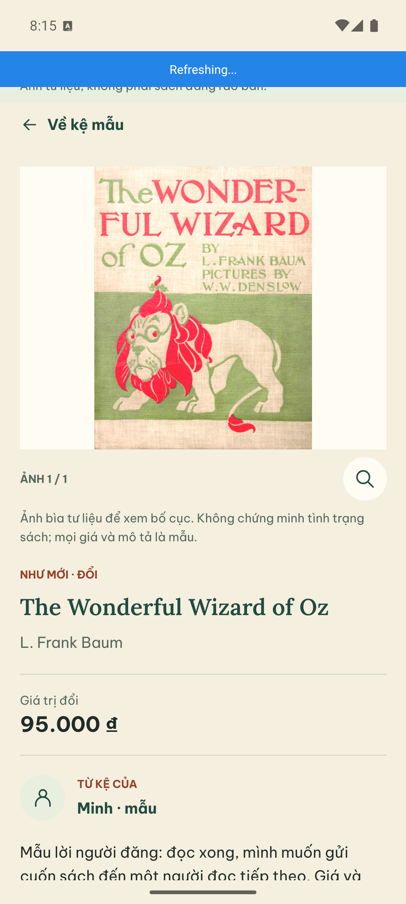
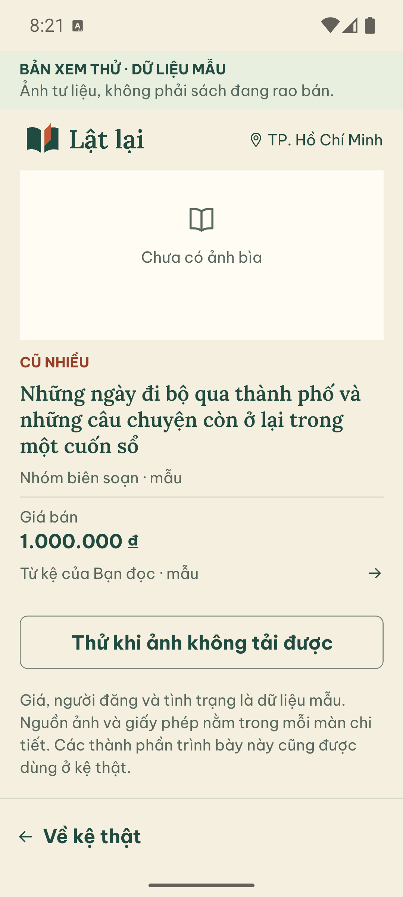
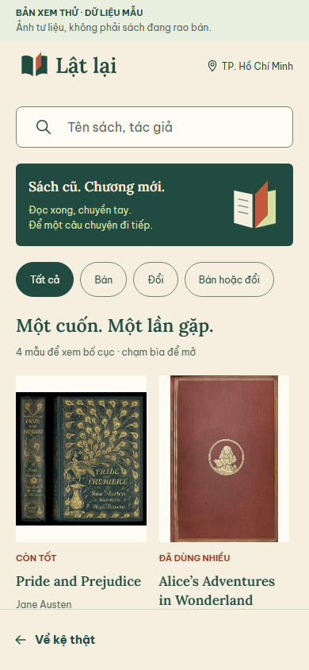
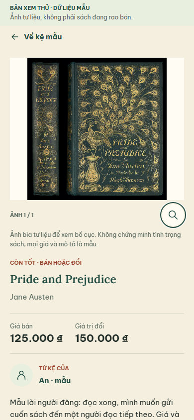
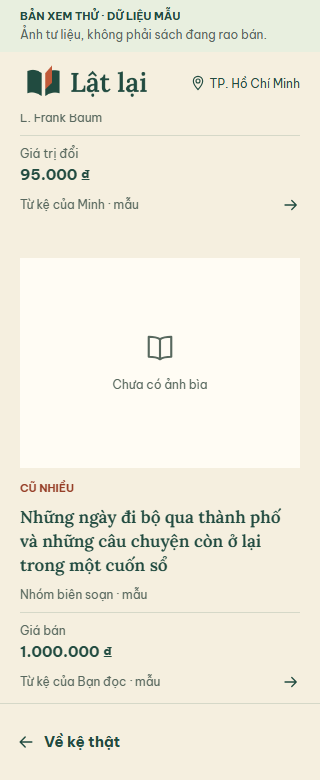

# Vòng kệ và chi tiết sách trước bàn giao

28/09/2026. Nhánh `codex/shelf-detail-showcase`, tiếp nối `5ad7cdd`.
Giữ F2h/OpenAPI 0.20.0. Vòng này thực hiện hai bước tiếp theo trong kế hoạch:
chuẩn bị dữ liệu xem giao diện riêng và tinh chỉnh kệ/chi tiết trên Android.
Form đăng sách và địa chỉ dài là bước tiếp theo, chưa được thiết kế lại trong vòng này.

## Thay đổi ở màn hình thật

- Kệ có phần mở đầu gọn hơn, nhường vùng nhìn cho sách. Bìa và phần tên đều chạm
  mở chi tiết được. Tên dài được xuống dòng; giá bán/giá trị đổi tách nhãn.
- Chi tiết có ảnh, số ảnh và nút xem lớn cùng một nhóm. Một ảnh không cần hàng
  chọn ảnh thừa; nhiều ảnh vẫn chọn được. Giá, tác giả và tình trạng ưu tiên trước
  phần mô tả. Ảnh phóng lớn giữ vùng hiển thị riêng.
- Tình trạng bản sách nằm trong nhóm “Dấu đọc còn lại”; thông tin đầu sách có thể
  mở/thu gọn. Giữ nguyên lời giải thích về ảnh người đăng, kiểm duyệt và giao nhận.
- `ShelfGrid`, `BookPresentation`, `BookGallery` nằm trong `features/shelf` và
  dùng chung giữa màn thật với màn xem mẫu. Chúng chỉ trình bày; màn thật vẫn giữ
  query, quyền đọc, revision, ảnh ký hạn và vòng đời foreground hiện có.
- Kệ chuyển một cột dưới 360 px hoặc khi chữ đạt khoảng 130%. Ngưỡng 1.29 xử lý
  sai số float Android báo 1.29999995 khi OS đặt 1.3.

Không đổi API, database, token store hoặc cơ chế retry. Không thêm CTA mua/đổi khi
chưa có workflow client. Không đưa fixture vào UI library hoặc cache của kệ thật.

## Mở bản xem mẫu

`/showcase` và `/showcase-book?id=...` chỉ mở khi `__DEV__` hoặc
`EXPO_PUBLIC_DESIGN_PREVIEW=1`. Bản export thông thường chuyển về `/`.
Đây là cờ trình bày, không phải cơ chế bảo mật hay cam kết loại ảnh khỏi bundle.
Không thêm lối vào mẫu trên thanh điều hướng sản phẩm. `/ui` và `/design` vẫn
theo cờ preview cũ.

Với Android debug đã chạy Metro và kết nối API theo hướng dẫn RN:

```sh
adb shell am start -a android.intent.action.VIEW -d "mobilereactnative:///showcase" com.huangg49.mobilereactnative
```

Màn hình luôn ghi “BẢN XEM THỬ · DỮ LIỆU MẪU”. Bốn mẫu bao gồm bán, đổi,
bán hoặc đổi, tên dài, giá 1.000.000 đồng và ảnh thiếu. Có tìm kiếm/lọc cục bộ,
nút thử toàn bộ ảnh thiếu, xem ảnh lớn và quay lại kệ thật. Giá/người đăng/tình
trạng là mẫu; không tạo account/catalog/listing hoặc gọi API listing.

Ba ảnh bìa dùng lại tài sản tư liệu đã có trong repo, giữ nguyên ảnh và hiển thị
nguồn/giấy phép ở chi tiết. Xem [hồ sơ ảnh](../../apps/mobile-react-native/assets/design/README.md).
Không dùng ảnh tư liệu này để publish một bài bán sách hoặc chứng minh tình trạng
vật phẩm. Mẫu thứ tư không có ảnh, tên sách do dự án đặt để thử nội dung dài.

## Kiểm tra và giới hạn

- RN lint/typecheck, 61 unit trên 9 file, contract check: PASS.
- Export web preview và thông thường: PASS. Kiểm gate bằng
  `node scripts/test-showcase-gate.mjs` sau export với preview=0: hai route mẫu
  chuyển về kệ thật. Runner chặn API, không phụ thuộc tài khoản/DB app.
- Browser regression `pnpm test:public:browser`: PASS trên Nest/HTTP/PostgreSQL
  test riêng. Các luồng kệ/chi tiết, ảnh lỗi, lọc, địa chỉ, nháp, upload/gửi duyệt,
  reject/resubmit, approved edit/replay, hide/reopen/archive và quyền vẫn chạy.
  Storage trong suite là fake, không phải bằng chứng Supabase thật.
- Bổ sung kiểm mở/thu gọn metadata màn thật; mẫu có lọc, chạm bìa, hai giá riêng,
  modal/Escape, ảnh thiếu, tên dài ở 320 px không tràn ngang và không gọi API listing.
- Android Pixel_7 AVD/Android 15 x86_64 chạy JS qua Metro trên APK debug hiện có:
  hai cột, bìa tư liệu, tên dài/ảnh thiếu; mở chi tiết mẫu đổi 95.000 đồng; xem
  ảnh lớn; Android Back đóng modal rồi trở về đúng vị trí cuộn của kệ.
- OS font_scale 1.3: chuyển một cột, tên dài/giá không cắt. Đã trả về 1.0 sau QA.
  Không build APK mới; web export không được dùng thay bằng chứng native.

Đây là kiểm tra UI với fixture tách biệt, không phải full native listing acceptance.
Không chạy lại 480 API E2E vì backend/contract không đổi. TalkBack, iOS/ARM,
upload lỗi/mất mạng/background và các ca trong [native acceptance](NATIVE_ACCEPTANCE.md)
còn mở. Review độc lập và người dùng duyệt thẩm mỹ chưa được coi là hoàn tất.

## Ảnh Android









## Ảnh browser regression







## Tiếp tục từ đây

1. Xem hướng kệ/chi tiết trên Android cùng người dùng; điều chỉnh theo phản hồi
   cụ thể. Không kết luận toàn bộ app đã đạt mong muốn chỉ từ các ảnh mẫu này.
2. Cải thiện editor đăng sách và sổ địa chỉ: nhóm thông tin theo tác vụ, giảm độ
   dài cảm nhận, giữ nút hành động dễ tiếp cận khi mở bàn phím. Bảo toàn validation,
   dirty Back, expectedVersion và retry cùng idempotency key khi mất phản hồi.
3. Hoàn tất native/visual và independent review theo [READINESS](READINESS.md).
   Chưa mở Delivered/inspection/settlement.

Gói nguồn local: `.tmp/latlai-shelf-detail-review.bundle`, checksum `.sha256` bên
cạnh. Clone: `git clone --branch codex/shelf-detail-showcase ./latlai-shelf-detail-review.bundle latlai`.
Không kèm `.env`, database, APK, dependency hoặc test-results tạm. Các bundle/tag
trước giữ nguyên. Chưa push/PR; đây chưa phải release bàn giao cuối.
