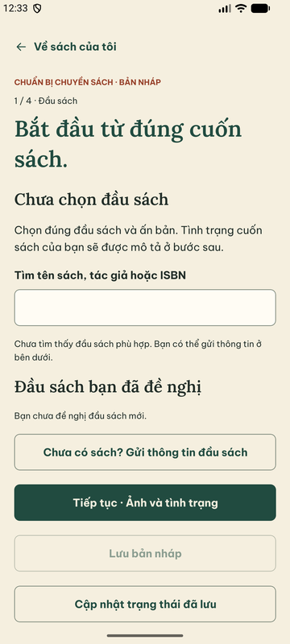
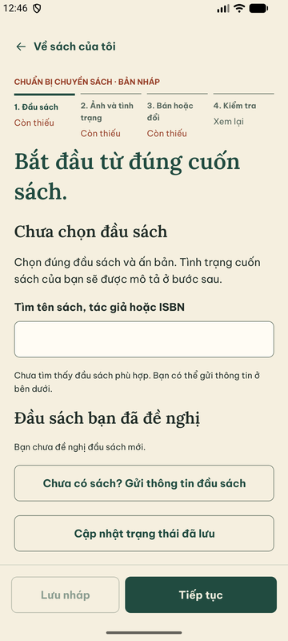
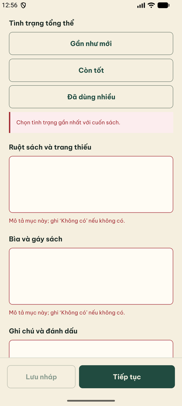
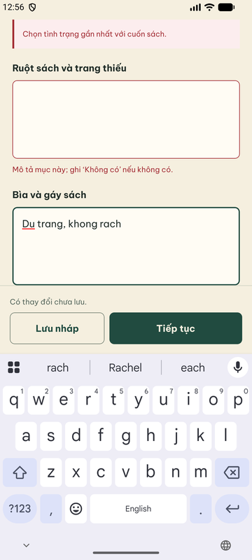
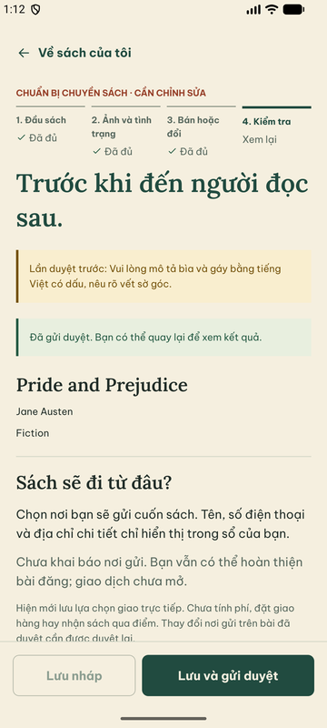
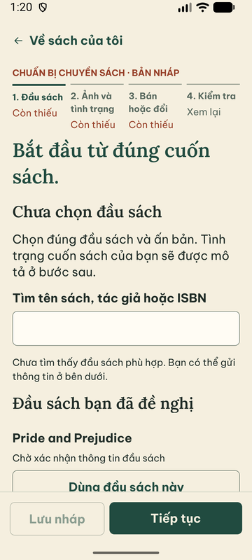

# U02 — Form đăng sách theo nhóm tác vụ

29/09/2026, nhánh `codex/u02-listing-form` (tách từ `codex/a00-android-startup`).
Gói U02 trong [CONTINUATION_PLAN](CONTINUATION_PLAN.md). Chỉ đổi presentation của
editor RN; không đổi contract, API, command/idempotency, expectedVersion hay luật
kiểm tra dữ liệu.

## Vấn đề quan sát trước khi sửa (Android)

- Chỉ có dòng nhỏ “1 / 4 · Đầu sách”: không thấy các nhóm còn lại, không nhảy nhóm.
- Bốn nút full-width xếp chồng trong thân (Tiếp tục, Về bước trước, Lưu bản nháp,
  Cập nhật trạng thái đã lưu). Ở bước dài, hành động chính nằm cuối trang, dưới bàn phím.
- Lỗi kiểm tra chỉ đưa về đầu bước, không tới ô sai đầu tiên.
- Lỗi đã sửa vẫn hiển thị tới lần lưu/gửi sau (ví dụ “Chọn từ 1 đến 8 ảnh…” khi ảnh
  đã Ready và đã chọn); thông báo “Đã gửi duyệt” còn lại sau khi bài đã bị từ chối.

## Thay đổi

| Phần | Nội dung |
|---|---|
| `features/drafts/step-nav.tsx` (mới) | Thanh 4 nhóm dạng tab: nhảy nhóm không mất dữ liệu; trạng thái “Đã đủ/Còn thiếu/Xem lại” bằng chữ + icon, không chỉ màu; khóa khi đang gửi/chưa rõ kết quả |
| `listing-form.ts` | `stepFields` (thứ tự hiển thị), `firstError`, `stepComplete` (áp luật submit lên dữ liệu đang nhập, không tính theo lượt ghé bước), `stillFailing` (lỗi đã báo chỉ co lại khi sửa, không tự báo ô chưa hỏi) |
| `draft-editor.tsx` | Footer cố định dùng `Screen.footer`: “Lưu nháp” + “Tiếp tục”/“Lưu và gửi duyệt”, ghi “Có thay đổi chưa lưu.”; bỏ nút xếp chồng; tiêu đề “Tình trạng bản sách” tách khỏi ảnh; kiểm lỗi → mở nhóm và cuộn tới ô sai đầu tiên; thông báo kiểm lỗi chỉ hiện ở bước còn ô sai; state mới từ server xóa thông báo cũ |
| `listing-fields.tsx` | Mốc cuộn (`anchor`) cho từng ô tình trạng/giá; `createAnchors` không dùng React ref trong render (React Compiler rule) |
| Browser tests | `test-listing-journey`/`test-public-shelf` dùng nhãn mới và tab bước; thêm assert trạng thái bước từ dữ liệu thật |

Giữ nguyên: `Screen`/core UI không đổi; dirty guard, retry cùng key/body, uncertain
state, approved edit + ConfirmDialog, LifecycleActions, “Cập nhật trạng thái đã lưu”.

## Kiểm thử thực chạy

| Lệnh / môi trường | Kết quả |
|---|---|
| `pnpm --filter @used-books/mobile-react-native test` | 9 file, **64/64 PASS** (61 cũ + 3 mới cho step/firstError/stillFailing) |
| RN `lint`, `typecheck`; `pnpm contract:check` | PASS; contract không đổi |
| `export:web` (cờ preview, API 3009) + `pnpm test:public:browser` trên DB `_test` 55434 | **PASS** 3 suite: address book, listing journey (create/catalog/upload fake storage/Unicode/reopen/submit/reject/resubmit/approve), shelf/detail + approved revision lost-ack + archive. Storage fake |
| Android AVD API 37 x86_64, Metro dev, API/worker từ `dist`, Supabase thật | Xem bảng dưới |

| Ca native | Kết quả |
|---|---|
| Tạo nháp, đề nghị đầu sách mới qua sheet, chọn | PASS; sheet báo thiếu tác giả/ngôn ngữ đúng ô khi nhập sai |
| Picker Android → upload thật → Sharp → preview | PASS: finalize 200, “Ảnh đã sẵn sàng”, preview signed hiển thị |
| Gửi khi thiếu ảnh / thiếu tình trạng | PASS: nhảy bước 2 và cuộn tới “Ảnh bản sách”, lần sau tới “Tình trạng tổng thể” |
| Lỗi tự mất khi sửa | PASS: chọn ảnh Ready → lỗi ảnh biến mất ngay |
| Bàn phím docked Gboard | PASS: footer nằm trên bàn phím, ô đang nhập vẫn thấy |
| Lưu nháp / reopen | PASS: “Có thay đổi chưa lưu.” mất sau lưu; mở lại giữ dữ liệu và trạng thái bước |
| Gửi duyệt → Staff từ chối qua operations → editor tự nhận qua poll | PASS: “Cần chỉnh sửa”, lý do hiển thị, footer mở lại |
| Sửa và gửi lại | PASS: bản gửi 2, “Đang chờ duyệt”, chỉ đọc, footer ẩn vì không có hành động |
| Chữ OS 130% | PASS: tab bước xuống dòng không cắt; footer hai nút một hàng. Đã trả font_scale 1.0 |

## Giới hạn / chưa làm

- Approved edit, conflict/stale version, mất phản hồi và ảnh preview lỗi chỉ được
  kiểm qua browser regression (API thật, storage fake), chưa chạy native trong lượt
  này; thuộc Q01 (N13/N14/N18/N19).
- Nhập bằng `adb input` chỉ gõ được ASCII; nội dung tiếng Việt có dấu trong ảnh chụp
  đến từ app, không từ dữ liệu nhập. Dữ liệu QA: một listing “Pride and Prejudice”
  (catalog request Pending, listing PendingReview bản gửi 2) và một nháp rỗng trên
  DB local; không phải sách thật.
- TalkBack cho tab bước chưa kiểm (N21). Hardware Back vẫn rời editor (có dirty
  guard), không lùi bước — giữ hành vi cũ.
- Metro trên Windows không có Watchman có lúc không nhận thay đổi file; đã khởi động
  lại Metro. Xem [A00](A00_ANDROID_STARTUP.md).
