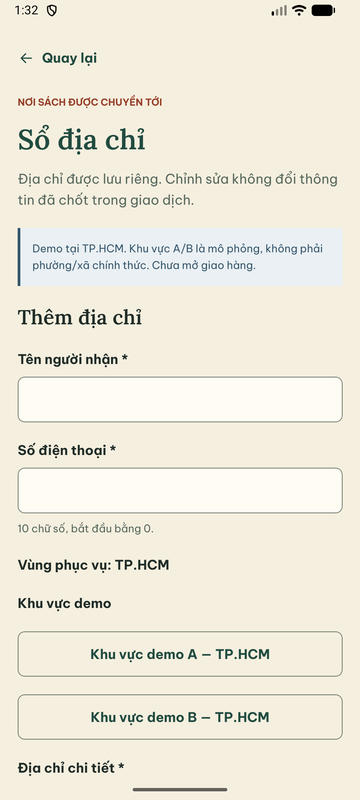
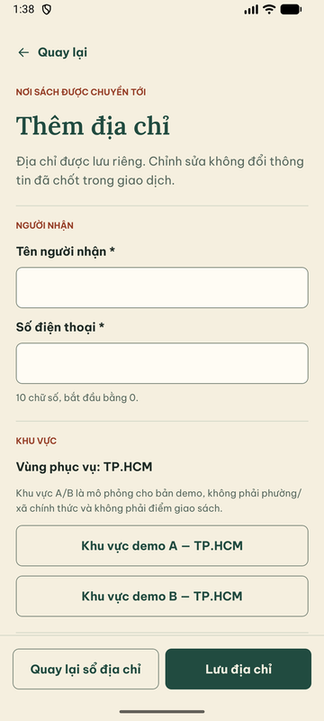
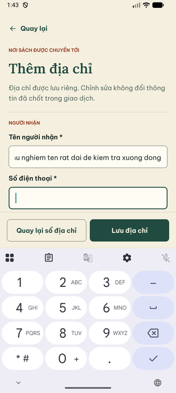
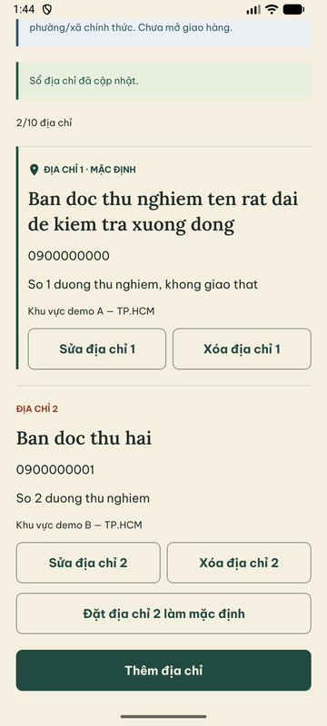
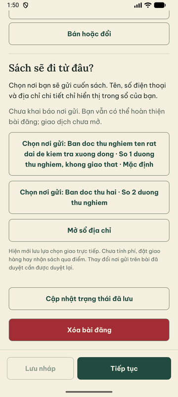

# U03 — Sổ địa chỉ và chọn nơi gửi

29/09/2026, nhánh `codex/u03-address-book` (tách từ `codex/u02-listing-form`).
Gói U03 trong [CONTINUATION_PLAN](CONTINUATION_PLAN.md). Chỉ đổi presentation;
không đổi API, contract, luật tối đa 10/default, expectedBookVersion,
Idempotency-Key hay snapshot nơi gửi của listing.

## Vấn đề quan sát trước khi sửa (Android)

- Form mở dưới tiêu đề trang và notice demo: ô đầu tiên ở giữa màn, nút Lưu nằm
  cuối trang, bị bàn phím che.
- Các ô không chia nhóm; ghi chú A/B mô phỏng nằm xa lựa chọn khu vực.
- Mỗi địa chỉ có 2–3 nút full-width xếp chồng, nút Xóa tô đỏ lặp lại; địa chỉ mặc
  định chỉ phân biệt bằng một nhãn nhỏ.
- Trạng thái rỗng dùng icon sách. Danh sách chọn nơi gửi trong editor không cho biết
  địa chỉ nào là mặc định.

## Thay đổi

| File | Nội dung |
|---|---|
| `features/addresses/addresses-screen.tsx` | Khi mở form: tiêu đề trang thành “Thêm/Chỉnh sửa địa chỉ”, ẩn notice demo lớn; ba nhóm có tiêu đề (Người nhận · Khu vực · Địa chỉ), ghi chú A/B “mô phỏng, không phải điểm giao sách” ngay trong nhóm Khu vực. Footer `Screen` giữ “Quay lại sổ địa chỉ” + “Lưu địa chỉ” trên bàn phím. Danh sách: mặc định có icon ghim, nhãn màu rừng và đường kẻ trái (không chỉ dựa vào màu); Sửa/Xóa cùng hàng dạng viền, hộp xác nhận vẫn giữ hành động phá hủy màu đỏ; số thứ tự không bị ngắt dòng riêng. Rỗng dùng icon ghim |
| `features/drafts/fulfillment-fields.tsx` | Địa chỉ mặc định đứng đầu và có nhãn “Mặc định”; vẫn phải chọn rõ ràng, không tự gán nơi gửi |

Tên truy cập của nút giữ nguyên để test/TalkBack đọc đủ ngữ cảnh (“Sửa địa chỉ 1”).
Không đổi `core/ui`.

## Kiểm thử thực chạy

| Lệnh / môi trường | Kết quả |
|---|---|
| RN `typecheck`, `lint` | PASS |
| `export:web` + `pnpm test:public:browser` (DB `_test`, API thật, storage fake), chạy 2 lần sau từng chỉnh sửa | **PASS** 3 suite; address journey gồm lỗi tại ô, tạo mất ack replay cùng key, default, stale version giữ dữ liệu đang nhập, xóa mất ack/default promotion, reopen, 320 px chữ 135% không tràn ngang |
| Android AVD API 37, Metro dev, API thật | Form trống → lỗi đúng ô + tóm tắt; bàn phím số cho điện thoại, footer trên bàn phím; tạo 2 địa chỉ; tên dài xuống dòng; mặc định phân biệt rõ; editor listing liệt kê mặc định trước |

## Giới hạn

- Stale version, mất ack và xóa/default promotion chỉ chạy trong browser regression,
  chưa cắt mạng trên native (Q01/N19).
- Chưa kiểm TalkBack cho nhóm/tiêu đề mới (N21). Không đổi thứ tự địa chỉ trong sổ
  (vẫn theo API); chỉ editor chọn nơi gửi đưa mặc định lên đầu.
- Dữ liệu QA trên DB local: hai địa chỉ thử ASCII, không phải địa chỉ thật.
