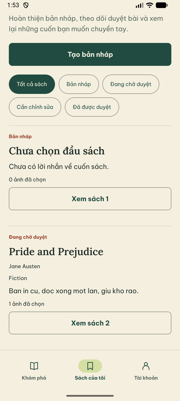
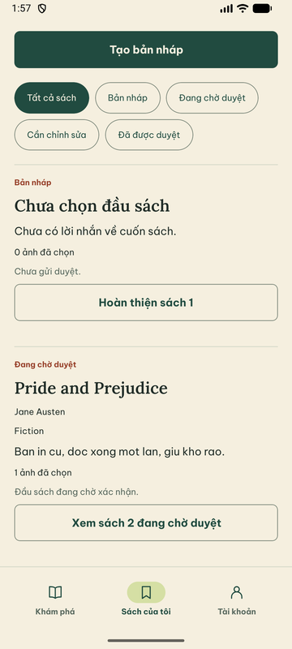

# U04 — Sách của tôi và tài khoản

29/09/2026, nhánh `codex/u04-my-books` (tách từ `codex/u03-address-book`).
Gói U04 trong [CONTINUATION_PLAN](CONTINUATION_PLAN.md). Chỉ đổi presentation
của danh sách; không đổi API, quyền hay trạng thái bài đăng.

## Vấn đề và thay đổi

Trước: mỗi dòng chỉ có nhãn trạng thái nhỏ và nút chung “Xem sách N”; bài bị từ chối
không cho biết góp ý ở danh sách, bài chờ duyệt không nói vì sao chưa sửa được.

- `listing-form.ts` thêm `listingSummary(d, n)`: trạng thái, ghi chú lấy từ dữ liệu
  thật (`latestDecision.reason`, `removalReason`, `catalogStatus`, `visibility`,
  `trade`, `deletedAt`) và hành động kế tiếp có số thứ tự để tên nút là duy nhất:
  “Hoàn thiện sách N”, “Xem sách N đang chờ duyệt”, “Sửa sách N theo góp ý”,
  “Quản lý sách N”, “Xem sách N đã gỡ/đã lưu trữ”. Không ghi “đang trên kệ” vì hiển
  thị kệ còn phụ thuộc tài khoản; không bịa số đếm.
- `drafts-screen.tsx` dùng tóm tắt đó; góp ý từ chối/lý do gỡ dùng màu đất nung,
  ghi chú khác dùng màu phụ.
- Browser tests đổi nhãn nút tương ứng.

Tài khoản: đã xem ảnh LOCKED/RESTRICTED từ browser suite; màn giữ cảnh báo hạn chế và
ẩn lối vào không được phép. Nghĩa vụ còn lại (Order/ví) chưa có UI (C01/C02) nên không
thêm mục giả. Không đổi màn tài khoản.

## Kiểm thử thực chạy

| Lệnh / môi trường | Kết quả |
|---|---|
| RN unit | 9 file, **66/66 PASS** (thêm 2 ca tóm tắt dòng) |
| RN lint/typecheck | PASS |
| `export:web` + `pnpm test:public:browser` (DB `_test`) | **PASS** 3 suite; dòng nháp mở bằng “Hoàn thiện sách 1”, bài duyệt bằng “Quản lý sách 1” |
| Android AVD API 37 | Danh sách thật: nháp “Chưa gửi duyệt.” + “Hoàn thiện sách 1”; bài chờ duyệt “Đầu sách đang chờ xác nhận.” + “Xem sách 2 đang chờ duyệt” |

## Giới hạn / phát hiện

- Tab “Sách của tôi” dựa trên trạng thái user trong session lúc đăng nhập; nếu tài
  khoản bị khóa sau khi đăng nhập, tab còn hiện tới khi phiên làm mới, trong khi màn
  tài khoản đã đọc profile mới. API vẫn từ chối nên không lộ quyền; ghi nhận cho gói
  auth/session, không sửa trong gói UI này.
- Chưa kiểm dòng Rejected/Removed trên native (có unit test và browser reject flow);
  TalkBack chưa kiểm. Không đổi thứ tự danh sách (theo API).
