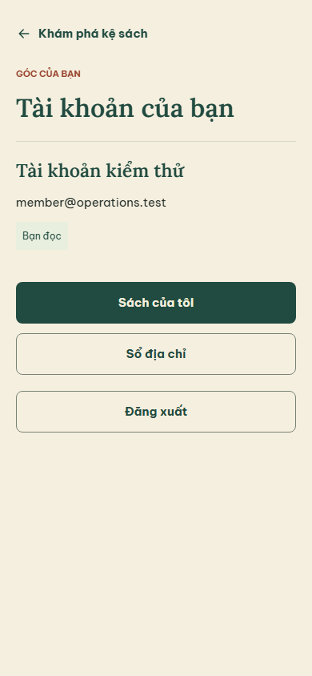
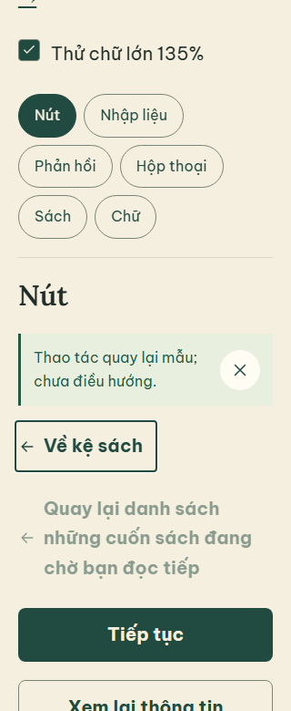
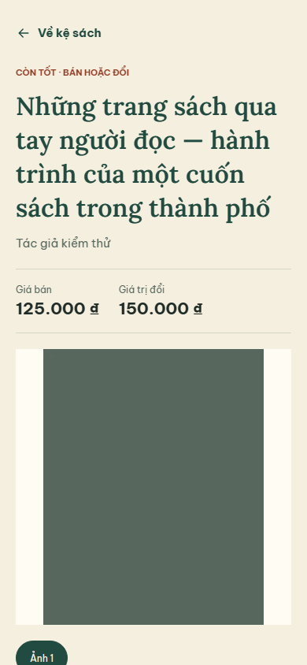

# Hoàn thiện UI hiện có — 28/09/2026

Phạm vi F2h/0.20.0 không đổi. Không bổ sung checkout, ví hoặc giao dịch giả.
Đợt này hoàn thiện cách trình bày và điều hướng của các màn đã có; nghiệm thu native
và mốc Git bàn giao vẫn là các việc riêng trong [READINESS](READINESS.md).

## Những thay đổi có thể kiểm tra

- Kệ dành thêm chiều ngang cho tên sách; dùng cấp chữ tên sách của design system,
  vẫn xuống dòng đầy đủ. Chi tiết đưa giá bán/giá trị đổi ngay dưới tên và tác giả.
- Sheet ảnh có tiêu đề ngắn theo số thứ tự ảnh. Tên sách đầy đủ nằm trong vùng cuộn;
  nút đóng không bị tiêu đề dài đẩy xuống. Không crop bìa hoặc thay ảnh người đăng.
- `BackAction` dùng chung: vùng chạm tối thiểu 44 px, nhãn đọc được, focus bàn phím,
  disabled và chữ dài. Icon giữ kích thước khi nhãn xuống dòng. Ví dụ cập nhật ở `/ui`.
- Tài khoản nhóm tên/email/vai trò và tác vụ; sách của tôi là hành động chính.
  LOCKED/RESTRICTED vẫn nhận trạng thái từ API, không tự suy quyền từ bố cục.
- Địa chỉ rút gọn phần dẫn và nhịp khoảng cách, giữ thông báo dữ liệu mô phỏng,
  quyền riêng tư và tính bất biến của thông tin giao dịch đã chốt.
- Sách của tôi và editor có nút quay lại ở đầu màn. Giữ nguyên điều kiện cảnh báo
  dữ liệu chưa lưu, yêu cầu chưa rõ kết quả và tác vụ đang chạy; không đổi command/retry.
- Tên hiển thị ứng dụng là **Lật lại**. Icon, adaptive/themed icon, favicon và splash
  dùng biểu tượng SVG gốc/nền giấy, thay tài nguyên mẫu của Expo. Không đổi package
  Android, scheme hay slug. PNG được sinh lại bằng `pnpm brand:app-icons`.

Operations hiện có cấu trúc đọc/ra quyết định hai cột, về một cột trên màn hẹp.
Đã xem detail 1440 px và rejected 320 px chữ lớn: nhãn tình trạng, giá, lý do/lỗi
và nội dung dài còn đủ. Giữ bố cục này; chưa có thay đổi sản phẩm operations trong
lát cắt polish này. Không coi việc giữ bố cục là đã kiểm mọi trạng thái bằng mắt.

## Bằng chứng mới

- RN lint/typecheck và 61 unit tests qua; contract không thay đổi.
- Regression RN web trên PostgreSQL QA mới qua: shelf/detail/media lỗi và retry,
  address CRUD/default/stale/lost-ack, đăng sách/upload Sharp/lưu nháp/submit/reject/
  resubmit/approve, lifecycle hide/reopen/revise/archive.
- Thêm kiểm tra Back khi editor còn dữ liệu chưa lưu: hủy rời màn giữ nguyên nội dung;
  tài khoản RESTRICTED/LOCKED hiển thị đúng, LOCKED không có tác vụ sách/địa chỉ;
  logout hoạt động. `/ui` 320 px chữ 135%, Enter kích hoạt Back, nhãn disabled dài
  và không tràn ngang. Browser storage là **fixture**, không phải Supabase/native.
- Xem trực tiếp ảnh của login, tài khoản, sổ địa chỉ, danh sách sách, editor chọn
  catalog/tình trạng/kiểm tra, chi tiết và Sheet. Test xuất ảnh từng bước vào
  `apps/mobile-react-native/test-results/`; ảnh lỗi cũ không là kết quả vòng cuối.
- Log vòng cuối: `.tmp/handoff-ui-final-export.log`, `.tmp/handoff-ui-final-browser.log`.
  Lệnh tái tạo ở [START_HERE](START_HERE.md); không phụ thuộc log hoặc fixture đang chạy.

Ảnh được lưu để người nhận đọc báo cáo ngay, đều chứa dữ liệu kiểm thử:

Khối ảnh xanh trơn là ảnh fixture có chủ đích, không là bìa sản phẩm thật.

## Giới hạn còn mở

Android debug x86_64 được build riêng, không dùng export web để suy ra native pass.
Build cuối sau thay tài nguyên: **BUILD SUCCESSFUL**, 3 phút 37 giây, 338 tasks;
APK SHA-256 `6CBE6646C80013B27D8F06E3799855EA2CC6E9664BE337E7CF12B8FEA945A039`.
Log `.tmp/handoff-android-final-build.log`. Đây là APK debug cần Metro, không là
bản phát hành đã ký hoặc bằng chứng JS mới được chạy trên Android.
Lệnh khởi động Metro cho kiểm tra runtime bị automatic approval review từ chối
với thông báo `blocked by policy`; không chạy lại bằng cách khác. Emulator được
tắt sau đó. Chưa nghiệm thu launcher/splash, picker/upload, bàn phím docked, Back
phần cứng, TalkBack và font scale hệ điều hành trong lượt này; iOS chưa kiểm tra.

In-app Browser không mở được localhost QA (`ERR_BLOCKED_BY_CLIENT`), nên không có
bằng chứng kiểm tra trực tiếp qua công cụ đó. Bằng chứng web ở trên đến từ bộ
regression của repository và việc xem ảnh kết quả, không thay cho kiểm thử native.
